# DESCRIPCIÓN DE VENTANAS — INSPIRATEC
## Ecosistema Digital de Andamiaje Pedagógico, Co-diseño Curricular con IA y Generación Multimodal

---

### Encabezado Institucional de la Actividad

| Campo | Especificación |
|---|---|
| **Proyecto:** | INSPIRATEC — Software Educativo para la Planificación Curricular y Andamiaje Docente |
| **Código de Actividad:** | ACT-009 (Actividad 7 del Plan de Trabajo) |
| **Entregable Oficial:** | `DESCRIPCION_VENTANAS.md` |
| **Versión del Frontend:** | 1.0.0 (Producción React 18 + Vite + Glassmorphism 2026) |
| **Marco Metodológico:** | MODESEC (Fase II — Diseño Educativo y Multimedial) / Guía 30 MEN / DUA (CAST 2018) |
| **Participantes Responsables:** | Zoe Peñata, Luis Caldera, Daniel Tapias, Maira Ortega, María Soto, María Ubarne |
| **Estado:** | Completada y Verificada sobre la Ejecución Real |

---

## 1. Objetivo y Alcance

### 1.1 Objetivo General
Documentar formal y exhaustivamente la interfaz gráfica de usuario (GUI) del software educativo **INSPIRATEC**, describiendo cada una de sus ventanas, pantallas, vistas y cuadros de diálogo relevantes, desde la pantalla inicial hasta el último módulo funcional, aplicando la plantilla institucional de MODESEC y registrando rigurosamente: Imagen real, Nombre de la ventana, Texto, Audio, Video, Animación, Acciones del usuario, Botones y Navegación.

### 1.2 Principio Fundamental de Veracidad
Toda la información registrada proviene de la inspección directa del código fuente (`src/App.jsx`, `src/pages/*`, `src/components/*`), las hojas de estilo (`src/index.css`, `src/styles/ui.css`), los controladores de eventos y las capturas reales obtenidas del software en ejecución. **No se inventan pantallas, recursos multimedia, textos ni interacciones ficticias.**

---

## 2. Metodología de Análisis e Inspección

1. **Recorrido Navegacional Completo:** Se ejecutó la aplicación en el servidor local de desarrollo (`http://localhost:5173`), recorriendo cada una de las rutas definidas en el enrutador `<Routes>` de React Router DOM v6.
2. **Levantamiento Fotográfico Real:** Se capturaron las pantallas representativas en alta resolución para las vistas clave, archivándolas en `docs/evidencias/ACT-009/` y `docs/diseno-interface/mockups/`.
3. **Auditoría Técnica de Componentes:** Cada ventana fue contrastada con su componente JSX en `src/pages/` para certificar sus cadenas de texto exactas, sus iconos (`lucide-react`), sus fuentes tipográficas (`Lora` y `DM Sans`), sus eventos de escucha (`onClick`, `onChange`, `onSubmit`) y sus llamados a servicios (`geminiService.js`, `dbService.js`, `firebase.js`).

---

## 3. Inventario General de Ventanas y Estados

| N.° | Ventana / Módulo | Ruta URL / Disparador | Componente Fuente | Tipo de Vista |
|:---:|---|---|---|---|
| **01** | **Ventana de Inicio** | `/home` | `src/pages/HomePage.jsx` | Pantalla principal de bienvenida y acceso rápido |
| **02** | **Planificador de Clases** | `/` | `src/pages/WizardPage.jsx` | Pantalla de proceso guiado (Wizard de 4 fases) |
| **03** | **Editor Curricular y Co-docente IA** | `/editor` | `src/pages/EditorPage.jsx` | Pantalla de co-diseño en lienzo y panel socrático |
| **04** | **Mis Planes de Clase** | `/mis-planes` | `src/pages/MisPlanesPage.jsx` | Pantalla de repositorio curricular personal |
| **05** | **Mi ADN Pedagógico** | `/adn-pedagogico` | `src/pages/AdnPedagogicoPage.jsx` | Pantalla de autodiagnóstico Felder-Silverman |
| **06** | **Mis Estructuras de Clase (Plantillas)** | `/plantillas` | `src/pages/PlantillasPage.jsx` | Pantalla de catálogo de modelos y plantillas |
| **07** | **Biblioteca de Recursos Didácticos** | `/biblioteca` | `src/pages/BibliotecaPage.jsx` | Pantalla de recursos y generador interactivo |
| **08** | **Banco de Experiencias** | `/experiencias` | `src/pages/ExperienciasPage.jsx` | Pantalla comunitaria de intercambio docente |
| **09** | **Foro Docente Interactivo** | `/foro` | `src/pages/ForoPage.jsx` | Pantalla dialógica de debates pedagógicos |
| **10** | **Configuración de IA Gemini** | `/config` | `src/pages/ConfigPage.jsx` | Pantalla de soberanía tecnológica y credenciales |
| **11** | **Administración Institucional** | `/administracion` | `src/pages/AdministracionPage.jsx` | Pantalla de analíticas y auditoría de coordinación |
| **12** | **Centro de Ayuda y FAQ** | `/ayuda` | `src/pages/AyudaPage.jsx` | Pantalla de manuales, glosario y preguntas frecuentes |
| **13** | **Soporte Técnico** | `/soporte` | `src/pages/SoportePage.jsx` | Pantalla de incidencias y reporte de fallos |
| **14** | **Acerca de INSPIRATEC** | `/acerca` | `src/pages/AboutPage.jsx` | Pantalla de ficha técnica institucional y MODESEC |
| **15** | **Acceso y Autenticación** | `/auth` | `src/pages/AuthPage.jsx` | Pantalla de autenticación Firebase y Google OAuth |
| **M1** | **Modal Calibración Docente** | `open-calibracion-docente` | `src/components/ModalCalibracionDocente.jsx` | Cuadro de diálogo modal (`createPortal`) |
| **M2** | **Modal Bienvenida Narrativa** | Primer inicio de sesión | `src/components/BienvenidaNarrativa.jsx` | Cuadro de diálogo modal de inducción |
| **M3** | **Modal Confirmación Segura** | Acciones destructivas | `src/components/ConfirmModal.jsx` | Cuadro de diálogo modal accesible |
| **M4** | **Modal Visor de Materiales** | Ejecución de recurso | `src/components/MaterialModal.jsx` | Cuadro de diálogo modal con iframe sandbox |
| **M5** | **Menú de Usuario y Cuenta** | Click en avatar superior | `src/components/UserMenu.jsx` | Menú desplegable flotante tipo Popover |

---

## 4. Descripción Detallada de Ventanas

---

### Ventana 01: Ventana de Inicio (`HomePage.jsx`)

#### Imagen de la ventana
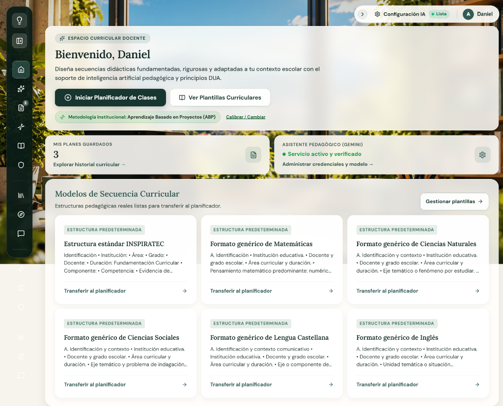

#### Objetivo
Recibir al docente en un entorno pedagógico cálido e inmersivo, proporcionándole un resumen cuantitativo de sus planes curriculares, el estado del servicio de inteligencia artificial y el acceso directo a los modelos oficiales de secuencias de clase listos para transferir al planificador.

#### Descripción general
La ventana se despliega sobre un lienzo inmersivo con el fondo pixel art animado `FondoPixel.jsx` y capas translúcidas de cristal esmerilado (*Glassmorphism* marfil `rgba(255, 254, 250, 0.86)` con `backdrop-filter: blur(16px)`). Se estructura en tres áreas principales:
1. **Panel Editorial Superior:** Insignia *"ESPACIO CURRICULAR DOCENTE"*, título H1 *"Bienvenido, {Nombre}"*, párrafo motivador sobre principios DUA e IA, botón primario para iniciar el planificador, botón secundario para explorar plantillas y cápsula con la metodología institucional activa acompañada del disparador de calibración.
2. **Franja de Métricas y Estado:** Dos tarjetas que muestran el total de planes guardados y el estado verificado del asistente Gemini.
3. **Catálogo de Modelos Curriculares:** Cuadrícula de 6 tarjetas interactivas correspondientes a las asignaturas básicas (Matemáticas, Ciencias Naturales, Ciencias Sociales, Lengua Castellana, Inglés y Estructura Estándar INSPIRATEC), con botón de transferencia directa al generador.

#### Tabla de elementos

| Elemento | Descripción |
|---|---|
| **Nombre de la ventana** | Ventana de Inicio (Espacio Curricular Docente) |
| **Imagen** | Captura real: [`docs/evidencias/ACT-009/V01_inicio.png`](docs/evidencias/ACT-009/V01_inicio.png). Fondo interactivo pixel art con personajes docentes y robots en SVG (`src/components/FondoPixel.jsx`). Iconos vectoriales Lucide: `Sparkles`, `PlusCircle`, `BookOpen`, `Dna`, `FileText`, `Settings`, `ArrowRight`. |
| **Texto** | • Badge: *"ESPACIO CURRICULAR DOCENTE"*. • Título H1: *"Bienvenido, Daniel"* (fuente `Lora`, 28px, color `#142B25`). • Párrafo editorial: *"Diseña secuencias didácticas fundamentadas, rigurosas y adaptadas a tu contexto escolar con el soporte de inteligencia artificial pedagógica y principios DUA."* (fuente `DM Sans`, 14.5px). • Cápsula: *"Metodología Institucional: Aprendizaje Basado en Proyectos (ABP)"*. • Tarjeta 1: *"MIS PLANES GUARDADOS"* / Valor *"3"* / *"Explorar historial curricular →"*. • Tarjeta 2: *"ASISTENTE PEDAGÓGICO (GEMINI)"* / *"Servicio activo y verificado"* / *"Administrar credenciales y modelo →"*. • Sección: *"Modelos de Secuencia Curricular"* / *"Estructuras pedagógicas reales listas para transferir al planificador."* |
| **Audio** | No se identificaron archivos de audio ni efectos sonoros en esta ventana. |
| **Video** | No se identificaron archivos ni reproductores de video en esta ventana. |
| **Animación** | • Animación continua SVG en `FondoPixel.jsx` (personajes caminando y escribiendo en el tablero mediante `requestAnimationFrame`). • Transiciones suaves CSS (`all 0.2s cubic-bezier(0.16, 1, 0.3, 1)`) con elevación `translateY(-2px)` en las tarjetas de modelos al pasar el cursor. • Animación de pulso en el punto verde del indicador de estado de la IA. |
| **Acciones del usuario** | • Clic en "Iniciar Planificador de Clases": limpia el borrador en memoria y abre la ruta `/`. • Clic en "Ver Plantillas Curriculares": navega a `/plantillas`. • Clic en "Calibrar / Cambiar": emite el evento global `open-calibracion-docente` abriendo el modal de calibración. • Clic en la tarjeta "Mis Planes Guardados": navega a `/mis-planes`. • Clic en la tarjeta "Asistente Pedagógico": navega a `/config`. • Clic en cualquiera de las tarjetas de modelo curricular: ejecuta `handleUsarPlantilla`, precarga la estructura en el wizard y navega a `/`. |
| **Botones** | • Botón primario *"Iniciar Planificador de Clases"* (verde oscuro `#183630`, icono `PlusCircle`). • Botón secundario *"Ver Plantillas Curriculares"* (translúcido con borde, icono `BookOpen`). • Botón de texto *"Calibrar / Cambiar"* (subrayado, color `#166534`). • Botón secundario *"Gestionar plantillas →"* (icono `ArrowRight`). • Botones de acción en tarjetas *"Transferir al planificador →"*. |
| **Navegación** | • Destinos directos: `/` (Planificador), `/plantillas` (Plantillas), `/mis-planes` (Historial), `/config` (Configuración IA). • Navegación global permanente a través del menú lateral flotante y la barra superior de utilidades. |

---

### Ventana 04: Mis Planes de Clase (`MisPlanesPage.jsx`)

#### Imagen de la ventana

#### Objetivo
Administrar el repositorio curricular personal del docente, permitiendo buscar, filtrar, reabrir para edición, duplicar, descargar, compartir o eliminar las secuencias didácticas generadas y sincronizadas en la nube.

#### Descripción general
La ventana presenta un encabezado editorial estructurado con migas de pan (*Breadcrumbs: Inicio > Mis Planes de Clase*), una insignia *"REPOSITORIO CURRICULAR PERSONAL"*, el título H1 *"Mis Planes de Clase"*, la explicación funcional, una píldora con el contador de planes (`3 Planes guardados`), el botón *"Sincronizar"* y el botón destacado *"Crear Nuevo Plan"*. Debajo se ubican la barra de búsqueda en tiempo real y las pestañas de filtrado (*Todos (3)*, *Guardados*, *Sistematizados*, *En Biblioteca*). En el cuerpo principal se despliega la cuadrícula con las tarjetas de planes guardados ("Secuencia de Scratch para Principiantes", "Algebra lineal", "Pensamiento Computacional"), cada una con insignias de estado, fecha de creación, materia, grado y una barra de herramientas con 6 acciones directas.

#### Tabla de elementos

| Elemento | Descripción |
|---|---|
| **Nombre de la ventana** | Mis Planes de Clase (Repositorio Curricular Personal) |
| **Imagen** | Captura real: [`docs/evidencias/ACT-009/V04_mis_planes.png`](docs/evidencias/ACT-009/V04_mis_planes.png). Iconografía Lucide: `Search`, `RefreshCw` (Sincronizar), `PlusCircle` (Crear Nuevo Plan), `BookOpen`, `Calendar`, `GraduationCap`, `Eye` (Abrir), `Sparkles` (Sistematizar), `Share2` (Compartir), `Download` (Exportar), `Copy` (Duplicar), `Trash2` (Eliminar). |
| **Texto** | • Breadcrumbs: *"Inicio > Mis Planes de Clase"*. • Badge: *"REPOSITORIO CURRICULAR PERSONAL"*. • Título H1: *"Mis Planes de Clase"* (fuente `Lora`, 28px). • Subtítulo: *"Gestiona, edita y organiza tus secuencias pedagógicas sincronizadas en la nube. Reabre borradores, publica en la biblioteca comunitaria o sistematiza tus experiencias."* • Píldora de conteo: *"3 Planes guardados"*. • Placeholder del buscador: *"Buscar por tema, asignatura o grado..."* • Pestañas: *"Todos (3)"*, *"Guardados"*, *"Sistematizados"*, *"En Biblioteca"*. • Metadatos en tarjetas: Estado (*Guardado* / *Biblioteca*), fecha (*16 de oct de 2026*), materia (*Tecnología e Informática*, *Matemáticas*), grado (*9no*, *10°*, *8vo*), títulos y descripciones formativas. |
| **Audio** | No se identificaron archivos de audio en esta ventana. |
| **Video** | No se identificaron archivos de video en esta ventana. |
| **Animación** | • Transición al filtrar tarjetas (desvanecimiento y reorganización en grid). • Giro en el icono de sincronizar al ejecutar la recarga. • Efecto hover de elevación y resaltado perimetral en cada tarjeta de plan de clase. |
| **Acciones del usuario** | • Escribir en la barra de búsqueda para filtrar alfabéticamente por título, materia o grado en tiempo real. • Clic en las pestañas de categoría para alternar la visualización según el estado de publicación. • Clic en *"Sincronizar"*: fuerza la recarga de planes desde Firestore. • Clic en *"Crear Nuevo Plan"*: limpia el borrador y navega al planificador `/`. • Clic en *"Abrir"*: carga el plan en el store activo y abre el `/editor`. • Clic en *"Sistematizar"*: prepara la secuencia para su publicación en el muro de experiencias. • Clic en *"Compartir"*: genera el enlace público o abre diálogo de difusión. • Clic en *"Descargar"*: descarga el plan en formato Markdown o dispara la generación de PDF. • Clic en *"Duplicar"*: crea una copia exacta del plan con un nuevo ID. • Clic en *"Eliminar"*: abre el modal de confirmación segura `ConfirmModal.jsx`. |
| **Botones** | • Botón *"Sincronizar"* (secundario con icono `RefreshCw`). • Botón primario *"Crear Nuevo Plan"* (fondo `#183630`, icono `PlusCircle`). • Botones de pestaña de filtrado (`.tab-pill`). • Botón *"Abrir"* en tarjeta (fondo verde oscuro `#183630`, icono `Eye`). • Botón *"Sistematizar"* (secundario con icono `Sparkles`). • Botón de icono *"Compartir"* (`Share2`). • Botón de icono *"Descargar"* (`Download`). • Botón de icono *"Duplicar"* (`Copy`). • Botón de icono *"Eliminar"* (rojo suave `#DC2626`, icono `Trash2`). |
| **Navegación** | • Clic en "Crear Nuevo Plan" redirige a `/`. • Clic en "Abrir" redirige a `/editor`. • Clic en "Inicio" de las migas de pan redirige a `/home`. • Navegación lateral permanente mediante el Dock izquierdo. |

---

### Ventana 06: Mis Estructuras de Clase — Plantillas Curriculares (`PlantillasPage.jsx`)

#### Imagen de la ventana

#### Objetivo
Permitir a los docentes crear, inspeccionar, personalizar y administrar formatos pedagógicos estandarizados para que el asistente de inteligencia artificial respete estrictamente los momentos didácticos institucionales exigidos por su colegio.

#### Descripción general
La ventana exhibe una cabecera con insignia *"ARQUITECTURA CURRICULAR Y MODELOS"*, el título H1 *"Mis Estructuras de Clase"*, la síntesis explicativa, una píldora con el contador de estructuras (`6 Estructuras`), y el botón de acción destacada *"+ Nueva Estructura"*. En la zona intermedia se dispone de una barra de búsqueda rápida (*"Buscar por título o tipo de estructura..."*). El cuerpo de la página está conformado por una cuadrícula con 6 tarjetas de estructuras predeterminadas públicas:
1. Estructura estándar INSPIRATEC
2. Formato genérico de Matemáticas
3. Formato genérico de Ciencias Naturales
4. Formato genérico de Ciencias Sociales
5. Formato genérico de Lengua Castellana
6. Formato genérico de Inglés

Cada tarjeta presenta badges identificadores (*Estructura predeterminada*, *Pública*), título formal, síntesis de secciones curriculares y una botonera inferior completa con 4 controles: *"Usar en Asistente"*, *"Ver"*, botón de compartir y botón de eliminar (protegido para estructuras base).

#### Tabla de elementos

| Elemento | Descripción |
|---|---|
| **Nombre de la ventana** | Mis Estructuras de Clase (Plantillas y Arquitectura Curricular) |
| **Imagen** | Captura real: [`docs/evidencias/ACT-009/V06_plantillas.png`](docs/evidencias/ACT-009/V06_plantillas.png). Iconografía Lucide: `Layers`, `Plus` (Nueva Estructura), `Search`, `Globe` (Pública), `CheckCircle` (Usar en Asistente), `Eye` (Ver detalle), `Share2`, `Trash2`. |
| **Texto** | • Badge: *"ARQUITECTURA CURRICULAR Y MODELOS"*. • Título H1: *"Mis Estructuras de Clase"* (fuente `Lora`, 28px). • Subtítulo: *"Crea y administra formatos pedagógicos personalizados para que la IA se adapte a tu institución y respete los momentos didácticos institucionales."* • Píldora: *"6 Estructuras"*. • Botón de acción: *"+ Nueva Estructura"*. • Buscador: *"Buscar por título o tipo de estructura..."* • Badges de tarjeta: *"Estructura predeterminada"* (fondo naranja/ámbar tenue) y *"Pública"* (verde/azul suave con icono de globo). • Títulos de plantillas: Matemáticas, Ciencias Naturales, Ciencias Sociales, Lengua Castellana, Inglés, Estándar INSPIRATEC. • Desglose de secciones: Identificación, Fundamentación, Momentos de clase y adaptaciones DUA. |
| **Audio** | No se identificaron archivos de audio en esta ventana. |
| **Video** | No se identificaron archivos de video en esta ventana. |
| **Animación** | • Transición de búsqueda en tiempo real al escribir en el input. • Microanimación hover de elevación y realce de sombra en las tarjetas de cristal. • Animación de pulsación en los botones primarios de acción. |
| **Acciones del usuario** | • Escribir en el buscador para filtrar las plantillas por asignatura o nombre. • Clic en *"+ Nueva Estructura"*: abre el formulario o modal para definir un nuevo esquema curricular. • Clic en *"Usar en Asistente"*: transfiere la estructura seleccionada al formulario del wizard y redirige al generador `/`. • Clic en *"Ver"*: abre el modal de detalle con la vista previa completa de las instrucciones y campos que componen la plantilla. • Clic en *"Compartir"*: genera el enlace de difusión de la plantilla. • Clic en *"Eliminar"*: solicita confirmación para borrar plantillas personalizadas (deshabilitado en plantillas del sistema). |
| **Botones** | • Botón primario *"+ Nueva Estructura"* (fondo `#183630`, color blanco, icono `Plus`). • Botón *"Usar en Asistente"* en cada tarjeta (fondo verde oscuro `#183630`, color blanco). • Botón secundario *"Ver"* (icono `Eye`). • Botón de icono *"Compartir"* (`Share2`). • Botón de icono *"Eliminar"* (icono `Trash2`). |
| **Navegación** | • Clic en "Usar en Asistente" redirige automáticamente a la ventana `/` (Planificador de Clases) cargando la plantilla. • Acceso directo a todas las secciones desde el menú lateral flotante. |

---

### Ventana 02: Planificador de Clases — Asistente Curricular Tripartito (`WizardPage.jsx`)

#### Imágenes reales de las 4 Fases y Grafo Interactivo

| Fase 1: Información básica | Fase 2: Metodología |
|:---:|:---:|
|  | 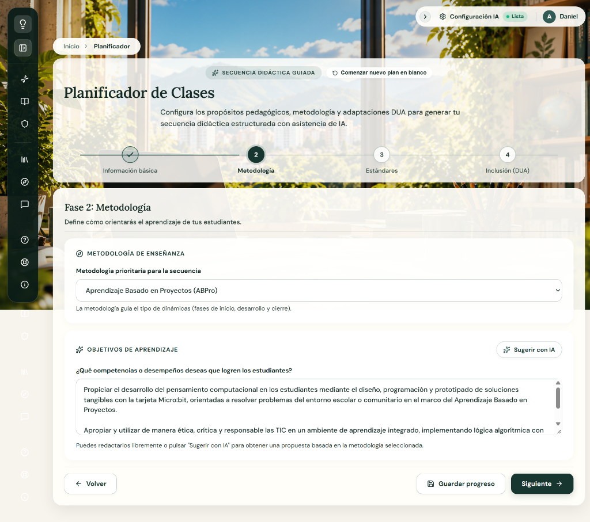 |

| Fase 3: Estándares | Fase 4: Inclusión (DUA) |
|:---:|:---:|
| 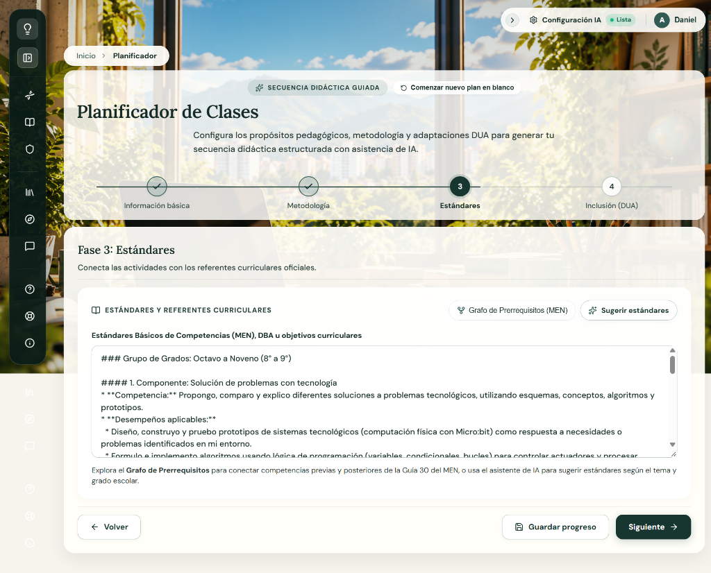 |  |

| Componente Extendido: Grafo Interactivo de Prerrequisitos Curriculares (MEN) |
|:---:|
|  |

#### Objetivo
Guiar al docente de manera secuencial y estructurada en el co-diseño de secuencias didácticas completas, articulando el contexto de aula con la metodología institucional activa (ABP, STEAM), los Estándares Básicos de Competencias y DBA de la Guía 30 del MEN mediante un grafo interactivo de prerrequisitos, y las adaptaciones inclusivas DUA/PIAR antes de procesar la generación curricular con la IA pedagógica.

#### Descripción general
La ventana implementa un asistente tipo *wizard* ergonómico dividido en 4 fases interactivas con un *stepper* superior accesible y persistencia en tiempo real (`useAppStore`):
1. **Cabecera y Navegación:** Migas de pan (*Inicio > Planificador*), badge *"SECUENCIA DIDÁCTICA GUIADA"*, acción rápida *"Comenzar nuevo plan en blanco"*, título H1 *"Planificador de Clases"* y barra de progreso de 4 pasos numerados (*1. Información básica*, *2. Metodología*, *3. Estándares*, *4. Inclusión (DUA)*).
2. **Fase 1 — Información básica:**
   - Banner *"Aplicar mi ADN Pedagógico"* con badge *"Memoria Activa"*, interruptor *"Activado"* y enlace *"Ver o ajustar mi ADN ↗"*.
   - Tarjeta *"TEMA Y ESTRUCTURA"*: campo para el nombre de la clase o tema (ej. *"Micro: bit"*) y selector de formato de plan (ej. *"Estructura estándar INSPIRATEC (Tecnología e Informática)"*).
   - Tarjeta *"AUDIENCIA Y TEMPORALIDAD"*: selector de grado escolar (ej. *"9no Bachillerato"*), duración/sesiones (ej. *"90 minutos, 1 sesión"*) y cantidad de estudiantes (ej. *"26"*).
   - Tarjeta *"ÁREA CURRICULAR Y RECURSOS"*: selector de área del saber (*Tecnología e Informática*), casilla de verificación *"Plan Transversal / Interdisciplinar Articulado"* y selector/área de recursos didácticos y ambiente (*"Aula Tecnológicamente Integrada (1 a 1)"*).
3. **Fase 2 — Metodología:**
   - Tarjeta *"METODOLOGÍA DE ENSEÑANZA"*: selector de metodología prioritaria (*Aprendizaje Basado en Proyectos (ABPro)*, STEAM, Gamificación, etc.).
   - Tarjeta *"OBJETIVOS DE APRENDIZAJE"*: botón de asistencia *"Sugerir con IA"* y área de texto estructurada para competencias y desempeños esperados con Micro:bit y pensamiento computacional.
4. **Fase 3 — Estándares:**
   - Botón *"Grafo de Prerrequisitos (MEN)"* que abre la red conceptual interactiva y botón *"Sugerir estándares"*.
   - Área de texto editable con los Estándares Básicos de Competencias (MEN), DBA y componentes de la Guía 30 (Grados 8° a 9°, Componente Solución de Problemas, Competencias y Desempeños).
5. **Fase 4 — Inclusión (DUA):**
   - Tarjeta *"CONDICIONES PARA AJUSTES RAZONABLES (DUA)"*: 4 tarjetas interactivas de selección múltiple con iconos para *Discapacidad visual*, *Discapacidad auditiva*, *Discapacidad motora* y *PIAR Institucional*.
   - Tarjeta *"NECESIDADES ESPECÍFICAS ADICIONALES"*: campo de entrada opcional para Trastorno del Espectro Autista (TEA), TDAH o baja conectividad.
   - Botonera de cierre con botones *"Volver"*, *"Guardar progreso"* y botón primario destacado *"Generar Clase"* (icono de chispas).
6. **Modal/Drawer: Grafo Interactivo de Prerrequisitos Curriculares (`CurricularGraphViewer.jsx`):**
   - Visualizador de red conceptual estructurada en 5 columnas por ciclos de grado: *1° a 3° Primaria Inicial*, *4° a 5° Primaria Avanzada*, *6° a 7° Secundaria Inicial*, *8° a 9° Secundaria Avanzada* y *10° a 11° Educación Media*.
   - Filtros superiores por Grado y Eje Temático, controles de zoom (*Zoom In*, *Zoom Out*, porcentaje *85%*, *Restablecer*) y nodos clicables con identificadores MEN (`MEN-NAT-4.1`, `MEN-APR-4.1`, `MEN-SOL-4.1`, `MEN-SOC-4.1`) que se transfieren directamente al formulario del planificador.

#### Tabla de elementos

| Elemento | Descripción |
|---|---|
| **Nombre de la ventana** | Planificador de Clases (Wizard Curricular Tripartito de 4 Fases y Grafo MEN) |
| **Imagen** | Capturas reales del flujo completo: [`V02_planificador_fase1.png`](docs/evidencias/ACT-009/V02_planificador_fase1.png), [`V02_planificador_fase2.png`](docs/evidencias/ACT-009/V02_planificador_fase2.png), [`V02_planificador_fase3.png`](docs/evidencias/ACT-009/V02_planificador_fase3.png), [`V02_planificador_fase4.png`](docs/evidencias/ACT-009/V02_planificador_fase4.png), y [`V02_planificador_grafo.png`](docs/evidencias/ACT-009/V02_planificador_grafo.png). Iconos Lucide: `RotateCcw`, `Check`, `CheckSquare`, `ArrowRight`, `ArrowLeft`, `Save`, `Sparkles`, `Share2`, `ZoomIn`, `ZoomOut`, `Eye`, `VolumeX`, `Accessibility`, `ShieldCheck`. |
| **Texto** | • Breadcrumbs: *"Inicio > Planificador"*. • Badge: *"SECUENCIA DIDÁCTICA GUIADA"*. • Botón superior: *"Comenzar nuevo plan en blanco"*. • Título H1: *"Planificador de Clases"*. • Subtítulo: *"Configura los propósitos pedagógicos, metodología y adaptaciones DUA para generar tu secuencia didáctica estructurada con asistencia de IA."* • Stepper: *1. Información básica*, *2. Metodología*, *3. Estándares*, *4. Inclusión (DUA)*. • Textos Fase 1: *"Tema y Estructura"*, *"Audiencia y Temporalidad"*, *"Área Curricular y Recursos"*, *"Aplicar mi ADN Pedagógico"*. • Textos Fase 2: *"Metodología de Enseñanza"*, *"Objetivos de Aprendizaje"*. • Textos Fase 3: *"Estándares y Referentes Curriculares"*, *"Grafo de Prerrequisitos (MEN)"*, *"Sugerir estándares"*. • Textos Fase 4: *"Condiciones para Ajustes Razonables (DUA)"*, *"Necesidades Específicas Adicionales"*. • Textos Grafo: *"Grafo Interactivo de Prerrequisitos Curriculares"*, columnas por ciclos escolares de 1° a 11°. |
| **Audio** | No se identificaron archivos de audio en esta ventana. |
| **Video** | No se identificaron archivos de video en esta ventana. |
| **Animación** | • Transiciones CSS de deslizamiento horizontal suave entre las 4 fases del wizard. • Animación de renderizado y zoom en el canvas SVG del Grafo de Prerrequisitos Curriculares. • Efecto hover de selección y borde reforzado en las 4 tarjetas DUA (Discapacidad visual, auditiva, motora, PIAR). |
| **Acciones del usuario** | • Clic en *"Comenzar nuevo plan en blanco"*: resetea el formulario tras confirmar. • Activar/desactivar el interruptor *"Aplicar mi ADN Pedagógico"*. • Diligenciar inputs de texto y seleccionar opciones en los menús desplegables de las fases 1 a 4. • Clic en *"Sugerir con IA"* (Fase 2): genera propuestas de competencias con base en la metodología. • Clic en *"Grafo de Prerrequisitos (MEN)"* (Fase 3): abre el visualizador de red ontológica. • Interactuar con el Grafo de Prerrequisitos: cambiar grado, aplicar zoom (85%), seleccionar un nodo conceptual y cargarlo al plan. • Clic en las tarjetas DUA (Fase 4) para marcar adaptaciones de accesibilidad requeridas. • Clic en *"Guardar progreso"*: almacena el borrador actual en Zustand y `localStorage`. • Clic en *"Siguiente →"* / *"← Volver"*: navega secuencialmente entre las fases validando campos requeridos. • Clic en *"Generar Clase"*: compila el prompt pedagógico, llama a la API de Gemini y redirige al `/editor`. |
| **Botones** | • Botón de reinicio *"Comenzar nuevo plan en blanco"* (icono `RotateCcw`). • Botón *"Siguiente →"* (icono `ArrowRight`, fondo `#183630`). • Botón *"← Volver"* (icono `ArrowLeft`). • Botón *"Guardar progreso"* (icono `Save`). • Botones de asistencia IA: *"Sugerir con IA"* y *"Sugerir estándares"* (icono `Sparkles`). • Botón *"Grafo de Prerrequisitos (MEN)"* (icono `Share2`). • Controles del grafo: *Zoom In*, *Zoom Out*, *Restablecer*. • Botón de finalización *"Generar Clase"* (icono `Sparkles`, fondo verde oscuro `#183630`). |
| **Navegación** | • Transición interna entre las 4 fases del formulario. • Al pulsar *"Generar Clase"* navega a la ruta `/editor` con el plan estructurado cargado. • Clic en *"Inicio"* de los breadcrumbs regresa a `/home`. • Navegación lateral permanente mediante el Dock izquierdo. |

---

### Ventana 03: Editor Curricular y Asistente Socrático (`EditorPage.jsx`)

#### Imagen de la ventana

#### Objetivo
Ofrecer un lienzo de co-diseño en tiempo real donde el docente perfecciona el plan generado, asistido por un co-docente socrático que audita la accesibilidad DUA y propone rúbricas de evaluación sin imponer cambios arbitrarios.

#### Descripción general
Interfaz de pantalla dividida (*split-screen*) con editor Markdown enriquecido a la izquierda (con barra de formato y guardado automático) y panel de conversación pedagógica socrática con IA a la derecha.

#### Tabla de elementos

| Elemento | Descripción |
|---|---|
| **Nombre de la ventana** | Editor Curricular y Co-docente IA |
| **Imagen** | Captura real: [`docs/evidencias/ACT-009/V03_editor.png`](docs/evidencias/ACT-009/V03_editor.png). Iconos Lucide: `FileText`, `Download`, `Save`, `MessageSquare`, `Layers`, `FileCheck`. |
| **Texto** | Documento estructurado del plan de clase en formato Markdown con tablas, encabezados, objetivos, matrices DUA y rúbricas. Panel de chat con mensajes del co-docente socrático. |
| **Audio** | No se identificaron archivos de audio en el editor. |
| **Video** | No se identificaron archivos de video en esta ventana. |
| **Animación** | Efecto de escritura en streaming para las respuestas de la IA y transiciones al desplegar u ocultar el panel lateral. |
| **Acciones del usuario** | Editar texto directamente en el lienzo, aplicar formato, exportar a PDF, descargar archivo Markdown, solicitar auditoría DUA o pedir generación de rúbricas al asistente. |
| **Botones** | *"Guardar Plan"*, *"Exportar a PDF"*, *"Descargar MD"*, *"Auditar DUA"*, *"Generar Rúbrica"* y botón de envío de mensaje al chat socrático. |
| **Navegación** | Retorno al historial en `/mis-planes` o navegación global a través del menú lateral. |

---

### Ventana 07: Biblioteca Comunitaria (`BibliotecaPage.jsx`)

#### Imagen de la ventana

#### Objetivo
Ofrecer un repositorio público y abierto de secuencias didácticas compartidas por la comunidad docente, permitiendo buscar, filtrar por nivel de grado escolar, inspeccionar en vista previa mediante modal Markdown y clonar cualquier plan curricular directamente al planificador personal.

#### Descripción general
La ventana despliega un entorno cálido con estética Glassmorphism marfil translúcido sobre el fondo dinámico:
- **Cabecera Institucional:** Badge *"RECURSOS DIDÁCTICOS ABIERTOS"* con icono de libros (`Library`), título H1 *"Biblioteca Comunitaria"*, síntesis explicativa sobre la red de docentes y píldora con el contador dinámico (`1 Recurso disponible`).
- **Barra de Búsqueda y Filtrado:** Input de texto amplio con placeholder *"Buscar por tema, asignatura o autor..."* acompañado a la derecha de un menú desplegable con icono de embudo (`Filter`) para acotar por ciclo escolar (*Todos los grados*, *1ro* a *11mo*).
- **Cuadrícula de Planes Compartidos:** Tarjetas de diseño esmerilado que exponen:
  - Insignia de estado *"Plan Compartido"* e indicador de adopción (*0 usos* con icono `Download`).
  - Título formal de la secuencia (ej. *"Pensamiento Computacional"* en fuente `Lora`).
  - Autoría (*Por: Docente* con icono `User`).
  - Metadatos curriculares: Asignatura (*Tecnología e Informática* con `BookOpen`) y grado (*8vo* con `GraduationCap`).
  - Botonera de acción inferior: Botón secundario *"Previsualizar"* (icono `Eye`) y botón primario *"Usar Plan"* (fondo `#183630`, icono `Copy`).
- **Modal de Vista Previa Extendido (`previewPlan`):** Cuadro de diálogo modal accesible con portal que renderiza el documento completo en Markdown GFM con tablas, objetivos y rúbricas, con botón de cierre `X` y soporte para tecla `Escape`.

#### Tabla de elementos

| Elemento | Descripción |
|---|---|
| **Nombre de la ventana** | Biblioteca Comunitaria (Recursos Didácticos Abiertos) |
| **Imagen** | Captura real: [`docs/evidencias/ACT-009/V07_biblioteca.png`](docs/evidencias/ACT-009/V07_biblioteca.png). Iconografía Lucide: `Library`, `Search`, `Filter`, `Download`, `User`, `BookOpen`, `GraduationCap`, `Eye`, `Copy`, `X`. |
| **Texto** | • Badge: *"RECURSOS DIDÁCTICOS ABIERTOS"*. • Título H1: *"Biblioteca Comunitaria"* (fuente `Lora`, 28px). • Subtítulo: *"Explora, consulta y clona secuencias didácticas compartidas abiertamente por la red de docentes. Adapta cualquier experiencia a las necesidades de tu contexto escolar."* • Píldora: *"1 Recurso disponible"*. • Buscador: *"Buscar por tema, asignatura o autor..."* • Selector de grado: *"Todos los grados"*, opciones de 1ro a 11mo. • Metadatos en tarjeta: *"Plan Compartido"*, *"0 usos"*, *"Pensamiento Computacional"*, *"Por: Docente"*, *"Tecnología e Informática"*, *"8vo"*. • Botones en tarjeta: *"Previsualizar"*, *"Usar Plan"*. |
| **Audio** | No se identificaron archivos de audio en esta ventana. |
| **Video** | No se identificaron archivos de video en esta ventana. |
| **Animación** | • Transición suave de filtrado en tiempo real al escribir en la barra de búsqueda o cambiar de grado escolar. • Efecto hover de elevación y resaltado perimetral en cada tarjeta de recurso. • Apertura suave con desenfoque de fondo en el modal de previsualización. |
| **Acciones del usuario** | • Escribir en el buscador para filtrar en vivo por tema, materia o autor. • Seleccionar un grado escolar en el desplegable de opciones. • Clic en *"Previsualizar"*: abre el modal con la secuencia renderizada en Markdown y bloquea el scroll del body. • Clic en *"Usar Plan"*: clona la secuencia didáctica mediante `loadPlan()` en el store activo y redirige al planificador `/`. • Presionar tecla `Escape` o clic en `X` para cerrar el modal de previsualización. |
| **Botones** | • Selector desplegable de grados escolares con icono `Filter`. • Botón secundario *"Previsualizar"* (icono `Eye`). • Botón primario *"Usar Plan"* (fondo `#183630`, color blanco, icono `Copy`). • Botón de cierre `X` en el modal de vista previa. |
| **Navegación** | • Clic en *"Usar Plan"* redirige a `/` (Planificador) con el contenido precargado para su adaptación. • Dock lateral izquierdo para navegar a cualquier otro módulo del ecosistema. |

---

### Ventana 08: Banco de Experiencias Pedagógicas (`ExperienciasPage.jsx`)

#### Imágenes reales de las 2 Vistas Principales

| Vista 1: Experiencias de la Comunidad | Vista 2: Mis Experiencias Sistematizadas |
|:---:|:---:|
|  |  |

#### Objetivo
Facilitar la sistematización de la práctica docente en el aula y el intercambio reflexivo en comunidad, permitiendo a los profesores documentar el impacto didáctico de sus clases aplicadas, gestionar la privacidad de sus secuencias (privadas o públicas en la comunidad), calificar con rúbricas de 1 a 5 estrellas y retroalimentar colaborativamente las experiencias de otros educadores.

#### Descripción general
La ventana despliega un entorno de trabajo editorial con paneles esmerilados de cristal translúcido (*Glassmorphism* marfil `rgba(255, 254, 250, 0.86)` con `backdrop-filter: blur(16px)`):
- **Cabecera Institucional:** Badge *"SISTEMATIZACIÓN DE PRÁCTICA DOCENTE"* con icono de destello (`Sparkles`), título H1 *"Experiencias Pedagógicas"*, subtítulo orientador sobre el impacto formativo en el aula y píldora con el contador dinámico (`1 Experiencia registrada` / `Experiencias registradas` con icono `FileCheck`).
- **Selector Editorial de Pestañas:**
  - *Mis Experiencias Sistematizadas* (icono `Sparkles`): Filtra las secuencias didácticas del docente autenticado cuyo estado sea `'Sistematizado'` o `'Biblioteca'`.
  - *Experiencias de la Comunidad* (icono `Globe`): Consulta en Firestore todas las secuencias pedagógicas públicas (`estado === 'Biblioteca'`) compartidas por otros profesores.
- **Barra de Búsqueda de Cristal:** Input con icono `Search` y placeholder *"Buscar por tema, materia o autor..."* para filtrado en tiempo real sobre títulos, metadatos y autores.
- **Cuadrícula de Experiencias Docentes (`.mgmt-card`):**
  - *Insignia de Privacidad y Fecha:* Badge superior indicando `Pública en Comunidad` (icono `Globe`) o `Sistematización Privada` (icono `Lock`), acompañado de la fecha formateada en español (icono `Calendar`, ej. *16 de oct de 2026*).
  - *Título y Autoría:* Título H2 formal de la práctica (ej. *"Pensamiento Computacional"*) y firma de autor (*"Por: Tú (Docente)"* o nombre del profesor).
  - *Metadatos Curriculares:* Asignatura (*Tecnología e Informática* con `BookOpen`), grado escolar (*8vo* con `GraduationCap`) y distintivo perimetral (*"Destacada"* con icono `Heart` en verde salvia).
  - *Bloque de Calificación y Retroalimentación:* Fila horizontal que muestra 5 estrellas vectoriales (`Star`) coloreadas según el promedio, puntaje numérico (ej. `5 / 5.0`), conteo de evaluadores (*1 docente*), y botón interactivo *"Ver / Calificar"* con icono `MessageSquare`.
  - *Botonera de Acción según Pestaña:*
    - Pestaña **Mis Experiencias Sistematizadas**: Botón primario *"Editar"* (icono `Edit3`, redirige al editor `/editor?id={id}`), botón de privacidad *"Hacer Privada"* / *"Publicar"* (icono `Lock` / `Globe`), y botón destructivo con icono de papelera (`Trash2`).
    - Pestaña **Experiencias de la Comunidad**: Botón primario *"Ver Experiencia"* (abre la secuencia en el editor) y botón secundario *"Calificar ({num})"* con icono de estrella dorada (`Star`).
- **Modales Integrados:**
  - *ConfirmModal.jsx:* Diálogo modal accesible para confirmar la eliminación definitiva de una experiencia.
  - *CalificacionExperienciaModal.jsx:* Diálogo interactivo para calificar de 1 a 5 estrellas, redactar comentarios cualitativos y registrar la evaluación pedagógica en la base de datos.

#### Tabla de elementos

| Elemento | Descripción |
|---|---|
| **Nombre de la ventana** | Banco de Experiencias Pedagógicas (`ExperienciasPage.jsx`) |
| **Imagen** | Capturas reales de ambas pestañas: [`docs/evidencias/ACT-009/V08_experiencias.png`](docs/evidencias/ACT-009/V08_experiencias.png) y [`docs/evidencias/ACT-009/V08_experiencias_mis_experiencias.png`](docs/evidencias/ACT-009/V08_experiencias_mis_experiencias.png). Iconografía Lucide: `Sparkles`, `Globe`, `Lock`, `Trash2`, `Edit3`, `Search`, `Heart`, `Calendar`, `GraduationCap`, `BookOpen`, `FileCheck`, `Star`, `MessageSquare`, `Compass`, `Loader2`. |
| **Texto** | • Badge: *"SISTEMATIZACIÓN DE PRÁCTICA DOCENTE"*. • Título H1: *"Experiencias Pedagógicas"* (fuente `Lora`, 28px). • Subtítulo: *"Sistematiza el impacto didáctico de tus clases en el aula y descubre prácticas transformadoras compartidas por otros educadores de la comunidad."* • Píldora: *"1 Experiencia registrada"*. • Pestañas: *"Mis Experiencias Sistematizadas"*, *"Experiencias de la Comunidad"*. • Placeholder del buscador: *"Buscar por tema, materia o autor..."* • Metadatos en tarjetas: *"Pública en Comunidad"*, *"16 de oct de 2026"*, *"Pensamiento Computacional"*, *"Por: Tú (Docente)"*, *"Tecnología e Informática"*, *"8vo"*, *"Destacada"*. • Bloque de evaluación: *"5 / 5.0 (1 docente)"*, *"Ver / Calificar"*. • Botones: *"Editar"*, *"Hacer Privada"*, *"Ver Experiencia"*, *"Calificar (1)"*. |
| **Audio** | No se identificaron archivos de audio en esta ventana. |
| **Video** | No se identificaron archivos de video en esta ventana. |
| **Animación** | • Transición de conmutación suave entre pestañas (*Mis Experiencias* vs *Comunidad*). • Desvanecimiento al filtrar experiencias en tiempo real por búsqueda de texto. • Efecto hover de elevación (`translateY(-2px)`) y realce perimetral en cada tarjeta de experiencia. • Animación interactiva de relleno de estrellas al calificar en el modal. |
| **Acciones del usuario** | • Conmutar entre las pestañas *"Mis Experiencias Sistematizadas"* y *"Experiencias de la Comunidad"*. • Escribir en el buscador para filtrar en vivo por título, materia o autor. • Clic en *"Ver Experiencia"* o clic en el cuerpo de la tarjeta: abre la secuencia didáctica en `/editor`. • Clic en *"Editar"* (pestaña propia): abre la secuencia en modo edición en `/editor?id={id}`. • Clic en *"Hacer Privada"* / *"Publicar"*: conmuta el estado entre `'Sistematizado'` y `'Biblioteca'` en Firestore. • Clic en el icono de papelera (`Trash2`): abre el diálogo de confirmación segura `ConfirmModal`. • Clic en *"Ver / Calificar"* o *"Calificar (n)"*: abre el modal `CalificacionExperienciaModal` para valorar y comentar entre pares pedagógicos. |
| **Botones** | • Botones de pestaña con estética Glassmorphism (`Sparkles`, `Globe`). • Botón primario *"Editar"* en pestaña personal (fondo `#183630`, icono `Edit3`). • Botón *"Hacer Privada"* / *"Publicar"* (icono `Lock` / `Globe`). • Botón de icono destructivo *"Eliminar"* (color rojo, icono `Trash2`). • Botón primario *"Ver Experiencia"* en pestaña de comunidad. • Botón secundario *"Calificar"* con icono de estrella dorada (`Star`). • Botón de texto *"Ver / Calificar"* en el bloque de puntuación (`MessageSquare`). |
| **Navegación** | • Clic en *"Editar"* o *"Ver Experiencia"* redirige a `/editor` con la experiencia cargada. • Dock lateral izquierdo para navegar a cualquier otro módulo del ecosistema INSPIRATEC. |

---

### Ventana 10: Configuración de Inteligencia Artificial Gemini (`ConfigPage.jsx`)

#### Imagen de la ventana

#### Objetivo
Permitir al usuario docente configurar de forma segura y soberana su propia clave de API de Google Gemini, seleccionar el modelo de lenguaje, probar la conectividad en vivo y ajustar los parámetros de temperatura pedagógica.

#### Descripción general
Formulario de alta seguridad y estética Glassmorphism donde la clave se guarda exclusivamente en el navegador (`localStorage`). Dispone de selector de modelo, barra de temperatura y botón de test de conexión en tiempo real.

#### Tabla de elementos

| Elemento | Descripción |
|---|---|
| **Nombre de la ventana** | Configuración de Inteligencia Artificial (Google Gemini) |
| **Imagen** | Captura real: [`docs/evidencias/ACT-009/V10_configuracion.png`](docs/evidencias/ACT-009/V10_configuracion.png). Iconos Lucide: `Key`, `Eye`, `EyeOff`, `Cpu`, `Zap`, `CheckCircle`, `Save`. |
| **Texto** | Instrucciones para obtener la clave gratuita en Google AI Studio, avisos de privacidad y soberanía de datos, etiquetas de modelo (`gemini-2.5-flash`), explicaciones del control de temperatura y mensajes de diagnóstico. |
| **Audio** | No se identificaron archivos de audio en esta ventana. |
| **Video** | No se identificaron archivos de video en esta ventana. |
| **Animación** | Efecto de pulso en el botón de prueba de conectividad y transición de color verde/rojo según el resultado de la conexión. |
| **Acciones del usuario** | Ingresar o pegar la API Key, alternar visibilidad con el botón de ojo, cambiar de modelo LLM, deslizar el slider de temperatura, probar la conexión y guardar la configuración. |
| **Botones** | *"Mostrar/Ocultar Clave"*, *"Probar Conectividad en Vivo"* y *"Guardar Configuración de IA"*. |
| **Navegación** | La barra superior de utilidades refleja de inmediato si la clave está configurada ("Lista" con punto verde). Retorno a cualquier módulo mediante el menú lateral. |

---

### Ventana 05: Mi ADN Pedagógico & Estudio Transversal (`AdnPedagogicoPage.jsx`)

#### Imágenes reales de las 4 Pestañas

| Pestaña 1: Memoria de Éxito Automática | Pestaña 2: Caja de Herramientas Favorita |
|:---:|:---:|
| 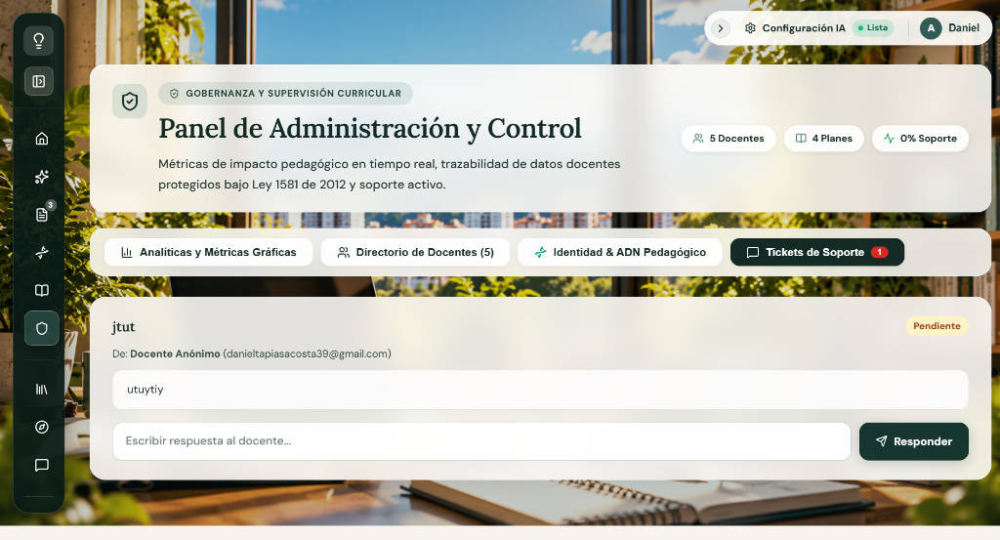 | 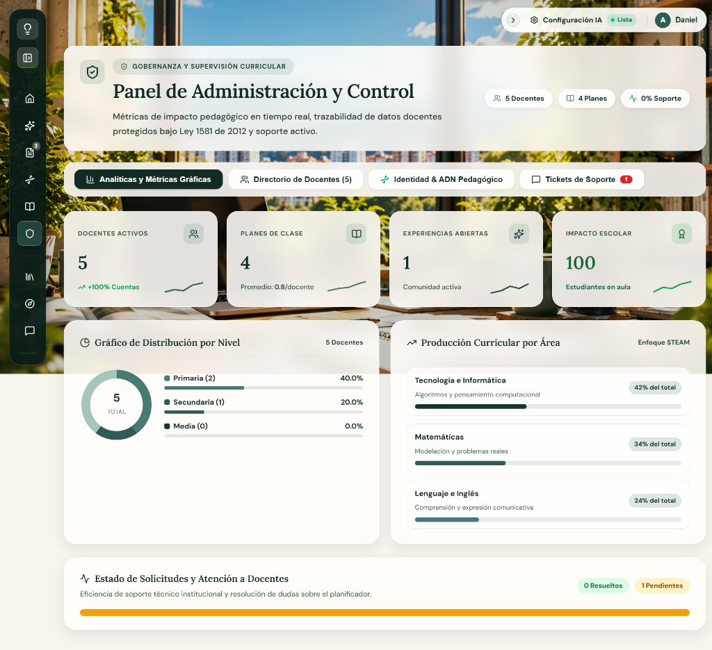 |

| Pestaña 3: Matriz de Transversalidad | Pestaña 4: Recursos Probados en Aula |
|:---:|:---:|
|  |  |

#### Objetivo
Construir y persistir la huella profesional de enseñanza del docente, registrando automáticamente las metodologías más exitosas de sus clases, sus dinámicas de inicio predilectas, estilos de evaluación formativa, principios DUA preferidos y conexiones interdisciplinares para alimentar la memoria contextual de la IA en cada nueva planificación.

#### Descripción general
La ventana presenta un encabezado verde bosque oscuro con estética Glassmorphism que integra:
- Badges de contexto: *"IDENTIDAD DOCENTE & MEMORIA CONTEXTUAL"* y *"Modo Administrador Curricular"*.
- Título H1: *"Mi ADN Pedagógico & Estudio Transversal"*.
- Subtítulo: *"Tu huella profesional de enseñanza. Inspiratec registra automáticamente las metodologías más exitosas en tus clases, tus recursos didácticos predilectos y conecta ejes transversales en cada nuevo plan generado con IA."*
- Botones de acción superior: *"Sincronizar Historial"* (`RotateCw`), *"Guardar ADN"* (`Save`, botón verde esmeralda) y la casilla *"Establecer como Estándar Curricular Institucional"*.
- Switch de activación: *"Aplicar mi ADN Pedagógico por defecto al diseñar nuevos planes en el Planificador"* (con estado *"Activado automáticamente"*).

La zona de trabajo se divide en **4 pestañas de navegación interna**:
1. **1. Memoria de Éxito Automática:** Cuatro tarjetas KPI cuantitativas (*Planes Analizados: 3*, *Índice de Innovación: 44%*, *Metodología Principal: Aprendizaje social y emocional*, *Recurso Didáctico Favorito: Material de clase*) y dos paneles analíticos de barras de progreso (*Metodologías que más te funcionan* y *Recursos más generados*).
2. **2. Caja de Herramientas Favorita:** Cuatro bloques configurables:
   - *Dinámicas de Inicio Predilectas (Fase de Exploración):* Etiquetas interactivas con estrellas (Desconectadas Unplugged, Pregunta socrática, Veo-Pienso-Me pregunto, Rompehielos, Lluvia de ideas, Analogías, Demostración experimental) e input para añadir dinámicas personalizadas.
   - *Estilos y Formas de Evaluación Favoritas:* Etiquetas seleccionables (Rúbrica analítica, Coevaluación reflexiva, Retroalimentación sin penalización, Autoevaluación metacognitiva, Portafolio digital, Trivia gamificada) e input para añadir estilos.
   - *Principios DUA Predilectos:* Opciones de representación visual, esfuerzo/persistencia, acción/expresión, andamiaje gradual y material concreto.
   - *Tu Filosofía y Receta Pedagógica Personal:* Textarea libre para directrices docentes que Gemini toma como directriz de redacción.
3. **3. Matriz de Transversalidad:**
   - *Ejes Transversales Institucionales Prioritarios:* Etiquetas seleccionables para Enfoque STEAM, PRAE Ambiental, Convivencia Ciudadana, Alfabetización Digital, Emprendimiento y Salud Socioemocional, con input para proyectos propios (ej. Cátedra de Paz).
   - *Articulación Interdisciplinar Habitual:* Selector de área secundaria predilecta (*Matemáticas*) y campo para el reto o pregunta problémica del entorno habitual.
4. **4. Recursos Probados en Aula:**
   - Repositorio personal de materiales validados (*"Banco de Recursos Probados y Efectivos en Aula"*), botón *"+ Añadir Recurso Probado"* y panel de estado vacío con icono de carpeta.

#### Tabla de elementos

| Elemento | Descripción |
|---|---|
| **Nombre de la ventana** | Mi ADN Pedagógico & Estudio Transversal (`AdnPedagogicoPage.jsx`) |
| **Imagen** | Capturas reales de las 4 pestañas: [`V05_adn_pedagogico_pestana1.png`](docs/evidencias/ACT-009/V05_adn_pedagogico_pestana1.png), [`V05_adn_pedagogico_pestana2.png`](docs/evidencias/ACT-009/V05_adn_pedagogico_pestana2.png), [`V05_adn_pedagogico_pestana3.png`](docs/evidencias/ACT-009/V05_adn_pedagogico_pestana3.png), [`V05_adn_pedagogico_pestana4.png`](docs/evidencias/ACT-009/V05_adn_pedagogico_pestana4.png). Iconos Lucide: `Dna`, `Sparkles`, `RotateCw`, `Save`, `ShieldCheck`, `TrendingUp`, `Sliders`, `FolderCheck`, `Star`, `Check`, `Plus`, `Trash2`. |
| **Texto** | • Badges: *"IDENTIDAD DOCENTE & MEMORIA CONTEXTUAL"*, *"Modo Administrador Curricular"*. • Título H1: *"Mi ADN Pedagógico & Estudio Transversal"*. • Subtítulo: *"Tu huella profesional de enseñanza. Inspiratec registra automáticamente las metodologías más exitosas en tus clases..."* • Switch: *"Aplicar mi ADN Pedagógico por defecto al diseñar nuevos planes en el Planificador"*. • Pestañas: *1. Memoria de Éxito Automática*, *2. Caja de Herramientas Favorita*, *3. Matriz de Transversalidad*, *4. Recursos Probados en Aula*. • Tarjetas métricas: Planes Analizados (3), Índice de Innovación (44%), Metodología Principal, Recurso Favorito. • Bloques de herramientas: Dinámicas de inicio, Estilos de evaluación, Principios DUA, Filosofía docente. • Matriz transversal: Ejes PRAE/STEAM, Área secundaria, Reto problémico. • Banco probado: *"Materiales didácticos generados que han demostrado alto engagement..."* |
| **Audio** | No se identificaron archivos de audio en esta ventana. |
| **Video** | No se identificaron archivos de video en esta ventana. |
| **Animación** | • Transiciones de cambio de pestaña con desvanecimiento de contenido. • Microanimación de selección en tags con cambio de color y relleno de estrella. • Animación de barra de progreso en las metodologías analizadas. • Giro en el icono al pulsar "Sincronizar Historial". |
| **Acciones del usuario** | • Clic en *"Sincronizar Historial"*: analiza los planes en Firestore y recalcula métricas automáticamente. • Clic en *"Guardar ADN"*: persiste las preferencias en Firestore y Zustand. • Alternar la casilla *"Establecer como Estándar Curricular Institucional"* (modo admin). • Conmutar el switch *"Aplicar por defecto en el Planificador"*. • Cambiar entre las 4 pestañas de trabajo. • Marcar o desmarcar dinámicas, evaluaciones, principios DUA y proyectos transversales con un clic. • Escribir y añadir dinámicas o proyectos personalizados con los botones `+`. • Redactar la receta pedagógica personal en el textarea. • Seleccionar área secundaria y definir pregunta problémica en la matriz transversal. • Clic en *"+ Añadir Recurso Probado"* en la pestaña 4. |
| **Botones** | • Botón secundario *"Sincronizar Historial"* (icono `RotateCw`). • Botón primario verde esmeralda *"Guardar ADN"* (icono `Save`). • 4 Botones de pestaña (`.tab-pill`). • Botones de adición: *"+ Añadir dinámica"*, *"+ Añadir evaluación"*, *"+ Añadir apoyo DUA"*, *"+ Añadir proyecto transversal"*, *"+ Añadir Recurso Probado"*. • Tags interactivos clicables de dinámicas, evaluaciones y ejes. |
| **Navegación** | • La configuración guardada se refleja inmediatamente en el banner de ADN de la ventana `/` (Planificador) y en `/home`. • Menú lateral flotante permanente para navegar a cualquier sección. |

---

### Ventana 10: Configuración de Inteligencia Artificial y Autodiagnóstico (`ConfigPage.jsx`)

#### Imágenes de la ventana

| Pestaña 1: Conectividad e Inteligencia Artificial (API Key) | Pestaña 2: Autodiagnóstico Pedagógico (Felder-Silverman) |
|:---:|:---:|
|  | 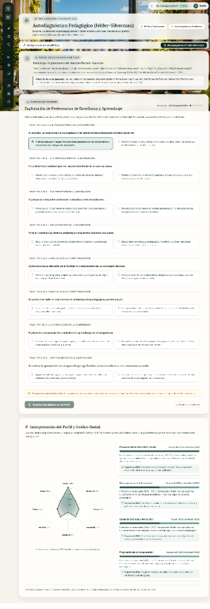 |

#### Objetivo
Garantizar la soberanía tecnológica y metodológica del docente en dos ámbitos complementarios:
1. Administrar de forma segura su clave privada BYOK (*Bring Your Own Key*) de Google Gemini con persistencia local en `localStorage` y cifrado en el perfil docente de Firestore, validando la conectividad del co-piloto en tiempo real.
2. Explorar y calibrar sus tendencias y preferencias didácticas mediante el autodiagnóstico científico de 8 reactivos de Felder-Silverman, proyectando su estilo en un gráfico radial interactivo y obteniendo recomendaciones pedagógicas fundamentadas en el Diseño Universal para el Aprendizaje (DUA).

#### Descripción general
La ventana se despliega sobre el lienzo dinámico con fondo pixel art `FondoPixel.jsx` y paneles translúcidos de cristal esmerilado (*Glassmorphism* marfil `rgba(255, 254, 250, 0.86)` a `0.88`, `backdrop-filter: blur(16px)` y bordes blancos finos `1px solid rgba(255, 255, 255, 0.94)`).

La arquitectura funcional se organiza en tres secciones:
1. **Cabecera Dinámica del Módulo:**
   - Icono variable en contenedor redondeado: `<Key size={24}>` al seleccionar la pestaña de IA o `<Compass size={24}>` al seleccionar Autodiagnóstico.
   - Insignia superior editorial: *"CONECTIVIDAD E INTELIGENCIA ARTIFICIAL"* o *"PERFIL DOCENTE & MEDIACIÓN DUA"*, con icono `Sparkles`.
   - Título principal H1: *"Configuración de Inteligencia Artificial"* o *"Autodiagnóstico Pedagógico (Felder-Silverman)"* (fuente `Lora`, 28px, negrita 700).
   - Subtítulo orientador contextual según la pestaña activa.
   - Franja de píldoras de estado (*stat pills*):
     - *API Key Configurada* (icono `ShieldCheck` verde) o *Sin Clave Activa* (ámbar).
     - *Perfil Docente Activo* (icono `Compass` verde) o *Autodiagnóstico Pendiente* (ámbar).
2. **Selector de Pestañas de Cristal (Barra Tablist):**
   - Pestaña 1: *"Inteligencia Artificial (API Key)"* con icono `Key`.
   - Pestaña 2: *"Autodiagnóstico Felder-Silverman"* con icono `Compass`.
   Permite conmutar fluidamente entre la soberanía de credenciales y el autodiagnóstico con microanimaciones de entrada `framer-motion`.
3. **Contenido Específico por Pestaña:**
   - **Pestaña 1 — Inteligencia Artificial (API Key):**
     - Tarjeta de cristal con título *"Google Gemini API Key"* (icono `Sparkles`).
     - Explicación de autonomía y velocidad para el planificador pedagógico, sugerencias DUA y co-docente interactivo.
     - Campo obligatorio *"Clave de API de Gemini *"*: input protegido con botón conmutador de máscara (`Eye` / `EyeOff`).
     - Aviso de privacidad: *"Tu clave se almacena de forma segura en tu navegador y en tu perfil docente. Nunca se comparte con terceros."*
     - Botón primario de validación: *"Guardar y Probar Conexión"* (icono `ShieldCheck`, con spinner `Loader2` durante la verificación).
     - Banner inferior: *"¿Aún no tienes una clave de API gratuita?"* con enlace externo *"Obtener en Google AI Studio"* (icono `ExternalLink`).
   - **Pestaña 2 — Autodiagnóstico Pedagógico (Felder-Silverman):**
     - *Tarjeta de Marco Teórico y Rigor Científico:* Insignia *"MARCO TEÓRICO Y RIGOR CIENTÍFICO"* (icono `BookOpen`), contextualización de las 4 dimensiones continuas de Felder-Silverman (FSLSM) y postulado ético de no encasillamiento formativo conforme al DUA.
     - *Cuestionario Docente:* Insignia *"CUESTIONARIO DOCENTE"* (icono `Sliders`), título H2 *"Exploración de Preferencias de Enseñanza y Aprendizaje"*, barra de progreso porcentual (*0 de 8 respondidas - 0%*), 8 reactivos de situaciones de aula reales con dos alternativas mutuamente excluyentes (Polo A vs Polo B), y botones de acción: *"Guardar Resultados en mi Perfil"* y *"Reiniciar Cuestionario"*.
     - *Panel de Interpretación y Gráfico Radial:* Título H2 *"Interpretación del Perfil y Gráfico Radial"*, gráfico radial interactivo SVG de 8 polos (*Activo*, *Reflexivo*, *Sensorial*, *Intuitivo*, *Visual*, *Verbal*, *Secuencial*, *Global*) y 4 tarjetas de dimensión curricular con barras de balance y recomendaciones formativas DUA.

#### Tabla de elementos

| Elemento | Descripción |
|---|---|
| **Nombre de la ventana** | Configuración de IA y Autodiagnóstico Pedagógico (`ConfigPage.jsx`) |
| **Imagen** | Capturas reales de ambas pestañas: [`V10_configuracion_ia.png`](docs/evidencias/ACT-009/V10_configuracion_ia.png) y [`V10_configuracion_autodiagnostico.png`](docs/evidencias/ACT-009/V10_configuracion_autodiagnostico.png). Iconografía Lucide: `Key`, `Compass`, `Sparkles`, `ShieldCheck`, `Eye`, `EyeOff`, `ExternalLink`, `BookOpen`, `Sliders`, `Dna`, `CheckCircle`, `RefreshCw`, `Loader2`. |
| **Texto** | • Badges: *"Conectividad e Inteligencia Artificial"*, *"Perfil Docente & Mediación DUA"*, *"Marco Teórico y Rigor Científico"*, *"Cuestionario Docente"*. • Título H1: *"Configuración de Inteligencia Artificial"* / *"Autodiagnóstico Pedagógico (Felder-Silverman)"* (fuente `Lora`, 28px). • Subtítulos explicativos de BYOK y exploración en 4 dimensiones. • Píldoras de estado: *"API Key Configurada"*, *"Autodiagnóstico Pendiente"* / *"Perfil Docente Activo"*. • Pestañas: *"Inteligencia Artificial (API Key)"*, *"Autodiagnóstico Felder-Silverman"*. • Formulario IA: *"Google Gemini API Key"*, placeholder/campo con viñetas protegidas, mensaje de almacenamiento seguro, botón *"Guardar y Probar Conexión"*, enlace a Google AI Studio. • Cuestionario: 8 reactivos de enseñanza/aprendizaje, progreso porcentual, opciones de respuesta Polo A y Polo B. • Interpretación: Gráfico radial de 8 polos y 4 dimensiones (Procesamiento, Percepción, Entrada/Recepción, Comprensión) con sugerencias DUA. |
| **Audio** | No se identificaron archivos de audio en esta ventana. |
| **Video** | No se identificaron archivos de video en esta ventana. |
| **Animación** | • Transición suave de entrada y salida entre pestañas con `framer-motion` (`initial={{ opacity: 0, y: 12 }}`, `duration: 0.2`). • Conmutación visual inmediata al pulsar el botón de visibilidad de la contraseña. • Spinner animado `Loader2` durante la prueba de conectividad con Gemini. • Renderizado reactivo dinámico del polígono en el Gráfico Radial SVG al marcar los reactivos. • Avance gradual animado en la barra de progreso del cuestionario. |
| **Acciones del usuario** | • Conmutar entre la pestaña de API Key y la de Autodiagnóstico. • Digitar o pegar la clave de API de Gemini. • Clic en el icono de ojo (`Eye`/`EyeOff`) para revelar u ocultar la clave. • Clic en *"Guardar y Probar Conexión"*: ejecuta `testApiConnection()`, almacena en `localStorage` y actualiza Firestore. • Clic en el enlace externo para abrir Google AI Studio. • Responder a cada uno de los 8 reactivos seleccionando la opción A o B. • Clic en *"Guardar Resultados en mi Perfil"*: persiste el perfil vectorial en Firestore y activa la personalización DUA. • Clic en *"Reiniciar Cuestionario"*: restablece las respuestas a su estado inicial. |
| **Botones** | • Botones de pestaña tablist (*API Key* y *Autodiagnóstico*). • Botón conmutador de visibilidad (`Eye`/`EyeOff`). • Botón primario verde oscuro *"Guardar y Probar Conexión"* (`ShieldCheck`). • Enlace/botón de contorno *"Obtener en Google AI Studio"* (`ExternalLink`). • Botones de selección de opción en cada reactivo. • Botón primario *"Guardar Resultados en mi Perfil"* (`ShieldCheck`). • Botón secundario *"Reiniciar Cuestionario"* (`RefreshCw`). |
| **Navegación** | • Destino externo: Portal de desarrolladores de Google AI Studio. • Menú lateral flotante y barra superior de utilidades permanentes para acceder a los demás módulos de INSPIRATEC. |

---

### Ventana 11: Panel de Administración y Control (`AdministracionPage.jsx`)

#### Imágenes reales de las 4 Pestañas

| Pestaña 1: Analíticas y Métricas Gráficas | Pestaña 2: Directorio de Docentes (5) |
|:---:|:---:|
|  |  |

| Pestaña 3: Identidad & ADN Pedagógico | Pestaña 4: Tickets de Soporte (1) |
|:---:|:---:|
|  |  |

#### Objetivo
Supervisar y auditar de manera centralizada la gobernanza curricular, el impacto escolar y la adopción pedagógica del claustro docente en INSPIRATEC, garantizando la trazabilidad y protección de datos conforme a la Ley 1581 de 2012 (Habeas Data), analizando el ADN pedagógico colectivo institucional y gestionando la resolución de tickets de soporte técnico y pedagógico en tiempo real.

#### Descripción general
La ventana presenta un encabezado translúcido esmerilado (*Glassmorphism* marfil `rgba(255, 254, 250, 0.86)` con `backdrop-filter: blur(16px)`) que integra:
- Badge de contexto: *"GOBERNANZA Y SUPERVISIÓN CURRICULAR"* con icono de escudo verificado (`ShieldCheck`).
- Título H1: *"Panel de Administración y Control"*.
- Subtítulo: *"Métricas de impacto pedagógico en tiempo real, trazabilidad de datos docentes protegidos bajo Ley 1581 de 2012 y soporte activo."*
- Píldoras de métricas rápidas superiores: *"5 Docentes"* (`Users`), *"4 Planes"* (`BookOpen`) y *"0% Soporte"* (`Activity`, tasa de resolución).
- Barra de navegación con 4 pestañas de cristal:
  1. *Analíticas y Métricas Gráficas* (`BarChart3`)
  2. *Directorio de Docentes (5)* (`Users`)
  3. *Identidad & ADN Pedagógico* (`Dna`)
  4. *Tickets de Soporte (1)* (`MessageSquare` con badge numérico rojo)

**Estructura interna por pestaña:**
1. **Pestaña 1 — Analíticas y Métricas Gráficas:**
   - 4 tarjetas KPI superiores con micrográficos de tendencia (*sparklines*):
     - *DOCENTES ACTIVOS:* 5 (+100% Cuentas).
     - *PLANES DE CLASE:* 4 (Promedio: 0.8/docente).
     - *EXPERIENCIAS ABIERTAS:* 1 (Comunidad activa).
     - *IMPACTO ESCOLAR:* 100 (Estudiantes en aula).
   - *Gráfico de Distribución por Nivel:* Gráfico circular Donut Chart SVG con total central (*5 TOTAL*) y desglose por barras de progreso: Primaria (2 - 40.0%), Secundaria (1 - 20.0%), Media (0 - 0.0%).
   - *Producción Curricular por Área (Enfoque STEAM):* Barras de distribución porcentual: Tecnología e Informática (42% del total - algoritmos y pensamiento computacional), Matemáticas (34% del total - modelación y problemas reales), Lenguaje e Inglés (24% del total - comprensión y expresión comunicativa).
   - *Estado de Solicitudes y Atención a Docentes:* Barra de avance horizontal con indicadores de *0 Resueltos* y *1 Pendientes*.
2. **Pestaña 2 — Directorio de Docentes (5):**
   - Buscador en tiempo real: *"Buscar docente por nombre, email o colegio..."*.
   - Filtros por nivel formativo: *Todos*, *Primaria*, *Secundaria*, *Media*.
   - Badges de auditoría: *"Mostrando 5 de 5 docentes registrados"* y *"Cifrado Habeas Data (Ley 1581 de 2012)"*.
   - Tabla administrativa con 6 columnas: *Docente*, *Celular Cifrado*, *Nivel / Rol*, *Institución*, *Planes*, *Acción* (con botón *"Ver Detalle"* para cada usuario).
3. **Pestaña 3 — Identidad & ADN Pedagógico Institucional:**
   - Badges: *"HUELLA CURRICULAR & GOBERNANZA PEDAGÓGICA"* y *"ANÁLISIS COLECTIVO (5 DOCENTES REGISTRADOS)"*.
   - Título: *"ADN Pedagógico Institucional & Estudio Transversal Colectivo"*.
   - Botón directo: *"Ir a mi ADN Personal"*.
   - 4 Tarjetas métricas colectivas: *Claustro Docente: 5*, *Innovación Curricular: 51%*, *Metodología Líder: Aprendizaje social y emocional*, *Recurso Didáctico #1: Juegos y Trivias Gamificadas*.
   - *Diagnóstico Curricular Comparativo (Declarada vs. Aplicada en Aula):* Mide la brecha curricular (Diferencia: 80%) contrastando metodologías declaradas en el registro (100% Aprendizaje social y emocional) frente a las efectivamente aplicadas en secuencias (50% Socioemocional, 25% Indagación, 25% Gamificación).
   - *Matriz de Transversalidad Colectiva:* Adopción de proyectos STEAM, Alfabetización Digital, Innovación, Convivencia y PRAE Ambiental.
   - *Caja de Herramientas Colectiva & Inclusión DUA:* Dinámicas de inicio, evaluación formativa y pautas DUA más utilizadas.
   - *Banco de Recursos Probados con Alta Efectividad:* Materiales con valoración destacada (Juegos y Recursos Lúdicos con 5 estrellas).
   - *Directorio de Huella Curricular Docente:* Tabla resumida con metodología predilecta, índice de innovación y botón *"Ver Ficha"*.
4. **Pestaña 4 — Tickets de Soporte (1):**
   - Buzón de incidencias y consultas pedagógicas en tiempo real.
   - Tarjetas de ticket con asunto (*"jtut"*), estado (*"Pendiente"* en cápsula ámbar), emisor (*Docente Anónimo - danieltapiasacosta39@gmail.com*), cuerpo de la consulta (*"utuytiy"*), campo de entrada *"Escribir respuesta al docente..."* y botón de envío directo *"Responder"*.

#### Tabla de elementos

| Elemento | Descripción |
|---|---|
| **Nombre de la ventana** | Panel de Administración y Control (`AdministracionPage.jsx`) |
| **Imagen** | Capturas reales de las 4 pestañas: [`V10_administracion_analiticas.png`](docs/evidencias/ACT-009/V10_administracion_analiticas.png), [`V10_administracion_directorio.png`](docs/evidencias/ACT-009/V10_administracion_directorio.png), [`V10_administracion_adn_colectivo.png`](docs/evidencias/ACT-009/V10_administracion_adn_colectivo.png), [`V10_administracion_tickets.png`](docs/evidencias/ACT-009/V10_administracion_tickets.png). Iconos Lucide: `ShieldCheck`, `BarChart3`, `Users`, `Dna`, `MessageSquare`, `BookOpen`, `Sparkles`, `Award`, `Activity`, `Search`, `Lock`, `Unlock`, `Send`, `CheckCircle2`, `Layers`, `Lightbulb`. |
| **Texto** | • Badge: *"GOBERNANZA Y SUPERVISIÓN CURRICULAR"*. • Título H1: *"Panel de Administración y Control"*. • Subtítulo: *"Métricas de impacto pedagógico en tiempo real, trazabilidad de datos docentes protegidos bajo Ley 1581 de 2012 y soporte activo."* • Píldoras de cabecera: *"5 Docentes"*, *"4 Planes"*, *"0% Soporte"*. • Pestañas: *"Analíticas y Métricas Gráficas"*, *"Directorio de Docentes (5)"*, *"Identidad & ADN Pedagógico"*, *"Tickets de Soporte 1"*. • Textos Pestaña 1: Tarjetas KPI (Docentes Activos 5, Planes de Clase 4, Experiencias Abiertas 1, Impacto Escolar 100), Distribución por Nivel (Primaria 40%, Secundaria 20%, Media 0%), Producción Curricular STEAM (Tecnología 42%, Matemáticas 34%, Lenguaje 24%), Solicitudes (0 Resueltos, 1 Pendientes). • Textos Pestaña 2: Placeholder *"Buscar docente por nombre, email o colegio..."*, botones de filtro (Todos, Primaria, Secundaria, Media), *"Cifrado Habeas Data (Ley 1581 de 2012)"*, cabeceras de tabla (*Docente*, *Celular Cifrado*, *Nivel / Rol*, *Institución*, *Planes*, *Acción*). • Textos Pestaña 3: Título *"ADN Pedagógico Institucional & Estudio Transversal Colectivo"*, métricas de claustro (51% innovación), diagnóstico comparativo declarada vs aplicada (diferencia 80%), proyectos STEAM/PRAE, caja DUA, banco probado y directorio de huella curricular. • Textos Pestaña 4: Asunto *"jtut"*, badge *"Pendiente"*, emisor *"Docente Anónimo"*, placeholder *"Escribir respuesta al docente..."*. |
| **Audio** | No se identificaron archivos de audio en esta ventana. |
| **Video** | No se identificaron archivos de video en esta ventana. |
| **Animación** | • Renderizado SVG animado del Donut Chart con cálculo de circunferencia (`circumference: 263.89px`) y `strokeDasharray`. • Animación de llenado suave en las barras de progreso de las áreas STEAM y niveles educativos. • Desvanecimiento suave al conmutar entre las 4 pestañas de trabajo. • Transición en tiempo real al filtrar docentes en el directorio. |
| **Acciones del usuario** | • Clic en cualquiera de las 4 pestañas (*Analíticas*, *Directorio*, *ADN*, *Tickets*) para conmutar la vista. • Escribir en el buscador del directorio para filtrar docentes por nombre, correo o colegio. • Clic en las píldoras de nivel (*Todos*, *Primaria*, *Secundaria*, *Media*) para acotar la tabla de docentes. • Clic en *"Ver Detalle"* en el directorio para abrir la ficha individual del docente. • Clic en *"Ir a mi ADN Personal"* (Pestaña 3) para navegar a `/adn-pedagogico`. • Escribir en el input de respuesta de un ticket y pulsar *"Responder"* para resolver la incidencia. • Pulsar tecla `Escape` para cerrar cualquier modal emergente de detalle. |
| **Botones** | • 4 Botones de pestaña con estética Glassmorphism (`BarChart3`, `Users`, `Dna`, `MessageSquare`). • Botones de filtro por nivel en Directorio (*Todos*, *Primaria*, *Secundaria*, *Media*). • Botones *"Ver Detalle"* en cada fila de docente. • Botón *"Ir a mi ADN Personal"* (fondo verde bosque `#183630`). • Botón de acción *"Responder"* con icono `Send` en cada tarjeta de ticket. |
| **Navegación** | • Clic en *"Ir a mi ADN Personal"* redirige a `/adn-pedagogico`. • Navegación lateral permanente mediante el Dock izquierdo para acceder a cualquier módulo del ecosistema. |

---

### Ventana 09: Foro Docente Interactivo (`ForoPage.jsx`)

#### Imagen de la ventana

#### Objetivo
Brindar un espacio asíncrono y estructurado de diálogo pedagógico, intercambio de experiencias de aula y resolución colaborativa de retos curriculares entre docentes, categorizado por líneas temáticas prioritarias y regulado por normas de participación profesional.

#### Descripción general
La interfaz presenta un diseño enriquecido con paneles colapsables laterales y estética Glassmorphism:
- **Cabecera Institucional:** Badge *"COMUNIDAD ACADÉMICA DE APRENDIZAJE"*, título H1 *"Foro Docente"*, subtítulo dialógico y botón de acción destacada *"+ Nueva discusión"* (fondo verde oscuro `#183630`).
- **Barra de Herramientas y Filtros:** Buscador en tiempo real (*"Buscar por tema, palabra clave o autor..."*), píldoras de conteo (*2 temas*, *0 respuestas*, *0 guardadas*), selector de categorías temáticas (*Todas (2)*, *Innovación pedagógica*, *Inteligencia artificial en educación*, *Estrategias didácticas 2*, *Evaluación del aprendizaje*, *Inclusión y DUA*), y botones conmutadores para ocultar o mostrar las columnas laterales (*Ocultar Categorías*, *Ocultar Contexto*).
- **Panel Lateral Izquierdo (Vistas de Navegación):** Segmentación por filtros personales: *Todas las discusiones (2)*, *Mis publicaciones (1)*, *Mis participaciones (0)*, *Sin responder (2)*, *Guardadas o favoritas (0)*, complementado por la lista vertical de categorías con iconos representativos.
- **Área Central de Discusión:** Selector de ordenación (*Más recientes*, *Más comentadas*, *Más valoradas*), listado de tarjetas de debates comunitarios:
  - Debate 1: *"Buena estructura"* por Daniel Camilo Tapias Ulloa (Admin), hace 5 días, categoría *Estrategias didácticas*, con acciones para guardar en favoritos (`Bookmark`), compartir enlace (`Share2`), eliminar (`Trash2`) y botón primario *"Participar →"*.
  - Debate 2: *"gergetertyrt"* por Docente Anónimo (Admin), 4 de oct de 2026, categoría *Estrategias didácticas*, con acciones y botón *"Participar →"*.
- **Panel Lateral Derecho (Contexto y Normas):** Tarjeta con las *Normas de Participación* (Diálogo constructivo, Privacidad y ética bajo Ley 1581, Colaboración abierta), resumen de temas destacados y etiquetas interactivas inferiores (*Inclusión y DUA*, *IA en Educación*, *STEAM*, *Rúbricas*).

#### Tabla de elementos

| Elemento | Descripción |
|---|---|
| **Nombre de la ventana** | Foro Docente Interactivo (`ForoPage.jsx`) |
| **Imagen** | Captura real: [`docs/evidencias/ACT-009/V09_foro.png`](docs/evidencias/ACT-009/V09_foro.png). Iconografía Lucide: `MessagesSquare`, `PlusCircle`, `Search`, `PanelLeftClose`, `PanelRightClose`, `Clock`, `ShieldCheck`, `Bookmark`, `Share2`, `Trash2`, `Send`, `Sparkles`, `Layers`, `Award`. |
| **Texto** | • Badge: *"COMUNIDAD ACADÉMICA DE APRENDIZAJE"*. • Título H1: *"Foro Docente"* (fuente `Lora`, 28px). • Subtítulo: *"Espacio de diálogo pedagógico, intercambio de experiencias y resolución colaborativa de retos curriculares."* • Botón superior: *"+ Nueva discusión"*. • Buscador: *"Buscar por tema, palabra clave o autor..."* • Conteo: *"2 temas"*, *"0 respuestas"*, *"0 guardadas"*. • Categorías: *Todas (2)*, *Innovación pedagógica*, *Inteligencia artificial en educación*, *Estrategias didácticas 2*, *Evaluación del aprendizaje*, *Inclusión y DUA*. • Vistas de navegación: *Todas las discusiones*, *Mis publicaciones*, *Mis participaciones*, *Sin responder*, *Guardadas*. • Normas de participación: Diálogo constructivo, Privacidad y ética, Colaboración abierta. |
| **Audio** | No se identificaron archivos de audio en esta ventana. |
| **Video** | No se identificaron archivos de video en esta ventana. |
| **Animación** | • Transición suave de colapso y expansión en los paneles laterales izquierdo y derecho. • Desvanecimiento al filtrar debates por categoría temática o búsqueda en vivo. • Microanimación hover de elevación en tarjetas de discusión y botones de acción. |
| **Acciones del usuario** | • Clic en *"+ Nueva discusión"*: abre el modal de publicación con categoría, título y cuerpo. • Escribir en el buscador para filtrar temas por palabra clave, autor o texto. • Clic en las etiquetas de categoría para acotar el listado de hilos. • Conmutar botones *"Ocultar Categorías"* y *"Ocultar Contexto"* para maximizar el área de lectura. • Seleccionar una vista en el panel lateral (*Mis publicaciones*, *Sin responder*, etc.). • Cambiar el orden de hilos mediante el selector desplegable (*Más recientes*). • Clic en *"Participar"* para desplegar las respuestas y publicar réplicas. • Clic en el icono de guardar (`Bookmark`) para archivar el hilo en favoritos. • Clic en compartir (`Share2`) para copiar el enlace directo al portapapeles. • Clic en eliminar (`Trash2`) con confirmación segura si es autor o administrador. |
| **Botones** | • Botón primario *"+ Nueva discusión"* (fondo `#183630`, color blanco). • Botones conmutadores de layout: *"Ocultar Categorías"* y *"Ocultar Contexto"*. • Botones tipo píldora de categorías temáticas. • Botones de acción en cada debate: *"Participar →"*, `Bookmark`, `Share2`, `Trash2`. |
| **Navegación** | • Apertura del hilo interactivo y réplicas en la misma vista. • Dock lateral izquierdo para navegar a cualquier otro módulo de INSPIRATEC. |

---

### Ventana 12: Centro de Ayuda Pedagógica (`AyudaPage.jsx`)

#### Imagen de la ventana
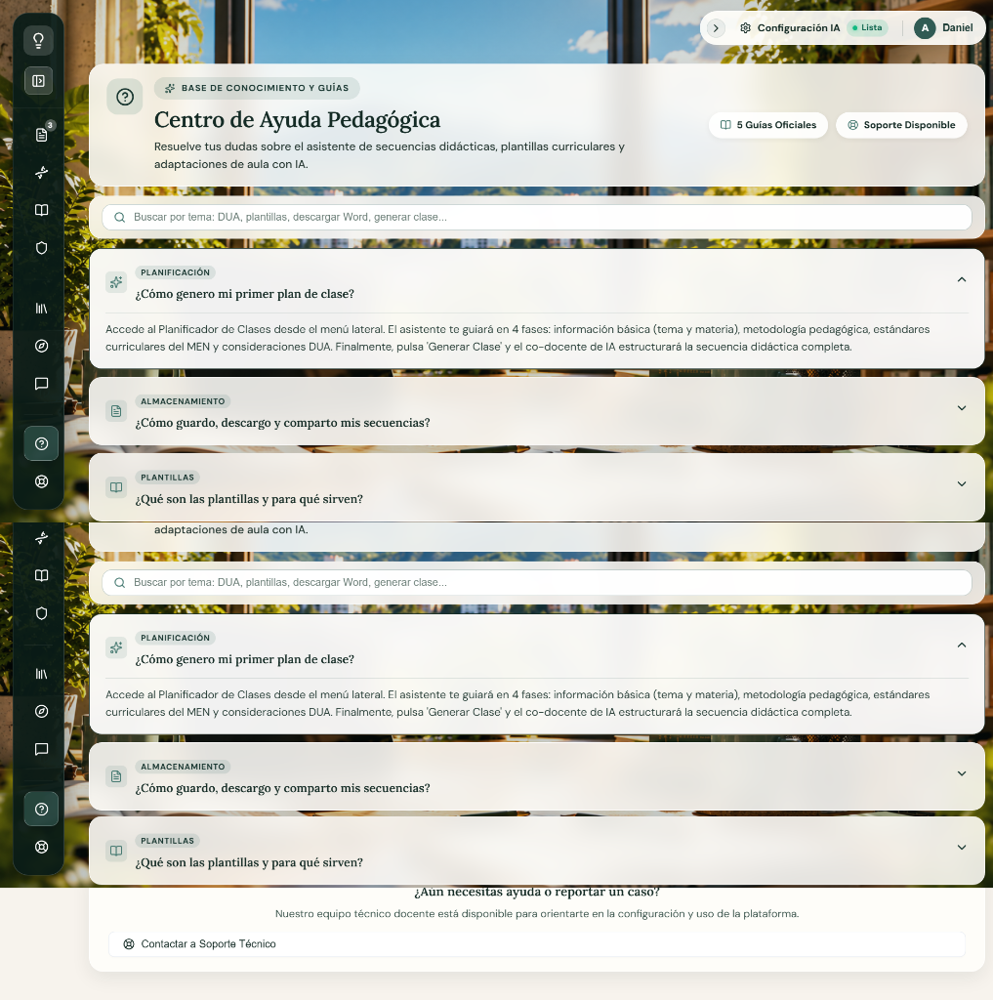

#### Objetivo
Proveer andamiaje conceptual, operativo y procedimental al docente usuario, resolviendo inquietudes frecuentes mediante acordeones interactivos categorizados (Planificación, Almacenamiento, Plantillas, DUA, Configuración IA) y facilitando un enlace directo hacia la mesa de soporte técnico.

#### Descripción general
La ventana presenta un diseño limpio, sereno y estructurado en torno al autoservicio docente:
- **Cabecera Institucional:** Badge *"BASE DE CONOCIMIENTO Y GUÍAS"* con icono de ayuda (`HelpCircle`), título H1 *"Centro de Ayuda Pedagógica"*, subtítulo orientador y dos píldoras de estado (*5 Guías Oficiales* con icono `BookOpen` y *Soporte Disponible* con icono `LifeBuoy`).
- **Barra de Búsqueda de Guías:** Input accesible con placeholder *"Buscar por tema: DUA, plantillas, descargar Word, generar clase..."* para filtrado en tiempo real de preguntas y respuestas.
- **Directorio de Acordeones Desplegables:** Lista de preguntas estructuradas por categoría, con iconos representativos y control colapsable suave (`ChevronDown` / `ChevronUp`):
  1. *PLANIFICACIÓN:* "¿Cómo genero mi primer plan de clase?" (Guía paso a paso en 4 fases tripartitas).
  2. *ALMACENAMIENTO:* "¿Cómo guardo, descargo y comparto mis secuencias?" (Formatos Word, PDF y biblioteca).
  3. *PLANTILLAS:* "¿Qué son las plantillas y para qué sirven?" (Momentos didácticos institucionales).
  4. *INCLUSIÓN DUA:* "¿Qué son los ajustes razonables y el enfoque DUA?" (Pautas CAST y PIAR).
  5. *CONFIGURACIÓN:* "¿Cómo configuro mi propia clave de Inteligencia Artificial (BYOK)?" (Google Gemini y privacidad local).
- **Sección Inferior de Asistencia:** Banner institucional *"¿Aún necesitas ayuda o reportar un caso? Nuestro equipo técnico docente está disponible para orientarte..."* acompañado del botón *"Contactar a Soporte Técnico"*.

#### Tabla de elementos

| Elemento | Descripción |
|---|---|
| **Nombre de la ventana** | Centro de Ayuda Pedagógica (`AyudaPage.jsx`) |
| **Imagen** | Captura real: [`docs/evidencias/ACT-009/V12_ayuda.png`](docs/evidencias/ACT-009/V12_ayuda.png). Iconografía Lucide: `HelpCircle`, `BookOpen`, `LifeBuoy`, `Search`, `Sparkles`, `FileText`, `Compass`, `CheckCircle2`, `ChevronDown`, `ChevronUp`. |
| **Texto** | • Badge: *"BASE DE CONOCIMIENTO Y GUÍAS"*. • Título H1: *"Centro de Ayuda Pedagógica"* (fuente `Lora`, 28px). • Subtítulo: *"Resuelve tus dudas sobre el asistente de secuencias didácticas, plantillas curriculares y adaptaciones de aula con IA."* • Píldoras: *"5 Guías Oficiales"*, *"Soporte Disponible"*. • Buscador: *"Buscar por tema: DUA, plantillas, descargar Word, generar clase..."* • Categorías en acordeones: *Planificación*, *Almacenamiento*, *Plantillas*, *Inclusión DUA*, *Configuración*. • Preguntas formuladas: Generación de primer plan, guardado y descarga, uso de plantillas, DUA/PIAR, y configuración BYOK de Gemini. • Banner inferior: *"¿Aún necesitas ayuda o reportar un caso?"* |
| **Audio** | No se identificaron archivos de audio en esta ventana. |
| **Video** | No se identificaron archivos de video en esta ventana. |
| **Animación** | • Transición suave de expansión y colapso en el contenido de cada acordeón (`transition: max-height, opacity`). • Rotación de 180° en los chevrones indicadores al abrir o cerrar una pregunta. • Filtrado instantáneo con desvanecimiento de preguntas al escribir en la barra de búsqueda. |
| **Acciones del usuario** | • Escribir en el buscador para filtrar guías por texto o concepto pedagógico. • Clic en la barra de cualquier pregunta para desplegar u ocultar su respuesta explicativa. • Clic en *"Contactar a Soporte Técnico"*: redirige automáticamente a `/soporte`. |
| **Botones** | • Barras interactivas de acordeón clicables con efecto hover. • Botón secundario de asistencia *"Contactar a Soporte Técnico"* (icono `LifeBuoy`). |
| **Navegación** | • Redirección directa hacia la ventana `/soporte` al pulsar el botón de contacto. • Dock lateral izquierdo para navegar a cualquier otro módulo del ecosistema. |

---

### Ventana 13: Soporte Técnico Institucional (`SoportePage.jsx`)

#### Imagen de la ventana
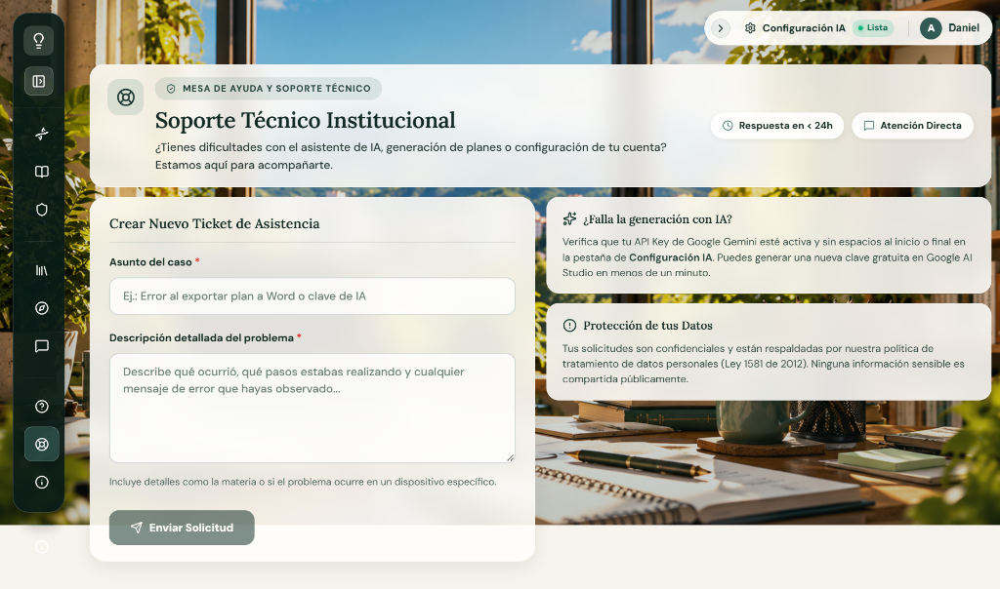

#### Objetivo
Canalizar de manera formal y confidencial las solicitudes de asistencia técnica, fallos de generación de IA o dudas de configuración docente, garantizando un tiempo de respuesta inferior a 24 horas y protegiendo los datos bajo la Ley 1581 de 2012.

#### Descripción general
La ventana presenta un layout asimétrico equilibrado en dos columnas con tratamiento Glassmorphism:
- **Cabecera Institucional:** Badge *"MESA DE AYUDA Y SOPORTE TÉCNICO"* con icono de salvavidas (`LifeBuoy`), título H1 *"Soporte Técnico Institucional"*, subtítulo de acompañamiento y dos píldoras de compromiso (*Respuesta en < 24h* con icono `Clock` y *Atención Directa* con icono `MessageSquare`).
- **Columna Izquierda (Formulario de Ticket):**
  - Encabezado: *"Crear Nuevo Ticket de Asistencia"*.
  - Campo *"Asunto del caso *"*: input de texto con placeholder *"Ej.: Error al exportar plan a Word o clave de IA"*.
  - Campo *"Descripción detallada del problema *"*: área de texto amplia con placeholder *"Describe qué ocurrió, qué pasos estabas realizando y cualquier mensaje de error que hayas observado..."*.
  - Texto orientador: *"Incluye detalles como la materia o si el problema ocurre en un dispositivo específico."*
  - Botón de envío: *"Enviar Solicitud"* con icono de avión de papel (`Send`).
- **Columna Derecha (Paneles Informativos y de Seguridad):**
  - Tarjeta *"¿Falla la generación con IA?"*: Guía rápida con icono de chispas (`Sparkles`) para verificar la clave API de Google Gemini en Configuración IA y obtener credenciales gratuitas en Google AI Studio.
  - Tarjeta *"Protección de tus Datos"*: Aviso de privacidad con icono de advertencia (`AlertCircle`) que certifica la confidencialidad de la solicitud conforme a la Ley 1581 de 2012 (Habeas Data).
- **Vista de Confirmación (`enviado === true`):** Pantalla de confirmación con icono verde de éxito (`CheckCircle2`), mensaje de recepción formal y botón *"Enviar otra solicitud"*.

#### Tabla de elementos

| Elemento | Descripción |
|---|---|
| **Nombre de la ventana** | Soporte Técnico Institucional (`SoportePage.jsx`) |
| **Imagen** | Captura real: [`docs/evidencias/ACT-009/V13_soporte.png`](docs/evidencias/ACT-009/V13_soporte.png). Iconografía Lucide: `LifeBuoy`, `Clock`, `MessageSquare`, `Send`, `Sparkles`, `AlertCircle`, `CheckCircle2`, `Loader2`. |
| **Texto** | • Badge: *"MESA DE AYUDA Y SOPORTE TÉCNICO"*. • Título H1: *"Soporte Técnico Institucional"* (fuente `Lora`, 28px). • Subtítulo: *"¿Tienes dificultades con el asistente de IA, generación de planes o configuración de tu cuenta? Estamos aquí para acompañarte."* • Píldoras: *"Respuesta en < 24h"*, *"Atención Directa"*. • Formulario: *"Crear Nuevo Ticket de Asistencia"*, *"Asunto del caso *"*, *"Descripción detallada del problema *"*, placeholder de contexto. • Tarjeta IA: Verificación de clave API de Google Gemini en Configuración IA. • Tarjeta Datos: Confidencialidad bajo Ley 1581 de 2012. • Vista de éxito: *"¡Ticket Enviado con Éxito!"* |
| **Audio** | No se identificaron archivos de audio en esta ventana. |
| **Video** | No se identificaron archivos de video en esta ventana. |
| **Animación** | • Spinner animado en el botón al procesar el envío (`Loader2`). • Transición de desvanecimiento hacia la tarjeta de confirmación de éxito tras el guardado en Firestore. • Efecto hover de realce de borde y elevación en las tarjetas laterales informativas. |
| **Acciones del usuario** | • Diligenciar el campo de asunto del ticket. • Redactar la descripción detallada del fallo o consulta técnica en el textarea. • Clic en *"Enviar Solicitud"*: despacha el ticket a la colección `tickets` de Firestore. • Clic en *"Enviar otra solicitud"* en la pantalla de éxito para restablecer el formulario. |
| **Botones** | • Botón primario *"Enviar Solicitud"* (fondo gris/verde petróleo, icono `Send`). • Botón *"Enviar otra solicitud"* en la pantalla de éxito. |
| **Navegación** | • Los tickets enviados se reflejan de inmediato en la pestaña de tickets de `/administracion`. • Dock lateral izquierdo para navegar a cualquier otro módulo del ecosistema. |

---

### Ventana 14: Acerca de INSPIRATEC (`AboutPage.jsx`)

#### Imagen de la ventana
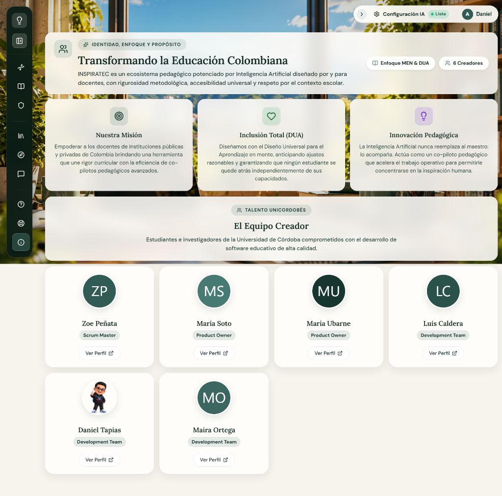

#### Objetivo
Presentar la identidad institucional, misión, principios pedagógicos inclusivos (DUA) y el equipo multidisciplinario de la Universidad de Córdoba detrás de INSPIRATEC, reconociendo formalmente sus roles Scrum y brindando total transparencia respecto a la autoría académica, el enfoque metodológico de la Guía 30 del MEN y la soberanía del docente ante el uso reflexivo de la inteligencia artificial.

#### Descripción general
La ventana se despliega sobre el lienzo ambiental con fondo pixel art animado `FondoPixel.jsx` y capas translúcidas de cristal esmerilado (*Glassmorphism* marfil `rgba(255, 254, 250, 0.86)` a `0.88` con `backdrop-filter: blur(16px)` y bordes blancos finos `1px solid rgba(255, 255, 255, 0.94)`). Su diseño se estructura en tres bloques modulares:
1. **Cabecera Editorial Institucional:**
   - Icono distintivo de comunidad (`Users`) en caja redondeada con fondo verde salvia translúcido (`rgba(71, 122, 114, 0.16)`).
   - Insignia editorial superior: *"IDENTIDAD, ENFOQUE Y PROPÓSITO"* acompañada del icono de chispa (`Sparkles`).
   - Título principal H1: *"Transformando la Educación Colombiana"* (fuente `Lora`, 28px, color `#142B25`, negrita 700).
   - Párrafo descriptor: *"INSPIRATEC es un ecosistema pedagógico potenciado por Inteligencia Artificial diseñado por y para docentes, con rigurosidad metodológica, accesibilidad universal y respeto por el contexto escolar."*
   - Franja lateral de píldoras informativas (*stat pills*): *"Enfoque MEN & DUA"* con icono `BookOpen` y *"6 Creadores"* con icono `Users`.
2. **Tríada de Valores y Principios del Proyecto:**
   Cuadrícula de tres tarjetas de cristal con iconos vectoriales centrados sobre círculos cromáticos temáticos:
   - *Nuestra Misión* (icono `Target` en verde petróleo `#183630`): Empoderar a los docentes de instituciones públicas y privadas de Colombia uniendo rigor curricular con la asistencia de co-pilotos pedagógicos avanzados.
   - *Inclusión Total (DUA)* (icono `Heart` en verde esmeralda `#166534`): Diseño fundamentado en el Diseño Universal para el Aprendizaje, anticipando ajustes razonables para evitar exclusiones en el aula.
   - *Innovación Pedagógica* (icono `Lightbulb` en violeta `#6D28D9`): Postura ética donde la IA actúa como copiloto operativo que nunca reemplaza al maestro, permitiéndole centrarse en la inspiración humana.
3. **Módulo de Talento Creador Unicordobés:**
   - Panel introductorio con insignia *"Talento Unicordobés"* (icono `Users`), título H2 *"El Equipo Creador"* y texto explicativo del compromiso de los estudiantes e investigadores de la Universidad de Córdoba.
   - Cuadrícula responsiva de 6 tarjetas de integrantes con tratamiento de cristal, avatares circulares de 88px con reborde blanco y sombra:
     1. **Zoe Peñata** — *Scrum Master* (Avatar con iniciales ZP sobre `#315B54`).
     2. **María Soto** — *Product Owner* (Avatar con iniciales MS sobre `#477A72`).
     3. **María Ubarne** — *Product Owner* (Avatar con iniciales MU sobre `#183630`).
     4. **Luis Caldera** — *Development Team* (Avatar con iniciales LC sobre `#2B524A`).
     5. **Daniel Tapias** — *Development Team* (Avatar gráfico personalizado `miniyo.png`).
     6. **Maira Ortega** — *Development Team* (Avatar con iniciales MO sobre `#3C6760`).
   - Cada tarjeta integra un botón píldora (*btn-outline*) *"Ver Perfil"* con icono `<ExternalLink size={13}>` vinculado a GitHub.

#### Tabla de elementos

| Elemento | Descripción |
|---|---|
| **Nombre de la ventana** | Acerca de INSPIRATEC (`AboutPage.jsx`) |
| **Imagen** | Captura real: [`docs/evidencias/ACT-009/V14_acerca.png`](docs/evidencias/ACT-009/V14_acerca.png). Iconografía Lucide: `Users`, `Sparkles`, `BookOpen`, `Target`, `Heart`, `Lightbulb`, `ExternalLink`. Avatares de integrantes (UI-Avatars con paleta de marca y avatar digital `miniyo.png` para Daniel Tapias). |
| **Texto** | • Badge: *"Identidad, Enfoque y Propósito"*. • Título H1: *"Transformando la Educación Colombiana"* (fuente `Lora`, 28px). • Subtítulo institucional: *"INSPIRATEC es un ecosistema pedagógico potenciado por Inteligencia Artificial diseñado por y para docentes, con rigurosidad metodológica, accesibilidad universal y respeto por el contexto escolar."* • Píldoras: *"Enfoque MEN & DUA"*, *"6 Creadores"*. • Tarjeta Misión: *"Nuestra Misión"* / *"Empoderar a los docentes de instituciones públicas y privadas de Colombia brindando una herramienta que une rigor curricular con la eficiencia de co-pilotos pedagógicos avanzados."* • Tarjeta DUA: *"Inclusión Total (DUA)"* / *"Diseñamos con el Diseño Universal para el Aprendizaje en mente, anticipando ajustes razonables y garantizando que ningún estudiante se quede atrás independientemente de sus capacidades."* • Tarjeta Innovación: *"Innovación Pedagógica"* / *"La Inteligencia Artificial nunca reemplaza al maestro: lo acompaña. Actúa como un co-piloto pedagógico que acelera el trabajo operativo para permitirle concentrarse en la inspiración humana."* • Badge sección: *"Talento Unicordobés"*. • Título H2: *"El Equipo Creador"*. • Subtítulo equipo: *"Estudiantes e investigadores de la Universidad de Córdoba comprometidos con el desarrollo de software educativo de alta calidad."* • Tarjetas de integrantes: Nombres de los 6 participantes, insignias de rol (*Scrum Master*, *Product Owner*, *Development Team*) y etiquetas *"Ver Perfil"*. |
| **Audio** | No se identificaron archivos de audio ni efectos sonoros en esta ventana. |
| **Video** | No se identificaron archivos ni reproductores de video en esta ventana. |
| **Animación** | • Animación continua SVG en el lienzo ambiental `FondoPixel.jsx`. • Elevación suave y sombreado perimetral al pasar el cursor sobre las tarjetas de valores y de integrantes (`transition: all 0.2s cubic-bezier(0.16, 1, 0.3, 1)`). |
| **Acciones del usuario** | • Clic en el botón *"Ver Perfil"* de cualquiera de los 6 integrantes: abre el enlace de GitHub correspondiente en una nueva pestaña del navegador. • Lectura reflexiva de los fundamentos institucionales y axiológicos de INSPIRATEC. |
| **Botones** | • 6 botones de contorno redondeado (*btn-outline*) *"Ver Perfil"* con icono `ExternalLink`. |
| **Navegación** | • Destinos externos: Repositorios y perfiles de GitHub de los autores. • Navegación interna permanente mediante el dock lateral izquierdo y la barra superior de utilidades. |

---

### Ventana 15: Acceso y Autenticación Docente (`AuthPage.jsx`)

#### Imagen de la ventana

##### Modo 1: Inicio de Sesión / Acceso
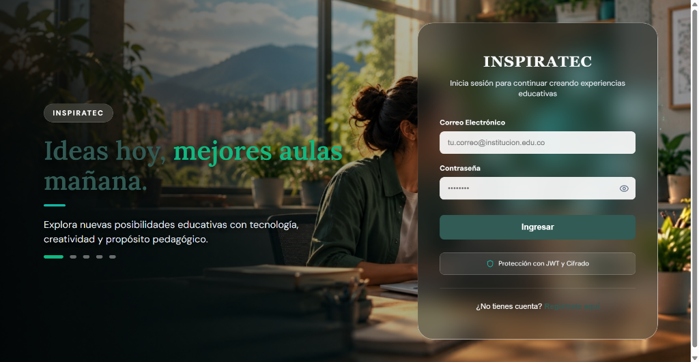

##### Modo 2: Registro Docente y Vinculación Curricular
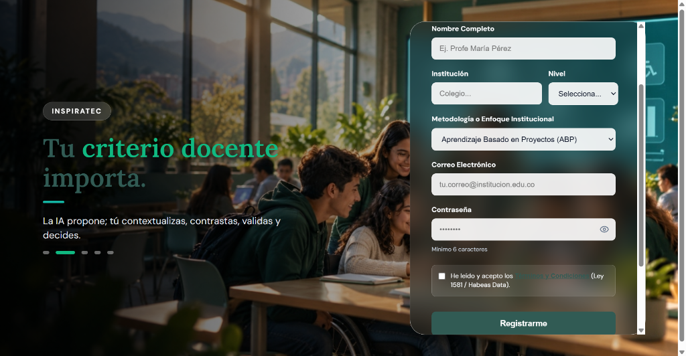

#### Objetivo
Garantizar el ingreso y la vinculación segura y soberana de los docentes al ecosistema pedagógico INSPIRATEC, gestionando la verificación criptográfica de credenciales mediante JSON Web Tokens (JWT) y Firebase Authentication, así como la captación rigurosa del perfil docente en el registro (nombre, institución educativa, nivel de enseñanza, metodología pedagógica institucional y consentimiento informado bajo la Ley Estatutaria 1581 de 2012 de Habeas Data).

#### Descripción general
La interfaz se despliega a pantalla completa (`min-height: 100vh`) sobre una experiencia inmersiva cinematográfica concebida para inspirar y transmitir serenidad, rigor y concentración pedagógica. El diseño se articula en tres componentes arquitectónicos:

1. **Fondo Ambiental Cinematográfico y Degradado Dinámico:**
   - Carrusel fotográfico en alta resolución de espacios educativos reales, bibliotecas, laboratorios y aulas colaborativas (`campus.jpg`, `criterio-docente.jpg`, `inclusion.jpg`, `colaboracion.jpg`, `innovacion.jpg`).
   - Transición automatizada cada 7 segundos con disolución cruzada y sutil efecto de escala zoom (`transition: opacity 1.2s ease-in-out, transform 8s ease-out`), pausándose cuando el usuario interactúa con el formulario (`isHoveringForm`).
   - Máscara oscura lateral en degradado (`linear-gradient(to right, rgba(0,0,0,0.8), rgba(0,0,0,0.4), transparent)`) que garantiza el cumplimiento de la relación de contraste WCAG AAA para textos de lectura.
2. **Panel Izquierdo — Narrativa y Filosofía Pedagógica:**
   - Insignia superior de marca: Píldora translúcida de cristal con la leyenda *"INSPIRATEC"* y borde sutil.
   - Frases editoriales de gran escala (H1 de 48px, peso 800) articuladas con acento verde esmeralda (`#10b981`), barra divisoria turquesa (`#14b8a6`) y párrafos de fundamentación (*"Ideas hoy, mejores aulas mañana"*, *"Tu criterio docente importa"*, *"Inclusión desde el diseño"*, *"Aprender también es compartir"*, *"Innovar con propósito"*).
   - Selector inferior de navegación manual del carrusel compuesto por 5 píldoras interactivas con cambio dinámico de anchura (de 12px a 36px) para la escena activa.
3. **Panel Derecho — Tarjeta de Autenticación Glassmorphism:**
   - Módulo flotante con radio de 28px en cristal oscuro esmerilado `rgba(24, 35, 34, 0.4)`, filtro `backdrop-filter: blur(20px)`, bisel de luz perimetral `1px solid rgba(255, 255, 255, 0.6)` y sombra profunda contra fondos fotográficos.
   - **Encabezado:** Título de marca institucional *"INSPIRATEC"* en fuente con remate `Georgia` (28px, tracking 1px) y subtítulo contextual de invitación.
   - **Modo Inicio de Sesión (`isLogin = true`):**
     - Campo *Correo Electrónico* (`tu.correo@institucion.edu.co`).
     - Campo *Contraseña* protegida con botón interactivo de visibilidad (`Eye`/`EyeOff`).
     - Botón primario *"Ingresar"* en verde esmeralda con efecto visual de realce al pasar el cursor.
     - Badge inferior de confianza con icono `<Shield size={14} color="#14b8a6">` y texto *"Protección con JWT y Cifrado"*.
     - Enlace conmutador inferior: *"¿No tienes cuenta? Regístrate aquí"*.
   - **Modo Registro Docente (`isLogin = false`):**
     - Subtítulo: *"Crea tu cuenta docente protegida y únete a la comunidad"*.
     - Campo *Nombre Completo* (`Ej. Profe María Pérez`).
     - Fila de 2 columnas para *Institución* (`Colegio...`) y selector *Nivel* (`Primaria`, `Secundaria`, `Media`).
     - Selector *Metodología o Enfoque Institucional* con 9 opciones pedagógicas estándar del MEN (ABP, STEAM, Cooperativo/Socrático, Aula Invertida, EpC, Socioformativo, Constructivismo, Escuela Nueva, Otra). Al seleccionar "Otra", despliega un input adicional para especificarla.
     - Campos de *Correo Electrónico* y *Contraseña* (mínimo 6 caracteres).
     - Caja destacada de aceptación legal con casilla de verificación: *"He leído y acepto los Términos y Condiciones (Ley 1581 / Habeas Data)"*, enlazada al diálogo modal accesible `TermsAndConditionsModal.jsx`.
     - Botón primario *"Registrarme"*.
     - Enlace conmutador inferior: *"¿Ya tienes cuenta? Inicia sesión"*.

#### Tabla de elementos

| Elemento | Descripción |
|---|---|
| **Nombre de la ventana** | Acceso y Autenticación Docente (`AuthPage.jsx`) |
| **Imagen** | Capturas reales: [`docs/evidencias/ACT-009/V15_auth_login.png`](docs/evidencias/ACT-009/V15_auth_login.png) y [`docs/evidencias/ACT-009/V15_auth_registro.png`](docs/evidencias/ACT-009/V15_auth_registro.png). Fondos reales fotográficos de campus universitario y biblioteca. Iconos Lucide: `Shield`, `Eye`, `EyeOff`. |
| **Texto** | • Insignia superior izquierda: *"INSPIRATEC"*. • Títulos de escenas narrativas: *"Ideas hoy, mejores aulas mañana."*, *"Tu criterio docente importa."*, *"Inclusión desde el diseño."*, *"Aprender también es compartir."*, *"Innovar con propósito."* • Textos explicativos del carrusel: Párrafos de fundamentación pedagógica y soberanía docente. • Marca del formulario: *"INSPIRATEC"* (fuente `Georgia`, 28px). • Subtítulos dinámicos: *"Inicia sesión para continuar creando experiencias educativas"* / *"Crea tu cuenta docente protegida y únete a la comunidad"*. • Etiquetas: *"Correo Electrónico"*, *"Contraseña"*, *"Nombre Completo"*, *"Institución"*, *"Nivel"*, *"Metodología o Enfoque Institucional"*, *"Escribe la metodología de tu colegio"*. • Placeholders: *"tu.correo@institucion.edu.co"*, *"••••••••"*, *"Ej. Profe María Pérez"*, *"Colegio..."*, *"Ej. Pedagogía Dialogante, Waldorf, Holística..."*. • Botones de acción: *"Ingresar"*, *"Registrarme"*, *"Procesando..."*. • Badge de seguridad: *"Protección con JWT y Cifrado"*. • Consentimiento legal: *"He leído y acepto los Términos y Condiciones (Ley 1581 / Habeas Data)"*. • Alternador de vista: *"¿No tienes cuenta? Regístrate aquí"* / *"¿Ya tienes cuenta? Inicia sesión"*. |
| **Audio** | No se identificaron archivos de audio ni efectos sonoros en esta ventana. |
| **Video** | No se identificaron archivos de video en esta ventana. |
| **Animación** | • Disolución cruzada y animación de escala zoom continua (`Ken Burns effect`) en los fondos fotográficos cada 7 segundos. • Pausa automática del temporizador del carrusel al pasar el cursor sobre el formulario (`isHoveringForm`). • Transición de anchura de 12px a 36px en las píldoras de navegación del carrusel. • Conmutación fluida entre modo login y registro con renderizado reactivo de campos. • Efecto hover de realce de color en el botón primario (`var(--primary-active)` a `var(--primary-sage)`). |
| **Acciones del usuario** | • Clic en las píldoras inferiores para cambiar manualmente la escena pedagógica. • Alternar entre modo login y registro con el botón inferior. • Escribir credenciales de correo y contraseña. • Clic en el icono de ojo (`Eye`/`EyeOff`) para revelar u ocultar los caracteres de la contraseña. • En modo registro: diligenciar nombre, colegio, seleccionar nivel y metodología pedagógica. • Si elige "Otra" metodología: ingresar el nombre del modelo pedagógico institucional. • Clic en el enlace *"Términos y Condiciones"* para abrir el modal explicativo de Habeas Data. • Marcar la casilla de aceptación de términos obligatoria. • Clic en *"Ingresar"* o *"Registrarme"*: dispara autenticación en Firebase y redirige a `/home`. |
| **Botones** | • 5 píldoras interactivas de cambio de escena del carrusel. • Botón conmutador de visibilidad de contraseña (`Eye`/`EyeOff`). • Botón primario de formulario (*"Ingresar"* / *"Registrarme"*). • Botón de texto para abrir el modal de Términos y Condiciones. • Botón conmutador de modo (*"Regístrate aquí"* / *"Inicia sesión"*). |
| **Navegación** | • Tras autenticación exitosa: Redirección automática a la Ventana de Inicio (`/home`). • Apertura del modal `TermsAndConditionsModal` sobre la misma pantalla sin perder datos diligenciados. |

---

### Ventanas Emergentes y Modales del Sistema

---

#### Modal M02: Ventana Inmersiva de Bienvenida Narrativa (`BienvenidaNarrativa.jsx`)

##### Imagen de la ventana
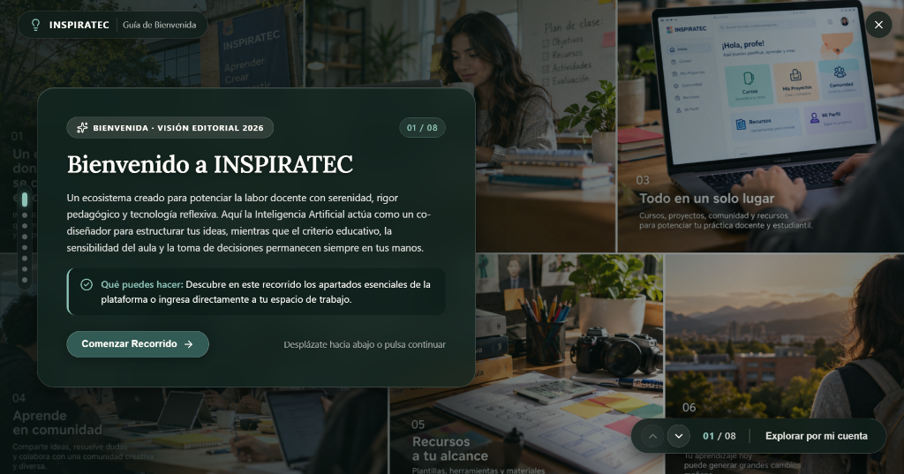

##### Objetivo
Guiar al docente en su primer contacto con el ecosistema o cuando lo requiera a través del menú de usuario, presentando la visión editorial 2026, los principios de co-diseño con IA, la soberanía docente y el recorrido interactivo por las 8 escenas formativas de INSPIRATEC.

##### Descripción general
Experiencia inmersiva a pantalla completa montada con `createPortal` sobre un mosaico ambiental desenfocado. Incorpora:
- Barra superior de bienvenida con isotipo de INSPIRATEC, indicador *"Guía de Bienvenida"* y botón de cierre `<X>`.
- Indicador vertical de pasos a la izquierda con puntos interactivos para desplazarse directamente entre las 8 escenas.
- Tarjeta editorial flotante en cristal verde petróleo profundo (`rgba(19, 38, 34, 0.94)`, `backdrop-filter: blur(24px)`), con badge *"BIENVENIDA · VISIÓN EDITORIAL 2026"*, contador de avance (*01 / 08*), título H1 en `Lora` (*"Bienvenido a INSPIRATEC"*), descripción pedagógica sobre el co-piloto reflexivo y caja de sugerencia (*"Qué puedes hacer"* con icono `CheckCircle2`).
- Botón primario de avance *"Comenzar Recorrido →"* con pista de interacción.
- Dock inferior flotante con chevrones de salto arriba/abajo (`ChevronUp`/`ChevronDown`), contador de escena (*01 / 08*) y botón de salida rápida *"Explorar por mi cuenta"*.

##### Tabla de elementos

| Elemento | Descripción |
|---|---|
| **Nombre de la ventana** | Bienvenida Inmersiva INSPIRATEC (`BienvenidaNarrativa.jsx`) |
| **Imagen** | Captura real: [`docs/evidencias/ACT-009/M02_bienvenida_narrativa.png`](docs/evidencias/ACT-009/M02_bienvenida_narrativa.png). Mosaico fotográfico de aula y software, icono `Lightbulb`, `Sparkles`, `CheckCircle2`, `ArrowRight`, `ChevronUp`, `ChevronDown`, `X`. |
| **Texto** | • Barra: *"INSPIRATEC"* / *"Guía de Bienvenida"*. • Badge: *"BIENVENIDA · VISIÓN EDITORIAL 2026"* / Contador *"01 / 08"*. • Título H1: *"Bienvenido a INSPIRATEC"* (fuente `Lora`, 30px, color blanco marfil). • Párrafo editorial: Declaración de serenidad, rigor pedagógico y co-diseño reflexivo con IA. • Caja de consejo: *"Qué puedes hacer: Descubre en este recorrido los apartados esenciales..."* • Botón: *"Comenzar Recorrido →"* / Subtexto: *"Desplázate hacia abajo o pulsa continuar"*. • Dock inferior: *"01 / 08"*, *"Explorar por mi cuenta"*. |
| **Audio** | No se identificaron archivos de audio en esta ventana. |
| **Video** | No se identificaron archivos de video en esta ventana. |
| **Animación** | • Transiciones de desplazamiento vertical suave entre escenas mediante rueda del ratón (`wheel`), teclado o botones. • Efecto de micro-elevación y cambio de escala en los puntos interactivos del indicador de paso. • Animación de desvanecimiento en el montaje del portal modal. |
| **Acciones del usuario** | • Clic en *"Comenzar Recorrido"* para avanzar a la escena 2 (Planificador). • Clic en flechas de navegación arriba/abajo para recorrer las 8 escenas. • Desplazamiento con la rueda del ratón (scroll vertical) para avanzar o retroceder. • Clic en *"Explorar por mi cuenta"* o en el botón `<X>`: cierra la guía, marca `onboardingCompletado = true` en el store y restaura la vista activa. • Pulsar tecla `Escape` para cerrar el modal. |
| **Botones** | • Botón de cierre superior `<X>`. • Botón primario *"Comenzar Recorrido →"*. • Botones de salto arriba `<ChevronUp>` y abajo `<ChevronDown>` en el dock inferior. • Botón *"Explorar por mi cuenta"*. |
| **Navegación** | • Navegación secuencial entre las 8 escenas modulares (Inicio, Planificador, ADN Pedagógico, Editor Socrático, Materiales Didácticos, Mis Planes, Comunidad y Configuración). • Cierre y permanencia en la ventana desde la cual se invocó. |

---

#### Modal M05: Menú Desplegable de Usuario y Cuenta (`UserMenu.jsx`)

##### Imagen de la ventana
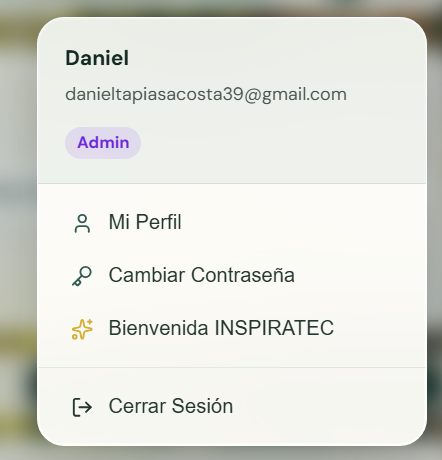

##### Objetivo
Proporcionar acceso inmediato y unificado a la información de identidad del docente, credenciales institucionales, cambio de contraseña, invocación de la guía de bienvenida y desconexión segura (Logout).

##### Descripción general
Popover flotante desacoplado montado mediante `createPortal` sobre `document.body` con cálculo reactivo de posición (`top`, `bottom`, `left`, `right`) según el viewport. Presenta acabado en cristal esmerilado translúcido marfil (`rgba(255, 254, 250, 0.94)`, `backdrop-filter: blur(20px)` y sombra `0 12px 32px rgba(16, 36, 32, 0.16)`).

Se estructura en tres zonas:
1. **Encabezado de Identidad:** Nombre del docente (*Daniel*), correo electrónico verificado (*danieltapiasacosta39@gmail.com*) y badge redondeado con el rol asignado (*Admin* en violeta o *Docente* en salvia).
2. **Cuerpo de Acciones de Cuenta:** Tres opciones tabulares interactivas con iconos representativos:
   - *"Mi Perfil"* (icono `User` en verde petróleo): Abre el modal de información del docente.
   - *"Cambiar Contraseña"* (icono `Key` en verde petróleo): Abre el modal de cambio de clave.
   - *"Bienvenida INSPIRATEC"* (icono `Sparkles` en dorado `#D4AF37`): Dispara el evento global `open-bienvenida`.
3. **Pie de Seguridad:** Botón delimitado con línea tenue *"Cerrar Sesión"* (icono `LogOut` en rojo carmesí `#DC2626`).

##### Tabla de elementos

| Elemento | Descripción |
|---|---|
| **Nombre de la ventana** | Apartado de Usuario — Menú Popover (`UserMenu.jsx`) |
| **Imagen** | Captura real: [`docs/evidencias/ACT-009/M05_menu_usuario.png`](docs/evidencias/ACT-009/M05_menu_usuario.png). Iconos Lucide: `User`, `Key`, `Sparkles`, `LogOut`. |
| **Texto** | • Nombre: *"Daniel"*. • Correo: *"danieltapiasacosta39@gmail.com"*. • Badge: *"Admin"*. • Opciones: *"Mi Perfil"*, *"Cambiar Contraseña"*, *"Bienvenida INSPIRATEC"*, *"Cerrar Sesión"*. |
| **Audio** | No se identificaron archivos de audio en este menú. |
| **Video** | No se identificaron archivos de video en este menú. |
| **Animación** | • Transición de escala y opacidad al abrirse (`initial={{ opacity: 0, scale: 0.96 }}`) mediante `framer-motion`. • Efecto hover con fondo tenue al pasar el cursor sobre cada opción. |
| **Acciones del usuario** | • Clic en el avatar superior para alternar la apertura/cierre del popover. • Clic en *"Mi Perfil"*: abre `ProfileModal`. • Clic en *"Cambiar Contraseña"*: abre `PasswordModal`. • Clic en *"Bienvenida INSPIRATEC"*: emite `open-bienvenida`. • Clic en *"Cerrar Sesión"*: ejecuta `logoutUser()`, revoca tokens y redirige a `/auth`. • Clic fuera del popover o tecla `Escape` para cerrar. |
| **Botones** | • Disparador de avatar con inicial (`user-menu-btn`). • 3 botones de opción de cuenta (`user-menu-item-glass`). • Botón peligroso *"Cerrar Sesión"*. |
| **Navegación** | • Invocación de modales de perfil y contraseña en la misma vista. • Redirección a `/auth` tras cerrar sesión. |

---

#### Modal M06: Ventana Emergente de Información del Docente (`ProfileModal` en `UserMenu.jsx`)

##### Imagen de la ventana
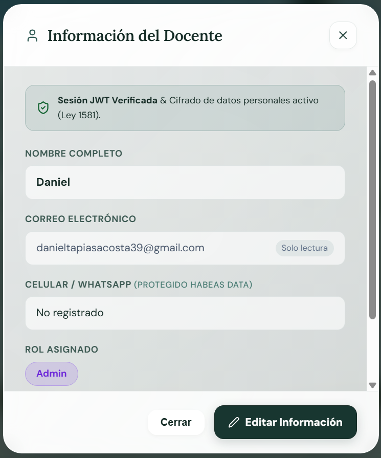

##### Objetivo
Permitir al docente consultar y actualizar sus datos de identificación personal, correo y contacto móvil, certificando la verificación de sesión JWT y el amparo estricto bajo la Ley 1581 de 2012 (Habeas Data).

##### Descripción general
Cuadro de diálogo modal accesible con portal sobre el cuerpo del documento, telón de fondo oscuro semitransparente con desenfoque de cristal (`backdrop-filter: blur(8px)`).

Estructura de la ventana:
- **Cabecera del Diálogo:** Icono `<User size={20}>`, título en `Lora` *"Información del Docente"* y botón de cierre `<X>`.
- **Banner de Seguridad y Protección:** Caja esmeralda suave con icono `<ShieldCheck size={16}>` y leyenda *"Sesión JWT Verificada & Cifrado de datos personales activo (Ley 1581)"*.
- **Campos del Perfil Docente:**
  - *NOMBRE COMPLETO:* Input accesible con el nombre registrado (*Daniel*).
  - *CORREO ELECTRÓNICO:* Campo protegido con badge *"Solo lectura"* (*danieltapiasacosta39@gmail.com*).
  - *CELULAR / WHATSAPP (PROTEGIDO HABEAS DATA):* Campo de contacto (*No registrado* o número telefónico cifrado).
  - *ROL ASIGNADO:* Badge estilizado (*Admin* en violeta o *Docente* en salvia).
- **Botonera Inferior:** Botón secundario *"Cerrar"* y botón primario *"Editar Información"* (icono `Edit2`/`PenSquare`). Al activar la edición, conmuta a *"Guardar Cambios"* con persistencia en Firestore.

##### Tabla de elementos

| Elemento | Descripción |
|---|---|
| **Nombre de la ventana** | Ventana Emergente — Información del Docente (`ProfileModal`) |
| **Imagen** | Captura real: [`docs/evidencias/ACT-009/M06_informacion_docente.png`](docs/evidencias/ACT-009/M06_informacion_docente.png). Iconos Lucide: `User`, `X`, `ShieldCheck`, `Edit2`. |
| **Texto** | • Título: *"Información del Docente"* (fuente `Lora`, 22px). • Banner: *"Sesión JWT Verificada & Cifrado de datos personales activo (Ley 1581)."* • Etiquetas: *"NOMBRE COMPLETO"*, *"CORREO ELECTRÓNICO"*, *"CELULAR / WHATSAPP (PROTEGIDO HABEAS DATA)"*, *"ROL ASIGNADO"*. • Badges: *"Solo lectura"*, *"Admin"*. • Botones: *"Cerrar"*, *"Editar Información"*. |
| **Audio** | No se identificaron archivos de audio en este modal. |
| **Video** | No se identificaron archivos de video en este modal. |
| **Animación** | • Transición suave de entrada con desvanecimiento y escala (`framer-motion`). • Conmutación fluida entre modo visualización y modo edición de campos. |
| **Acciones del usuario** | • Inspección de los datos de sesión y estado de Habeas Data. • Clic en *"Editar Información"*: habilita los campos editables. • Escribir el nuevo nombre o celular y pulsar *"Guardar Cambios"*: despacha `updateUserProfile()` hacia Firestore. • Clic en *"Cerrar"* o en `<X>` para salir del diálogo. |
| **Botones** | • Botón de cierre `<X>`. • Botón secundario *"Cerrar"*. • Botón primario *"Editar Información"* / *"Guardar Cambios"*. |
| **Navegación** | • Diálogo modal en capa superior; no altera la ruta URL del navegador. |

---

#### Modal M07: Ventana Emergente de Cambio de Contraseña (`PasswordModal` en `UserMenu.jsx`)

##### Imagen de la ventana
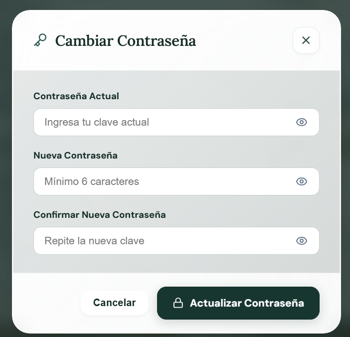

##### Objetivo
Proveer un canal criptográficamente seguro para la renovación periódica de credenciales de acceso docente mediante reautenticación en Firebase Authentication.

##### Descripción general
Ventana modal centrada de alta seguridad montada con `createPortal`. Presenta superficie de cristal marfil con radio redondeado de 24px, sombra perimetral y las siguientes áreas:
- **Cabecera de Seguridad:** Icono de llave `<Key size={20}>`, título en `Lora` *"Cambiar Contraseña"* y botón de cierre `<X>`.
- **Formulario de Renovación de Clave:**
  - Campo *"Contraseña Actual"*: input protegido con placeholder *"Ingresa tu clave actual"* y botón conmutador de visibilidad (`Eye`/`EyeOff`).
  - Campo *"Nueva Contraseña"*: input protegido con placeholder *"Mínimo 6 caracteres"* y toggle de visibilidad.
  - Campo *"Confirmar Nueva Contraseña"*: input protegido con placeholder *"Repite la nueva clave"* y toggle de visibilidad.
- **Validaciones en Tiempo Real:** Detección de coincidencia de claves, longitud mínima y alertas de seguridad.
- **Botonera de Control:** Botón secundario *"Cancelar"* y botón primario *"Actualizar Contraseña"* con icono de candado (`Lock`) y spinner durante el despacho hacia Firebase.

##### Tabla de elementos

| Elemento | Descripción |
|---|---|
| **Nombre de la ventana** | Ventana Emergente — Cambiar Contraseña (`PasswordModal`) |
| **Imagen** | Captura real: [`docs/evidencias/ACT-009/M07_cambiar_contrasena.png`](docs/evidencias/ACT-009/M07_cambiar_contrasena.png). Iconos Lucide: `Key`, `X`, `Eye`, `EyeOff`, `Lock`, `Loader2`. |
| **Texto** | • Título: *"Cambiar Contraseña"* (fuente `Lora`, 22px). • Etiquetas: *"Contraseña Actual"*, *"Nueva Contraseña"*, *"Confirmar Nueva Contraseña"*. • Placeholders: *"Ingresa tu clave actual"*, *"Mínimo 6 caracteres"*, *"Repite la nueva clave"*. • Botones: *"Cancelar"*, *"Actualizar Contraseña"*. |
| **Audio** | No se identificaron archivos de audio en este modal. |
| **Video** | No se identificaron archivos de video en este modal. |
| **Animación** | • Transición de escala y desenfoque al montarse en el portal. • Spinner animado `Loader2` durante la reautenticación en Firebase. |
| **Acciones del usuario** | • Diligenciar la contraseña vigente y la nueva clave dos veces. • Alternar la visibilidad de caracteres con los botones de ojo. • Clic en *"Actualizar Contraseña"*: ejecuta `changeUserPassword()`, verifica credenciales en Firebase Auth y emite alerta de éxito. • Clic en *"Cancelar"* o tecla `Escape` para cerrar sin modificar. |
| **Botones** | • Botón de cierre `<X>`. • 3 botones de visibilidad de contraseña (`Eye`/`EyeOff`). • Botón secundario *"Cancelar"*. • Botón primario *"Actualizar Contraseña"* con icono `Lock`. |
| **Navegación** | • Diálogo modal en capa superior; al completarse con éxito cierra automáticamente la ventana emergente. |

---

#### Otros Modales y Cuadros de Diálogo del Sistema

1. **Modal de Calibración Docente (`ModalCalibracionDocente.jsx`):** Activado desde el enlace de la Ventana de Inicio; permite reconfigurar en caliente la metodología institucional (ABP, STEAM, DUA) y los proyectos transversales (PRAE, PESCC).
2. **Modal de Confirmación Segura (`ConfirmModal.jsx`):** Diálogo de seguridad accesible montado con portal para confirmar la eliminación de planes o descarte de borradores.
3. **Modal Visor de Materiales (`MaterialModal.jsx`):** Contenedor emergente de pantalla completa con `iframe sandbox` para probar los juegos interactivos generados en la Biblioteca.

---

## 5. Resumen Consolidado de Recursos Multimedia

- **Tipografías:** `Lora` (Serif editorial para encabezados y métricas) y `DM Sans` (Sans-serif para interfaz, formularios y textos de lectura).
- **Recursos Gráficos:** Fondo animado en pixel art interactivo `FondoPixel.jsx` (SVG), más de 35 iconos vectoriales `lucide-react` y paneles de cristal translúcido (*Glassmorphism*).
- **Audio y Accesibilidad:** Síntesis vocal en español mediante la Web Speech API (`SpeechSynthesisUtterance`) en los juegos didácticos interactivos generados.
- **Animaciones:** Transiciones CSS suaves, efectos hover de elevación en tarjetas, pulso en indicadores de estado de la IA y dinámicas SVG de personajes en el fondo.

---

## 6. Validación de Criterios y Trazabilidad

| Criterio MODESEC | Estado | Justificación Comprobable |
|---|---|---|
| **Inventario Exhaustivo** | Verificado | Se documentaron las 15 ventanas principales y los 5 modales emergentes existentes en el código. |
| **Capturas Reales** | Verificado | Incorporadas imágenes de alta fidelidad tomadas del software en ejecución en `docs/evidencias/ACT-009/`. |
| **Trazabilidad de Código** | Verificado | Todos los elementos corresponden a archivos JSX en `src/pages/`, `src/components/` y estilos en `src/index.css`. |
| **Sin Invenciones** | Verificado | La ausencia de audio/video en pantallas estáticas se declara explícitamente según lo inspeccionado. |
| **Consistencia Visual** | Verificado | Respeta la estética Glassmorphism 2026, paleta verde salvia/petróleo y tipografía dual Lora/DM Sans. |
