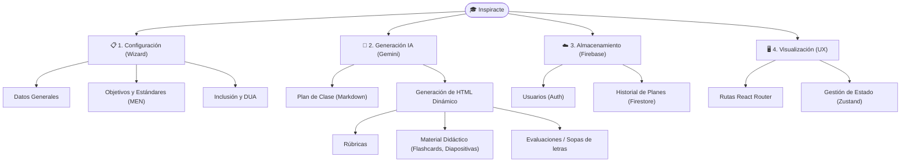

# Diagrama de Contenidos del Proyecto

## Proyecto
**Inspiracte — Plataforma Educativa Asistida por IA**

## Propósito
Representar la organización conceptual de los contenidos e instrumentos de evaluación del sistema, estructurados para el andamiaje docente (Guía 30 del MEN y otras áreas).

---

## Estructura Jerárquica

```
Inspiracte
│
├── 1. CONFIGURACIÓN INICIAL (WIZARD)
│   ├── Datos de Clase (Tema, Grado, Materia, Duración)
│   ├── Enfoque Pedagógico (Objetivos, Estándares, Metodología STEAM)
│   └── Inclusión (Adaptaciones DUA, Contexto Aula)
│
├── 2. GENERACIÓN CON IA (GEMINI)
│   ├── Plan de Clase Estructurado (Markdown)
│   └── Material Complementario
│       ├── Rúbricas HTML
│       ├── Diapositivas
│       ├── Sopas de Letras (Juegos)
│       ├── Cuestionarios / Evaluaciones
│       ├── Flashcards
│       └── Juegos de Roles / Talleres
│
├── 3. ALMACENAMIENTO (FIREBASE)
│   ├── Auth (Usuarios Docentes)
│   └── Firestore (Historial de Planes, Plantillas Institucionales)
│
└── 4. VISUALIZACIÓN Y UX
    ├── Rutas de Aplicación (React Router)
    ├── Estado Global (Zustand)
    └── Animaciones y Estilos (Framer Motion, CSS)
```

---

## Representación Visual en Mermaid


