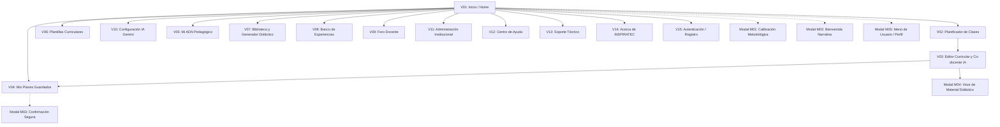
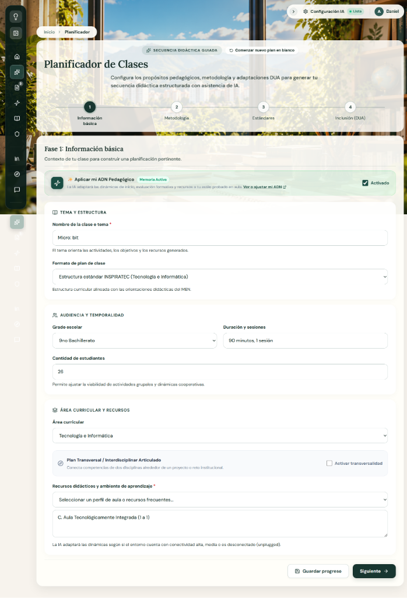
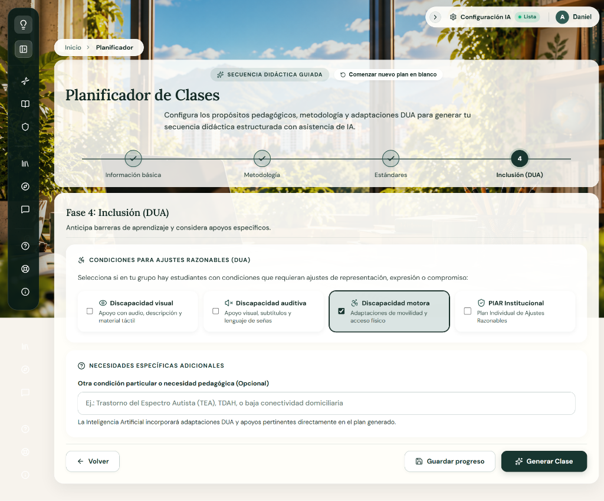
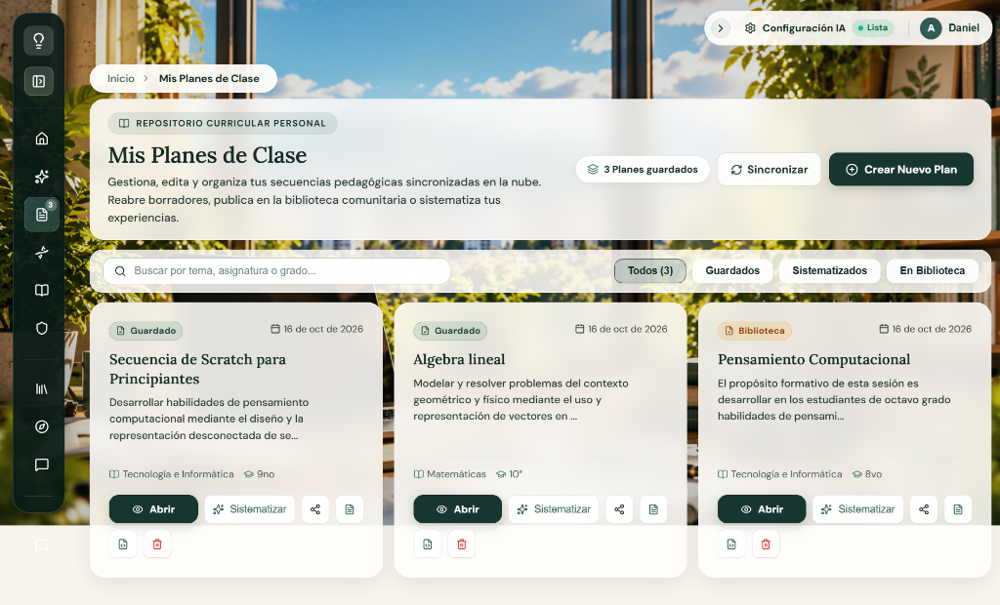
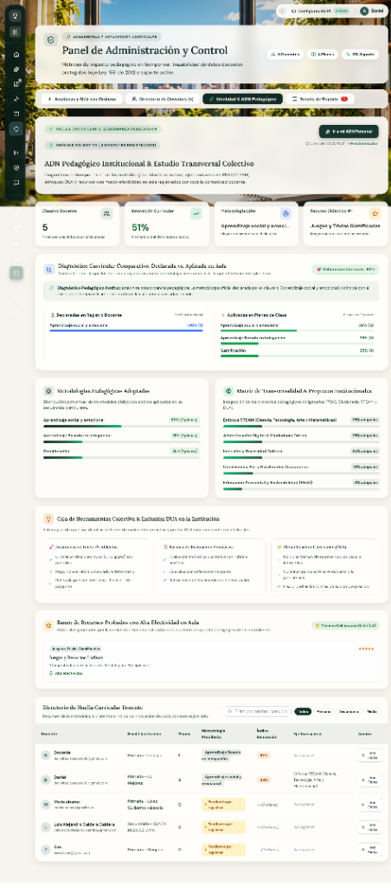
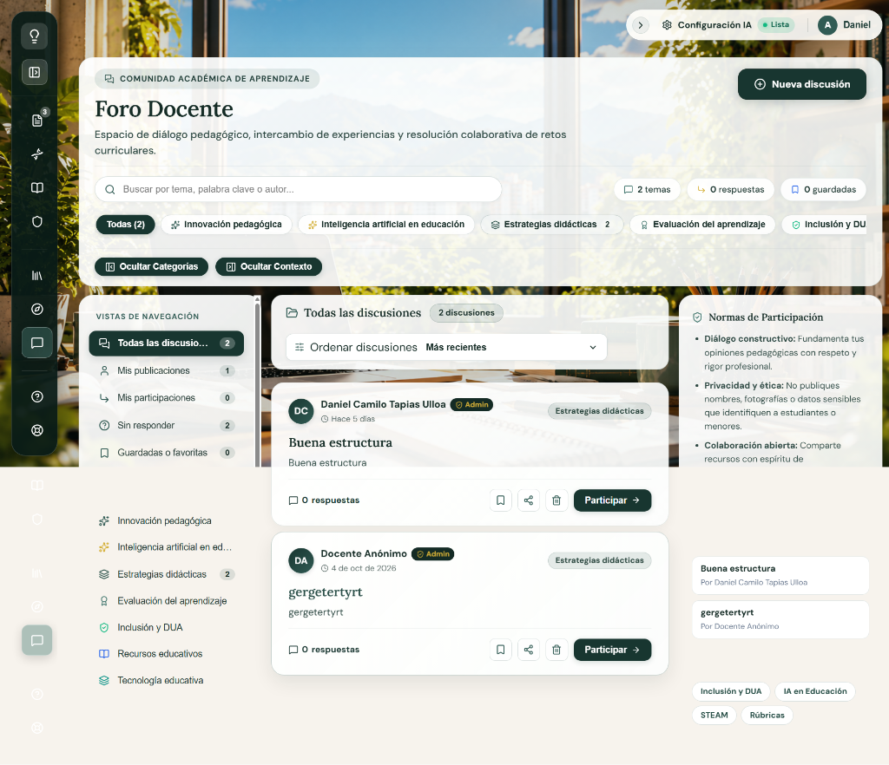
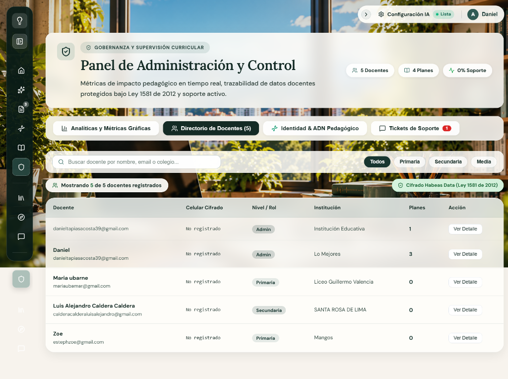

# GUION TÉCNICO MULTIMEDIAL — INSPIRATEC
## Ecosistema Digital de Andamiaje Pedagógico y Co-diseño Curricular con IA

---

### Portada y Control de Versión del Documento

| Campo Institucional | Detalle Oficial |
|---|---|
| **Proyecto:** | INSPIRATEC — Software Educativo para la Planificación Curricular y Andamiaje Docente |
| **Código de Actividad:** | ACT-010 (Actividad 8 del Cronograma de Trabajo) |
| **Documento:** | Guion Técnico Multimedial del Frontend |
| **Versión del Software:** | 1.0.0 (Producción React 18 + Vite + Glassmorphism 2026) |
| **Fecha de Emisión:** | Octubre de 2026 |
| **Estado:** | Completado y Verificado sobre el Código Fuente Real |
| **Marco Metodológico:** | MODESEC (Fase II — Diseño Educativo y Multimedial) / Guía 30 MEN / DUA (CAST 2018) |
| **Equipo de Desarrollo:** | Daniel Tapias, Luis Caldera, Zoe Peñata, Maira Ortega, María Soto, María Ubarne |

---

## 1. Objetivo y Alcance

### 1.1 Objetivo General
Documentar formalmente y de forma exhaustiva la arquitectura gráfica, componentes de interfaz de usuario (UI), elementos multimedia, comportamientos interactivos y disparadores de eventos del software educativo **INSPIRATEC**, inspeccionando la aplicación **ventana por ventana**, desde la pantalla de entrada hasta el último módulo funcional y diálogo modal, con base exclusiva en el código fuente implementado, las hojas de estilo vigentes y la ejecución en tiempo real del sistema.

### 1.2 Alcance Técnico
El presente guion técnico cubre:
1. **La totalidad de las 15 ventanas/rutas principales** registradas en el enrutador central `src/App.jsx`.
2. **Los 5 cuadros de diálogo y ventanas modales emergentes** montados a través de portales (`createPortal`) y escuchadores de eventos globales.
3. **El sistema de diseño visual unificado:** Tokens tipográficos (`Lora`, `DM Sans`), paleta cromática basada en HSL/Hexadecimal, tratamientos *Glassmorphism* canónicos de alto contraste (`rgba(255, 254, 250, 0.86)` con `backdrop-filter: blur(16px)`), sombras perimetrales y radios de curvatura.
4. **Los recursos multimedia reales:** Elementos vectoriales SVG pixel art animados (`FondoPixel.jsx`), banco de iconografía interactiva (`lucide-react`), audios sintetizados mediante la Web Speech API en materiales didácticos, e incrustaciones interactivas seguras en `iframe sandbox`.
5. **La matriz técnica estructurada en seis columnas:**
   $$\text{Ventana} \;\mid\; \text{Elemento} \;\mid\; \text{Descripción} \;\mid\; \text{Formato / Fuente} \;\mid\; \text{Acción} \;\mid\; \text{Evento}$$

---

## 2. Metodología de Inspección y Criterios de Rigor

Para garantizar que **no se invente ninguna pantalla, recurso o interacción**, se ejecutó la siguiente metodología de auditoría directa:
1. **Inspección de Enrutamiento y Estados:** Análisis estático de `src/App.jsx`, verificando rutas `<Route>`, enlaces de navegación `<NavLink>`, y guardas de autenticación en `src/store/useAppStore.js`.
2. **Inspección de Vistas y Componentes JSX:** Auditoría detallada de cada archivo en `src/pages/` y `src/components/`, registrando propiedades visuales, textos visibles, placeholders, manejadores de eventos (`onClick`, `onChange`, `onSubmit`, `onKeyDown`, `onMouseEnter`) y enlaces de navegación con `useNavigate()`.
3. **Inspección del Sistema de Estilos:** Trazabilidad de clases en `src/index.css` y `src/styles/ui.css`, verificando tokens CSS (`--font-heading`, `--font-main`, `--color-brand-primary`, `--glass-bg-ambient`).
4. **Verificación en Ejecución Activa:** Ejecución del entorno local en `http://localhost:5173`, validando las transiciones de estado, modales, alertas y captura fotográfica de las vistas reales.

---

## 3. Inventario General de Ventanas y Estados de la Aplicación

La aplicación organiza la experiencia docente en una arquitectura modular compuesta por **15 ventanas independientes** y **5 modales/diálogos globales**:

### Tabla de Inventario de Ventanas

| N.° | Identificador | Ruta / Trigger | Componente Fuente | Función Principal |
|:---:|---|---|---|---|
| 1 | **Ventana de Inicio** | `/home` | `src/pages/HomePage.jsx` | Espacio curricular docente, bienvenida, métricas y modelos pedagógicos. |
| 2 | **Planificador de Clases** | `/` | `src/pages/WizardPage.jsx` | Asistente curricular guiado en 4 fases tripartitas con asistencia IA. |
| 3 | **Editor Curricular** | `/editor` | `src/pages/EditorPage.jsx` | Lienzo estructurado WYSIWYG/Markdown y co-docente socrático IA en tiempo real. |
| 4 | **Mis Planes Guardados** | `/mis-planes` | `src/pages/MisPlanesPage.jsx` | Gestor del historial docente, duplicación, filtrado y exportación de secuencias. |
| 5 | **Mi ADN Pedagógico** | `/adn-pedagogico` | `src/pages/AdnPedagogicoPage.jsx` | Caracterización de estilo de enseñanza según modelo de Felder-Silverman. |
| 6 | **Plantillas Curriculares** | `/plantillas` | `src/pages/PlantillasPage.jsx` | Catálogo de estructuras institucionales (DUA, ABP, STEAM, Tradicional). |
| 7 | **Biblioteca de Recursos** | `/biblioteca` | `src/pages/BibliotecaPage.jsx` | Repositorio de recursos y generador de materiales didácticos multimedia. |
| 8 | **Banco de Experiencias** | `/experiencias` | `src/pages/ExperienciasPage.jsx` | Muro colaborativo de secuencias de clase compartidas con valoración entre pares. |
| 9 | **Foro Docente** | `/foro` | `src/pages/ForoPage.jsx` | Espacio dialógico de debate pedagógico y resolución comunitaria de dudas. |
| 10 | **Configuración IA** | `/config` | `src/pages/ConfigPage.jsx` | Gestión de API Key de Google Gemini, modelo LLM, temperatura y conectividad. |
| 11 | **Administración** | `/administracion` | `src/pages/AdministracionPage.jsx` | Tablero de analíticas institucionales, adopción DUA y métricas de producción. |
| 12 | **Centro de Ayuda** | `/ayuda` | `src/pages/AyudaPage.jsx` | Manuales de usuario, glosario conceptual y preguntas frecuentes (FAQ). |
| 13 | **Soporte Técnico** | `/soporte` | `src/pages/SoportePage.jsx` | Formulario de reporte de incidencias técnicas y diagnóstico de conexión. |
| 14 | **Acerca de INSPIRATEC** | `/acerca` | `src/pages/AboutPage.jsx` | Créditos académicos, marco teórico MODESEC e información institucional. |
| 15 | **Acceso y Registro** | `/auth` | `src/pages/AuthPage.jsx` | Formulario de autenticación con Firebase (correo/contraseña y Google OAuth). |
| M1 | **Modal Calibración** | `open-calibracion-docente` | `src/components/ModalCalibracionDocente.jsx` | Ventana emergente para ajustar metodología institucional y proyecto transversal. |
| M2 | **Bienvenida Narrativa** | Primer inicio de sesión | `src/components/BienvenidaNarrativa.jsx` | Ventana modal de inducción pedagógica interactiva. |
| M3 | **Confirmación Segura** | Acciones destructivas | `src/components/ConfirmModal.jsx` | Diálogo modal accesible para confirmar eliminación de planes o restablecimiento. |
| M4 | **Visor de Materiales** | Ejecución de recurso | `src/components/MaterialModal.jsx` | Contenedor modal con `iframe` aislado para juegos y fichas interactivas. |
| M5 | **Menú de Usuario** | Click en avatar superior | `src/components/UserMenu.jsx` | Popover desplegable para cerrar sesión, ver perfil y alternar roles. |

---

## 4. Documentación Técnica Detallada Ventana por Ventana

---

### VENTANA 1 — Ventana de Inicio (`HomePage.jsx`)

#### 1.1 Captura de Pantalla Real

#### 1.2 Descripción Funcional y Arquitectura Visual
La **Ventana de Inicio** (`/home`) actúa como el centro de mando pedagógico del docente. Presenta un lienzo inmersivo con el fondo pixel art interactivo `FondoPixel.jsx` difuminado por capas de vidrio esmerilado (*Glassmorphism* canónico: fondo marfil translúcido `rgba(255, 254, 250, 0.86)`, desenfoque `blur(16px)`, borde blanco perimetral de 1px y sombra suave). Se organiza en tres franjas visuales:
1. **Panel Editorial de Bienvenida:** Saludo personalizado, principios formativos DUA/IA, botones de llamada a la acción principal y cápsula de metodología institucional activa con disparador al modal de calibración.
2. **Franja de Métricas y Estado:** Dos tarjetas interactivas que reflejan el volumen de planes guardados y la verificación del estado de conexión con la IA de Google Gemini.
3. **Catálogo de Modelos de Secuencia Curricular:** Cuadrícula con las plantillas curriculares preconfiguradas y acción directa para transferir la estructura al planificador.

#### 1.3 Registro Técnico de Elementos (Formato Institucional)

| Ventana | Elemento | Descripción | Formato / Fuente | Acción | Evento |
|---|---|---|---|---|---|
| **Inicio** | `FondoPixel` | Fondo interactivo animado de aula en pixel art con docentes, estudiantes y robots dialogando. | SVG vectorial reactivo / `src/components/FondoPixel.jsx` | Ejecuta ciclos de animación de personajes caminando y escribiendo en el tablero. | Carga inicial del componente (`useEffect`, `requestAnimationFrame`). |
| **Inicio** | Menú Lateral Flotante | Barra lateral de navegación con accesos a los 11 módulos del software e identidad institucional. | Componente `<aside>` Glassmorphism / `src/App.jsx` | Expande o contrae la barra; permite navegar entre todas las rutas del sistema. | `onClick` sobre el botón `ChevronLeft`/`ChevronRight` o sobre los ítems `<NavLink>`. |
| **Inicio** | Barra Superior de Utilidades | Barra compacta en la esquina superior derecha con estado del servicio de IA y avatar del docente. | Componente `<header>` / `src/App.jsx` | Permite contraer/expandir utilidades y navegar rápidamente a `/config` o abrir el menú de cuenta. | `onClick` en botón colapsable o en píldora de usuario (`UserMenu`). |
| **Inicio** | Badge "Espacio Curricular Docente" | Insignia superior con icono de chispas que contextualiza el área de trabajo profesional. | Etiqueta `
` con icono `<Sparkles size={13}>` / Color `#1C3A34`, fondo `rgba(71, 122, 114, 0.14)` | Elemento informativo y decorativo de marca pedagógica. | Estático (renderizado al montar). |
| **Inicio** | Título de Bienvenida | Encabezado principal H1: *"Bienvenido, {userProfile.nombre}"* con tipografía serif editorial de alta legibilidad. | Texto dinámico / Fuente `Lora, serif`, peso 700, color `#142B25`, tamaño 28px | Muestra el nombre real del docente obtenido del estado global o predeterminado "Docente". | Actualización reactiva ante cambios en `useAppStore`. |
| **Inicio** | Párrafo Editorial | Texto descriptivo sobre el co-diseño curricular asistido por IA y principios DUA. | Texto estático / Fuente `DM Sans`, peso 500, color `#243630`, tamaño 14.5px | Comunica la intencionalidad formativa y ética de soberanía docente. | Estático. |
| **Inicio** | Botón "Iniciar Planificador de Clases" | Botón primario verde oscuro con icono de suma para comenzar una nueva secuencia didáctica. | Botón HTML `<button>` / Icono `<PlusCircle size={18}>`, fondo `#183630`, color `#FFFFFF` | Limpia el borrador previo del formulario (`clearWizardFormOnly`) y redirige a la ruta `/`. | `onClick`. |
| **Inicio** | Botón "Ver Plantillas Curriculares" | Botón secundario traslúcido con icono de libro abierto para explorar formatos didácticos. | Botón HTML `<button>` / Icono `<BookOpen size={16}>`, fondo `rgba(255, 255, 255, 0.65)` | Redirige al catálogo general de plantillas en la ruta `/plantillas`. | `onClick`. |
| **Inicio** | Píldora "Metodología Institucional" | Cápsula verde con icono ADN que exhibe la metodología activa predeterminada (ej. ABP, STEAM). | Contenedor `
` con icono `<Dna size={13}>` / Color `#166534`, fondo `rgba(22, 163, 74, 0.12)` | Exhibe el enfoque metodológico vigente vinculado al perfil del docente. | Reactivo al cambio en `userProfile.metodologiaInstitucional`. |
| **Inicio** | Enlace "Calibrar / Cambiar" | Botón de texto subrayado adyacente a la metodología institucional. | Botón accesible `<button type="button">` / Color `#166534`, peso 700 | Emite el evento personalizado `open-calibracion-docente` en la ventana del navegador. | `onClick` activa `window.dispatchEvent(new Event('open-calibracion-docente'))`. |
| **Inicio** | Alerta "Configuración de Clave IA" | Mensaje de advertencia de color naranja visible únicamente si no existe clave de Gemini configurada. | Contenedor `
` con icono `<AlertTriangle size={14}>` / Fondo naranja tenue | Notifica la necesidad de configurar la API Key y provee un enlace directo a `/config`. | `onClick` en el enlace interno redirige a `/config`. Condicionado por `!apiKey`. |
| **Inicio** | Tarjeta Métrica "Mis Planes Guardados" | Panel tipo tarjeta que exhibe el conteo numérico de planes creados por el docente. | Tarjeta interactiva / Fondo marfil translúcido, icono `<FileText size={18}>`, valor numérico H2 | Muestra el total de planes (`planesCount`) y al presionarla navega al historial. | `onClick` navega a `/mis-planes`. Efectos `onMouseEnter` / `onMouseLeave`. |
| **Inicio** | Tarjeta Estado "Asistente Pedagógico (Gemini)" | Panel tipo tarjeta que exhibe la disponibilidad del servicio LLM con indicador de semáforo. | Tarjeta interactiva / Icono `<Settings size={18}>`, punto verde/naranja | Informa si el servicio está activo o pendiente y redirige a la consola de credenciales. | `onClick` navega a `/config`. Efectos `onMouseEnter` / `onMouseLeave`. |
| **Inicio** | Título de Sección "Modelos de Secuencia Curricular" | Encabezado H2 que introduce la galería de estructuras predeterminadas y botón de gestión. | Texto tipográfico / Fuente `Lora, serif`, color `#315B54`, tamaño 20px | Introduce el catálogo de plantillas curriculares oficiales del MEN e institucionales. | Estático. |
| **Inicio** | Botón "Gestionar plantillas" | Botón secundario con flecha hacia la derecha para ir a la biblioteca de formatos. | Botón HTML `<button>` / Icono `<ArrowRight size={14}>` | Redirige al catálogo extendido en `/plantillas`. | `onClick`. |
| **Inicio** | Tarjetas de Modelos Curriculares | Galería en cuadrícula (grid) de 6 plantillas de secuencia (Matemáticas, Ciencias, Sociales, etc.). | Tarjetas interactivas / `src/services/templates/genericTemplates.js` | Cada tarjeta resume la estructura; al hacer clic transfiere los datos al wizard y navega a `/`. | `onClick` ejecuta `handleUsarPlantilla(tpl)`. Animaciones `translateY(-2px)` en `hover`. |
| **Inicio** | Enlace "Transferir al planificador" | Pie interactivo de cada tarjeta de modelo con texto y flecha indicadora. | Contenedor `
` con icono `<ArrowRight size={14}>` / Color `#315B54` | Indica visualmente que la tarjeta es un disparador de transferencia de datos hacia el generador. | Hereda el `onClick` de la tarjeta contenedora. |

---

### VENTANA 2 — Planificador de Clases — Asistente Curricular Tripartito (`WizardPage.jsx`)

#### 2.1 Capturas de Pantalla Reales de las Fases del Wizard y Grafo Curricular

| Fase 1: Información básica | Fase 2: Metodología |
|:---:|:---:|
|  |  |

| Fase 3: Estándares | Fase 4: Inclusión (DUA) |
|:---:|:---:|
|  |  |

| Componente Extendido: Grafo Interactivo de Prerrequisitos Curriculares (MEN) |
|:---:|
|  |

#### 2.2 Descripción Funcional y Arquitectura Visual
El **Planificador de Clases** (`/`) es el núcleo de andamiaje pedagógico del software. Implementa un asistente (*wizard*) secuencial de 4 fases alineado estrictamente con los momentos de la clase recomendados por la Guía 30 del MEN y los principios DUA (Múltiples formas de implicación, representación, acción y expresión):
- **Fase 1 — Información básica:** Tema de clase (Micro:bit), formato de plan predeterminado, audiencia (grado 9no, 90 minutos, 26 estudiantes), área (*Tecnología e Informática*), opción de transversalidad y recursos didácticos (*Aula Tecnológicamente Integrada 1 a 1*). Incorpora el banner de activación del **ADN Pedagógico** con memoria activa.
- **Fase 2 — Metodología:** Selección de la metodología prioritaria (*Aprendizaje Basado en Proyectos - ABPro*), redacción de objetivos de aprendizaje competenciales y botón de asistencia generativa *"Sugerir con IA"*.
- **Fase 3 — Estándares:** Articulación con los Estándares Básicos de Competencias y DBA del MEN. Integra el botón para abrir el **Grafo Interactivo de Prerrequisitos Curriculares** y el botón *"Sugerir estándares"*.
- **Fase 4 — Inclusión (DUA):** Matriz de selección múltiple con 4 tarjetas para condiciones de ajustes razonables (*Discapacidad visual*, *Discapacidad auditiva*, *Discapacidad motora* y *PIAR Institucional*), más campo opcional para condiciones específicas (TEA, TDAH) y botón final de generación.
- **Grafo Interactivo de Prerrequisitos Curriculares (`CurricularGraphViewer.jsx`):** Red interactiva ontológica estructurada en 5 columnas por ciclo de grado (1° a 3°, 4° a 5°, 6° a 7°, 8° a 9°, 10° a 11°), con filtros, controles de zoom (85%) y nodos transferibles al formulario.

#### 2.3 Registro Técnico de Elementos (Formato Institucional de 6 Columnas)

| Ventana | Elemento | Descripción | Formato / Fuente | Acción | Evento |
|---|---|---|---|---|---|
| **Planificador** | Migas de Pan (Breadcrumbs) | Navegación jerárquica *"Inicio > Planificador"*. | Componente visual / `src/pages/WizardPage.jsx` | Permite regresar con un clic a la vista `/home`. | `onClick` sobre el enlace "Inicio". |
| **Planificador** | Badge "Secuencia Didáctica Guiada" | Píldora superior que identifica el modo de planificación guiada. | Badge Glassmorphism con icono `<Sparkles size={13}>` | Elemento informativo de contexto formativo. | Estático. |
| **Planificador** | Botón "Comenzar nuevo plan en blanco" | Botón en cabecera con icono de reinicio para vaciar los campos del asistente. | Botón HTML `<button>` / Icono `<RotateCcw size={14}>` | Ejecuta `clearWizardFormOnly()` tras confirmación del usuario. | `onClick`. |
| **Planificador** | Stepper de 4 Pasos | Indicador horizontal con números de paso y etiquetas: *1. Información básica*, *2. Metodología*, *3. Estándares*, *4. Inclusión (DUA)*. | Componente horizontal / Clases `.wizard-stepper`, `.step-indicator` | Permite visualizar el avance y retornar a fases previas ya validadas. | `onClick` sobre los pasos habilitados. |
| **Planificador** | Banner "Aplicar mi ADN Pedagógico" | Tarjeta verde suave con badge "Memoria Activa" y switch de estado. | Contenedor interactivo con icono `<Sparkles>` | Activa o desactiva la inyección del perfil de Felder-Silverman en el prompt de la IA. | `onClick` conmuta el estado `aplicarAdnActivo`. |
| **Planificador** | Enlace "Ver o ajustar mi ADN ↗" | Enlace rápido dentro del banner de ADN pedagógico. | Enlace de texto subrayado / Icono `<ExternalLink size={12}>` | Redirige al docente a `/adn-pedagogico` para calibrar su cuestionario. | `onClick`. |
| **Planificador** | Campo "Nombre de la clase o tema *" | Input de texto obligatorio para titular la secuencia (ej. "Micro: bit"). | Input HTML `<input type="text" required>` | Define el núcleo temático de la sesión en el borrador en memoria. | `onChange` actualiza `wizardData.tema`. |
| **Planificador** | Selector "Formato de plan de clase" | Menú desplegable con las estructuras pedagógicas disponibles. | Control `<select>` / `src/pages/WizardPage.jsx` | Selecciona la plantilla curricular base (ej. Estructura estándar INSPIRATEC). | `onChange` actualiza `wizardData.formato`. |
| **Planificador** | Selector "Grado escolar" | Desplegable de ciclos educativos (ej. "9no Bachillerato"). | Control `<select>` / `src/pages/WizardPage.jsx` | Define el nivel formativo del grupo y ajusta los estándares curriculares del MEN. | `onChange` actualiza `wizardData.grado`. |
| **Planificador** | Campo "Duración y sesiones" | Input de texto para la temporalidad (ej. "90 minutos, 1 sesión"). | Input HTML `<input type="text">` | Registra el tiempo estimado para la ejecución de la secuencia didáctica. | `onChange` actualiza `wizardData.duracion`. |
| **Planificador** | Campo "Cantidad de estudiantes" | Input numérico para registrar el aforo de aula (ej. "26"). | Input HTML `<input type="number">` | Modela la viabilidad de actividades grupales y dinámicas cooperativas. | `onChange` actualiza `wizardData.estudiantes`. |
| **Planificador** | Selector "Área curricular" | Desplegable de asignaturas principales (*Tecnología e Informática*, etc.). | Control `<select>` / `src/pages/WizardPage.jsx` | Establece el dominio temático y filtra los estándares curriculares del MEN. | `onChange` actualiza `wizardData.materia`. |
| **Planificador** | Checkbox "Plan Transversal Articulado" | Casilla interactiva para proyectos interdisciplinares (PRAE, PESCC). | Control `<input type="checkbox">` | Habilita campos secundarios para vincular competencias de dos áreas. | `onChange` conmuta `wizardData.transversal`. |
| **Planificador** | Selector / Textarea "Recursos didácticos" | Selector de perfiles rápidos y área de texto para el ambiente (ej. "Aula 1 a 1"). | Control mixto `<select>` + `<textarea>` | Especifica los recursos físicos o digitales disponibles en el aula. | `onChange` actualiza `wizardData.recursos`. |
| **Planificador** | Selector "Metodología prioritaria" | Menú desplegable en Fase 2 (*Aprendizaje Basado en Proyectos (ABPro)*, etc.). | Control `<select>` / `src/pages/WizardPage.jsx` | Determina la estrategia activa que guiará los momentos de inicio, desarrollo y cierre. | `onChange` actualiza `wizardData.metodologia`. |
| **Planificador** | Botón "Sugerir con IA" (Metas) | Botón en cabecera de Fase 2 para proponer competencias. | Botón HTML `<button>` / Icono `<Sparkles size={15}>` | Realiza una consulta asíncrona a Gemini para redactar metas de aprendizaje competenciales. | `onClick` ejecuta `handleSugerirMetas()`. |
| **Planificador** | Textarea "Objetivos de Aprendizaje" | Campo multilinea para redactar los desempeños esperados de los estudiantes. | Control `<textarea rows="5">` | Recoge las metas formativas redactadas o sugeridas. | `onChange` actualiza `wizardData.objetivo`. |
| **Planificador** | Botón "Grafo de Prerrequisitos (MEN)" | Botón en Fase 3 para inspeccionar la red ontológica curricular. | Botón HTML `<button>` / Icono `<Share2 size={15}>` | Abre el visualizador interactivo del grafo de competencias del MEN. | `onClick` activa `mostrarGrafoCurricular(true)`. |
| **Planificador** | Botón "Sugerir estándares" | Botón en Fase 3 para autocompletar estándares según el tema y grado. | Botón HTML `<button>` / Icono `<Sparkles size={15}>` | Consulta a la IA los estándares y DBA aplicables de la Guía 30 del MEN. | `onClick` ejecuta `handleSugerirEstandares()`. |
| **Planificador** | Textarea "Estándares Básicos (MEN)" | Campo de texto multilinea con los componentes curriculares oficiales. | Control `<textarea rows="6">` | Contiene los componentes, competencias y evidencias del MEN articulados al plan. | `onChange` actualiza `wizardData.estandares`. |
| **Planificador** | Tarjetas de Ajustes Razonables (DUA) | 4 tarjetas interactivas de selección múltiple con iconos para DUA y PIAR. | Componentes tipo Card con checkboxes / Iconos `Eye`, `VolumeX`, `Accessibility`, `ShieldCheck` | Permite al docente seleccionar qué tipos de barreras de aprendizaje mitigar. | `onClick` conmuta la selección en `wizardData.condicionesDua`. |
| **Planificador** | Campo "Necesidades Específicas" | Input opcional para registrar condiciones particulares (TEA, TDAH). | Input HTML `<input type="text">` | Incorpora adaptaciones pedagógicas contextualizadas en el prompt de la IA. | `onChange` actualiza `wizardData.necesidadesEspecificas`. |
| **Planificador** | Botón "Guardar progreso" | Botón presente en las 4 fases para salvar el borrador intermedio. | Botón HTML `<button>` / Icono `<Save size={15}>` | Serializa el estado actual en Zustand y emite confirmación visual toast. | `onClick` ejecuta `handleGuardarBorrador()`. |
| **Planificador** | Botón "Siguiente →" | Botón primario para avanzar de fase tras validar los campos obligatorios. | Botón HTML `<button>` / Icono `<ArrowRight size={15}>`, fondo `#183630` | Valida los inputs del paso actual y avanza el índice del stepper. | `onClick` ejecuta `handleNextStep()`. |
| **Planificador** | Botón "← Volver" | Botón secundario para regresar al paso inmediatamente anterior. | Botón HTML `<button>` / Icono `<ArrowLeft size={15}>` | Retrocede el índice del stepper sin perder los datos diligenciados. | `onClick` ejecuta `handlePrevStep()`. |
| **Planificador** | Botón "Generar Clase" | Botón de acción final destacado en la Fase 4 con animación y degradado. | Botón HTML `<button>` / Icono `<Sparkles size={18}>`, fondo `#183630` | Compila el contexto completo, envía la petición a Gemini y navega a `/editor`. | `onClick` ejecuta `handleGenerarPlan()`. |
| **Grafo MEN** | Selector de Grado en Grafo | Dropdown en cabecera del visualizador de grafo curricular. | Control `<select>` / `CurricularGraphViewer.jsx` | Filtra los nodos conceptuales por nivel (ej. 8° a 9° Básica Secundaria Avanzada). | `onChange`. |
| **Grafo MEN** | Selector de Eje Temático | Dropdown para acotar los conceptos a un eje disciplinar específico. | Control `<select>` / `CurricularGraphViewer.jsx` | Filtra las conexiones y aristas del grafo según el eje temático seleccionado. | `onChange`. |
| **Grafo MEN** | Controles de Zoom del Grafo | Botonera con Zoom In, porcentaje (85%), Zoom Out y Restablecer. | Botones de icono Lucide (`ZoomIn`, `ZoomOut`, `RotateCcw`) | Escala la matriz de transformación SVG del canvas del grafo. | `onClick`. |
| **Grafo MEN** | Nodos Conceptuales del Grafo | Nodos interactivos con código MEN (ej. `MEN-SOL-4.1 Sensores y robótica`). | Rectángulos SVG accesibles con estados hover y active | Al pulsar un nodo muestra sus prerrequisitos y permite transferirlo al planificador. | `onClick` ejecuta `handleSeleccionarNodo(nodo)`. |

---

### VENTANA 3 — Editor Curricular y Co-docente IA (`EditorPage.jsx`)

#### 3.1 Captura de Pantalla Real

#### 3.2 Descripción Funcional y Arquitectura Visual
El **Editor Curricular** (`/editor`) es el espacio de co-diseño en tiempo real entre el docente y la inteligencia artificial pedagógica. Implementa un diseño de pantalla dividida (*split-screen*):
1. **Lienzo Curricular Principal:** Editor de texto enriquecido/Markdown con barra de herramientas de formato, navegación por secciones, guardado automático cada 30 segundos y botones de exportación rápida (PDF institucional, archivo Markdown descargable e impresión directa).
2. **Panel Lateral de Asistencia Socrática:** Ventana de diálogo permanente con el asistente IA pedagógico de INSPIRATEC. No reemplaza al docente: formula preguntas reflexivas, evalúa la cobertura de principios DUA mediante rúbricas automáticas y propone adaptaciones para estudiantes con necesidades educativas especiales (PIAR).

#### 3.3 Registro Técnico de Elementos

| Ventana | Elemento | Descripción | Formato / Fuente | Acción | Evento |
|---|---|---|---|---|---|
| **Editor** | Lienzo de Edición Markdown | Área principal de edición de texto enriquecido con soporte de encabezados, tablas y listas. | Componente `<textarea>` / Editor Markdown personalizado | Permite al docente reescribir, ajustar y afinar cada componente de su plan de clase. | `onChange` actualiza el contenido y activa temporizador de auto-guardado. |
| **Editor** | Barra de Herramientas de Formato | Botonera superior con acciones rápidas: Negrita, Cursiva, Listas, Tablas, Rúbrica y Citas. | Barra de botones con iconos Lucide (`Bold`, `Italic`, `List`, `Table`) | Inserta la sintaxis Markdown correspondiente en la posición del cursor del editor. | `onClick` sobre cada botón de formato. |
| **Editor** | Botón "Exportar a PDF" | Botón primario con icono de descarga para generar el documento formal de la institución. | Botón HTML `<button>` / Integración con motor de impresión/PDF | Renderiza una vista estilizada sin elementos de UI y genera el archivo PDF para impresión. | `onClick` ejecuta `handleExportarPDF()`. |
| **Editor** | Botón "Guardar Cambios" | Botón con icono de disco que fuerza la sincronización inmediata con la base de datos Firestore. | Botón HTML `<button>` / Icono `<Save size={16}>` | Almacena la versión vigente en Firestore/localStorage y muestra indicador de confirmación. | `onClick` ejecuta `handleGuardarPlan()`. |
| **Editor** | Panel de Co-docente IA | Franja lateral derecha con interfaz de chat pedagógico socrático y sugerencias automáticas. | Panel lateral colapsable Glassmorphism | Recibe consultas del docente y responde con análisis pedagógico y ajustes DUA. | `onSubmit` del formulario de mensaje o clic en botones de andamiaje. |
| **Editor** | Botón "Auditar Cobertura DUA" | Botón de andamiaje rápido en el panel IA para evaluar principios de accesibilidad. | Botón con icono `<Layers size={14}>` | Envía el plan actual a Gemini solicitando una matriz de verificación DUA en 3 niveles. | `onClick` envía mensaje contextualizado al asistente. |
| **Editor** | Botón "Generar Rúbrica de Evaluación" | Botón de acción rápida para formular una matriz analítica con 4 niveles de desempeño. | Botón con icono `<FileCheck size={14}>` | Solicita a la IA una tabla de evaluación con criterios, descriptores y puntajes MEN. | `onClick` concatena la rúbrica al final del plan de clase. |

---

### VENTANA 4 — Gestor de Planes Guardados (`MisPlanesPage.jsx`)

#### 4.1 Captura de Pantalla Real

#### 4.2 Descripción Funcional y Arquitectura Visual
La ventana **Mis Planes** (`/mis-planes`) constituye el portafolio curricular del docente. Ofrece una vista en cuadrícula de tarjetas de cristal translúcido con todas las secuencias didácticas elaboradas, filtradas por asignatura o grado escolar, con barra de búsqueda reactiva y opciones de gestión (reabrir en el editor, clonar estructura, descargar y eliminar con diálogo de seguridad).

#### 4.3 Registro Técnico de Elementos

| Ventana | Elemento | Descripción | Formato / Fuente | Acción | Evento |
|---|---|---|---|---|---|
| **Mis Planes** | Barra de Búsqueda Curricular | Campo de texto superior con icono de lupa para filtrar planes por título o contenido. | Input `<input type="search">` con icono `<Search size={16}>` | Filtra en tiempo real la lista de planes almacenados en el store local. | `onChange` actualiza el filtro de texto. |
| **Mis Planes** | Selector de Filtro por Asignatura | Píldoras horizontales de selección rápida: "Todas", "Matemáticas", "Ciencias", etc. | Botones de filtro de tipo *pill* | Aplica una condición de discriminación temática sobre el array de planes. | `onClick` cambia la categoría activa. |
| **Mis Planes** | Tarjetas de Plan de Clase | Tarjeta Glassmorphism con título, grado, metodología, fecha de modificación y estado. | Contenedor interactivo / `src/pages/MisPlanesPage.jsx` | Presenta la síntesis de la secuencia didáctica y agrupa los botones de acción operativa. | `onClick` sobre el cuerpo de la tarjeta abre el plan en `/editor`. |
| **Mis Planes** | Botón "Editar en Lienzo" | Botón con icono de lápiz para reanudar la edición del plan de clase seleccionado. | Botón HTML `<button>` / Icono `<Edit3 size={15}>` | Carga el plan en el estado activo del store y navega a la ruta `/editor`. | `onClick`. |
| **Mis Planes** | Botón "Duplicar Secuencia" | Botón con icono de copia para clonar un plan existente como base de uno nuevo. | Botón HTML `<button>` / Icono `<Copy size={15}>` | Crea un duplicado del registro con el prefijo "Copia de..." y nuevo identificador. | `onClick` ejecuta `handleDuplicarPlan(id)`. |
| **Mis Planes** | Botón "Eliminar Plan" | Botón con icono de papelera en color rojo suave para descartar secuencias obsoletas. | Botón HTML `<button>` / Icono `<Trash2 size={15}>`, color destructivo | Abre el cuadro de diálogo modal de confirmación segura (`ConfirmModal.jsx`). | `onClick` activa el modal de confirmación. |

---

### VENTANA 5 — Mi ADN Pedagógico & Estudio Transversal (`AdnPedagogicoPage.jsx`)

#### 5.1 Capturas de Pantalla Reales de las 4 Pestañas

| Pestaña 1: Memoria de Éxito Automática | Pestaña 2: Caja de Herramientas Favorita |
|:---:|:---:|
|  |  |

| Pestaña 3: Matriz de Transversalidad | Pestaña 4: Recursos Probados en Aula |
|:---:|:---:|
|  |  |

#### 5.2 Descripción Funcional y Arquitectura Visual
La ventana **Mi ADN Pedagógico & Estudio Transversal** (`/adn-pedagogico`) modela y persiste la huella profesional de enseñanza del docente. Registra de forma continua las metodologías de mayor éxito en sus clases, sus dinámicas de inicio predilectas, estilos de evaluación formativa, principios DUA preferidos y conexiones interdisciplinares para alimentar la memoria contextual de la IA en cada nuevo plan generado.

Se organiza en:
1. **Encabezado Institucional:** Badges *"IDENTIDAD DOCENTE & MEMORIA CONTEXTUAL"* y *"Modo Administrador Curricular"*, botón *"Sincronizar Historial"*, botón *"Guardar ADN"*, checkbox *"Establecer como Estándar Curricular Institucional"* y switch *"Aplicar mi ADN Pedagógico por defecto al diseñar nuevos planes en el Planificador"*.
2. **Pestaña 1 — Memoria de Éxito Automática:** 4 tarjetas de métricas analíticas (*Planes Analizados: 3*, *Índice de Innovación: 44%*, *Metodología Principal: Aprendizaje social y emocional*, *Recurso Favorito: Material de clase*) y gráficos de progreso de efectividad metodológica.
3. **Pestaña 2 — Caja de Herramientas Favorita:** 4 bloques de selección rápida de dinámicas de inicio (desconectadas unplugged, preguntas socráticas, rompehielos, analogías), estilos de evaluación formativa (rúbricas analíticas, coevaluación), principios DUA predilectos y textarea para la receta pedagógica personal.
4. **Pestaña 3 — Matriz de Transversalidad:** Selección de proyectos transversales institucionales (STEAM, PRAE ambiental, convivencia ciudadana, alfabetización digital) y configuración de articulación interdisciplinar con asignaturas secundarias y preguntas problémicas.
5. **Pestaña 4 — Recursos Probados en Aula:** Repositorio personal de materiales validados con botón *"+ Añadir Recurso Probado"*.

#### 5.3 Registro Técnico de Elementos (Formato Institucional de 6 Columnas)

| Ventana | Elemento | Descripción | Formato / Fuente | Acción | Evento |
|---|---|---|---|---|---|
| **ADN** | Badge "Identidad Docente" | Insignia superior que contextualiza el módulo de memoria contextual. | Badge Glassmorphism / Icono `<Sparkles size={13}>` | Elemento informativo de identidad pedagógica. | Estático. |
| **ADN** | Badge "Modo Administrador" | Insignia para docentes con rol de coordinador académico o administrador. | Badge amarillo/ámbar / Icono `<Shield size={13}>` | Indica privilegios para fijar el ADN como estándar institucional. | Condicionado a `isAdmin`. |
| **ADN** | Botón "Sincronizar Historial" | Botón superior para escanear los planes guardados y recalcular métricas. | Botón HTML `<button>` / Icono `<RotateCw size={15}>` | Ejecuta `autoSyncDnaFromHistory(userId)`, actualiza porcentajes y muestra toast. | `onClick`. |
| **ADN** | Botón "Guardar ADN" | Botón de acción primario verde esmeralda para persistir las preferencias. | Botón HTML `<button>` / Icono `<Save size={15}>`, fondo `#16A34A` | Serializa el perfil en Firestore y Zustand mediante `savePedagogicalDna()`. | `onClick`. |
| **ADN** | Checkbox "Estándar Institucional" | Casilla interactiva exclusiva para perfiles administradores. | Input HTML `<input type="checkbox">` | Establece el perfil activo como la plantilla metodológica base del colegio. | `onChange` actualiza `esEstandarInstitucional`. |
| **ADN** | Switch "Aplicar por Defecto" | Interruptor con casilla verde de activación automática en el planificador. | Control interactivo con icono `<CheckSquare>` | Activa o desactiva la inyección del ADN en el prompt de Gemini. | `onClick` conmuta `aplicarPorDefecto`. |
| **ADN** | 4 Pestañas de Navegación | Píldoras horizontales: *1. Memoria de Éxito*, *2. Caja de Herramientas*, *3. Matriz Transversal*, *4. Recursos Probados*. | Botones tabulados con iconos (`TrendingUp`, `Sliders`, `Layers`, `FolderCheck`) | Conmuta la sección visual activa en la vista de ADN pedagógico. | `onClick` actualiza `activeTab`. |
| **ADN** | Tarjeta Métrica "Planes Analizados" | Indicador con valor numérico *"3"* y metadato de secuencias en historial. | Tarjeta Glassmorphism / Icono `<BookOpen size={18}>` | Informa la muestra documental sobre la que se calculan las métricas. | Reactivo al historial de planes. |
| **ADN** | Tarjeta Métrica "Índice de Innovación" | Indicador porcentual *"44%"* (diversificación metodológica y DUA). | Tarjeta Glassmorphism / Icono `<Award size={18}>` | Mide la variabilidad de estrategias activas utilizadas en el aula. | Recalculado tras sincronización. |
| **ADN** | Tarjeta Métrica "Metodología Principal" | Tarjeta con el enfoque más frecuente (*Aprendizaje social y emocional*). | Tarjeta Glassmorphism / Icono `<Compass size={18}>` | Exhibe la metodología predominante del docente en sus planes. | Derivado de `planesAnalizados`. |
| **ADN** | Tarjeta Métrica "Recurso Favorito" | Indicador del formato predilecto (*Material de clase*). | Tarjeta Glassmorphism / Icono `<Star size={18}>` | Exhibe el tipo de material didáctico más anexado a las secuencias. | Derivado de los anexos. |
| **ADN** | Barras de Progreso Metodológico | Indicadores visuales de distribución porcentual por metodología (67% / 33%). | Contenedor con barra de avance estilizada en verde `#16A34A` | Muestra qué metodologías han sido más efectivas y frecuentes. | Estático con animación de ancho. |
| **ADN** | Tags de Dinámicas de Inicio | Etiquetas interactivas con estrellas (Desconectadas, Pregunta socrática, etc.). | Botones tipo tag con icono `<Star>` | Marca o desmarca las dinámicas que el docente desea priorizar en clase. | `onClick` conmuta la selección en `dinamicasFavoritas`. |
| **ADN** | Input + Botón "+ Añadir dinámica" | Campo de texto y botón para registrar técnicas rompehielos propias. | Input `<input type="text">` + botón `<button>` | Añade una nueva dinámica a la lista personalizada del usuario. | `onClick` / `onKeyDown` con tecla `Enter`. |
| **ADN** | Tags de Evaluación Formativa | Etiquetas interactivas (Rúbrica analítica, Coevaluación, Trivia de cierre). | Botones tipo tag con icono `<CheckCircle2>` | Selecciona las modalidades de evaluación que la IA debe sugerir. | `onClick` conmuta la selección en `evaluacionesFavoritas`. |
| **ADN** | Tags de Principios DUA | Etiquetas con las pautas DUA prioritarias (Representación, Acción, Expresión). | Botones tipo tag con icono `<Lightbulb>` | Prioriza pautas de accesibilidad para estudiantes con barreras de aprendizaje. | `onClick` conmuta `duaFavoritos`. |
| **ADN** | Textarea "Filosofía Pedagógica" | Campo de texto libre para anotar la receta docente de enseñanza en aula. | Control `<textarea rows="4">` | Inyecta las directrices de enseñanza del docente en el prompt de la IA. | `onChange` actualiza `filosofiaPersonal`. |
| **ADN** | Tags de Ejes Transversales | Etiquetas con proyectos institucionales (STEAM, PRAE Ambiental, Convivencia). | Botones tipo tag con icono `<Layers>` | Selecciona los ejes curriculares transversales articulados a la institución. | `onClick` conmuta `ejesTransversales`. |
| **ADN** | Selector de Área Secundaria | Menú desplegable con las áreas de conexión interdisciplinar (*Matemáticas*). | Control `<select>` / `AREAS_SECUNDARIAS` | Preselecciona el área secundaria para vincular en secuencias integradas. | `onChange` actualiza `areaSecundariaHabitual`. |
| **ADN** | Input "Pregunta Problémica Habitual" | Campo de texto para el reto o pregunta conductora de los proyectos. | Input HTML `<input type="text">` | Define el hilo conductor para articular aprendizajes entre asignaturas. | `onChange` actualiza `preguntaProblemicaHabitual`. |
| **ADN** | Botón "+ Añadir Recurso Probado" | Botón en Pestaña 4 para registrar materiales didácticos con alto engagement. | Botón HTML `<button>` / Icono `<Plus size={15}>` | Abre el formulario para documentar una actividad o recurso validado en aula. | `onClick` abre diálogo o formulario. |

---

### VENTANA 6 — Plantillas Curriculares Institucionales (`PlantillasPage.jsx`)

#### 6.1 Captura de Pantalla Real

#### 6.2 Descripción Funcional y Arquitectura Visual
La ventana **Plantillas Curriculares** (`/plantillas`) ofrece un repositorio oficial de estructuras didácticas avaladas institucionalmente. Cada plantilla incluye la descripción de sus apartados, el enfoque pedagógico base y un botón directo para transferir la estructura al planificador de clases sin pérdida de formato. Permite además registrar plantillas personalizadas propias del docente.

#### 6.3 Registro Técnico de Elementos

| Ventana | Elemento | Descripción | Formato / Fuente | Acción | Evento |
|---|---|---|---|---|---|
| **Plantillas** | Selector de Filtro Metodológico | Botones tipo píldora para segmentar plantillas por enfoque (DUA, ABP, Tradicional, STEAM). | Filtros de categoría / `src/pages/PlantillasPage.jsx` | Muestra exclusivamente los modelos alineados con la metodología seleccionada. | `onClick`. |
| **Plantillas** | Tarjetas de Estructura Didáctica | Paneles informativos con desglose de secciones: Fundamentación, Competencias, Secuencia y DUA. | Contenedores Glassmorphism con bordes reforzados | Muestra los apartados estructurales y resumen instruccional de cada modelo. | Estático con interactividad de tarjeta. |
| **Plantillas** | Botón "Usar en el Planificador" | Botón primario dentro de cada tarjeta para cargar la plantilla en el generador. | Botón HTML `<button>` / Icono `<PlusCircle size={15}>` | Establece el formato en el store del wizard y redirige al usuario a la ruta `/`. | `onClick` ejecuta `handleUsarPlantilla(tpl)`. |
| **Plantillas** | Botón "Crear Nueva Plantilla" | Botón superior destacado para abrir el formulario de definición de formatos institucionales. | Botón HTML `<button>` / Icono `<Plus size={16}>` | Abre el modal o vista de captura para definir nuevos esquemas curriculares. | `onClick`. |

---

### VENTANA 7 — Biblioteca Comunitaria (`BibliotecaPage.jsx`)

#### 7.1 Captura de Pantalla Real

#### 7.2 Descripción Funcional y Arquitectura Visual
La ventana **Biblioteca Comunitaria** (`/biblioteca`) constituye el repositorio público de secuencias didácticas abiertas compartidas por el colectivo docente. Permite explorar planes de clase validados en aula, filtrarlos en tiempo real por término de búsqueda y por ciclo escolar, visualizarlos en un modal accesible renderizado en Markdown con soporte de cierre por tecla `Escape`, y clonar cualquier secuencia curricular directamente al planificador personal mediante `loadPlan()`.

#### 7.3 Registro Técnico de Elementos (Formato Institucional de 6 Columnas)

| Ventana | Elemento | Descripción | Formato / Fuente | Acción | Evento |
|---|---|---|---|---|---|
| **Biblioteca** | Badge "Recursos Didácticos Abiertos" | Insignia superior que contextualiza el repositorio de acceso libre. | Badge Glassmorphism / Icono `<Library size={14}>` | Elemento visual identificador de la sección. | Estático. |
| **Biblioteca** | Píldora de Recursos Disponibles | Contador en la cabecera (*"1 Recurso disponible"*). | Contenedor cápsula / Icono `<BookOpen size={14}>` | Muestra el total de planes públicos obtenidos desde Firestore. | Reactivo a `recursos.length`. |
| **Biblioteca** | Buscador de Secuencias | Campo de búsqueda en tiempo real por tema, materia o autor. | Input HTML `<input type="text">` con icono `<Search size={16}>` | Filtra instantáneamente la cuadrícula de recursos comunitarios. | `onChange` actualiza `searchTerm`. |
| **Biblioteca** | Selector de Grado Escolar | Menú desplegable con opciones desde *Todos los grados* hasta *11mo*. | Control `<select>` estilizado con icono `<Filter size={15}>` | Acota los planes visibles según el ciclo escolar seleccionado. | `onChange` actualiza `selectedGrade`. |
| **Biblioteca** | Tarjeta de Plan Compartido | Contenedor Glassmorphism para la secuencia (ej. *"Pensamiento Computacional"*). | Tarjeta esmerilada con bisel blanco de 1px | Expone título, autoría, asignatura, grado y número de usos. | Estático con efecto hover. |
| **Biblioteca** | Botón "Previsualizar" | Botón secundario para inspeccionar el contenido completo del plan. | Botón HTML `<button>` / Icono `<Eye size={15}>` | Carga el plan en `previewPlan` y abre el modal con bloqueo de scroll. | `onClick`. |
| **Biblioteca** | Botón "Usar Plan" | Botón primario verde oscuro para transferir la secuencia al wizard. | Botón HTML `<button>` / Icono `<Copy size={15}>`, fondo `#183630` | Ejecuta `loadPlan(plan)`, asigna nuevo ID y redirige a `/`. | `onClick`. |
| **Biblioteca** | Modal de Vista Previa Markdown | Diálogo emergente con renderizado estructurado mediante `ReactMarkdown`. | Componente modal con `createPortal` | Muestra el plan completo con tablas didácticas y rúbricas. | Renderizado condicionado a `previewPlan`. |
| **Biblioteca** | Escape Key Handler | Listener de teclado para cerrar el modal de previsualización. | Event listener global `window.addEventListener('keydown')` | Cierra `previewPlan` y restaura el scroll del body. | `keydown` con `e.key === 'Escape'`. |

---

### VENTANA 8 — Banco de Experiencias Pedagógicas (`ExperienciasPage.jsx`)

#### 8.1 Capturas de Pantalla Reales

| Pestaña 1: Experiencias de la Comunidad | Pestaña 2: Mis Experiencias Sistematizadas |
|:---:|:---:|
|  |  |

#### 8.2 Descripción Funcional y Arquitectura Visual
La ventana **Experiencias Pedagógicas** (`/experiencias`) es el módulo de sistematización de la práctica docente en el aula y de intercambio reflexivo en comunidad. Permite a los profesores documentar el impacto didáctico de sus secuencias aplicadas, gestionar su privacidad (privadas o públicas en la comunidad), calificar mediante rúbricas cuantitativas de 1 a 5 estrellas y redactar retroalimentaciones cualitativas entre pares.

Su arquitectura interactiva comprende:
1. **Cabecera Institucional Glassmorphism:** Badge *"SISTEMATIZACIÓN DE PRÁCTICA DOCENTE"* con icono de destello (`Sparkles`), título H1 *"Experiencias Pedagógicas"*, subtítulo orientador y píldora con contador dinámico (`1 Experiencia registrada` / `Experiencias registradas` con `<FileCheck size={14}>`).
2. **Selector Editorial de Pestañas:** Conmutador estilizado entre *Mis Experiencias Sistematizadas* (`Sparkles`) y *Experiencias de la Comunidad* (`Globe`).
3. **Buscador de Cristal:** Campo de búsqueda en tiempo real con icono `<Search size={16}>` para filtrar por tema, asignatura o autor.
4. **Cuadrícula de Experiencias (`.mgmt-card`):** Tarjetas esmeriladas que exponen el estado de publicación (`Pública en Comunidad` / `Sistematización Privada`), fecha de registro, título formal (ej. *"Pensamiento Computacional"*), autoría, asignatura, grado escolar, distintivo *"Destacada"* (`Heart`) y bloque de evaluación de estrellas con botón *"Ver / Calificar"*.
5. **Botonera según Pestaña:**
   - *Mis Experiencias:* Botón primario *"Editar"* (`Edit3`), botón de privacidad *"Hacer Privada"* / *"Publicar"* (`Lock` / `Globe`) y botón destructivo *"Eliminar"* (`Trash2`).
   - *Comunidad:* Botón primario *"Ver Experiencia"* y botón secundario *"Calificar ({num})"* (`Star`).
6. **Modales Integrados:** `ConfirmModal.jsx` (confirmación segura de eliminación) y `CalificacionExperienciaModal.jsx` (evaluación y comentarios en Firestore).

#### 8.3 Registro Técnico de Elementos (Formato Institucional de 6 Columnas)

| Ventana | Elemento | Descripción | Formato / Fuente | Acción | Evento |
|---|---|---|---|---|---|
| **Experiencias** | Badge "Sistematización Docente" | Insignia superior identificadora del módulo de práctica docente. | Badge Glassmorphism / Icono `<Sparkles size={14}>` | Elemento visual de cabecera. | Estático. |
| **Experiencias** | Píldora de Conteo de Experiencias | Contador reactivo del total de secuencias registradas (`1 Experiencia registrada`). | Píldora translúcida con icono `<FileCheck size={14}>` | Informa el volumen de prácticas disponibles en la vista. | Reactivo a `experiencias.length`. |
| **Experiencias** | Pestaña "Mis Experiencias" | Selector para desplegar las prácticas propias del docente autenticado. | Botón tabulado con icono `<Sparkles size={15}>` | Carga secuencias con `estado === 'Sistematizado'` o `'Biblioteca'`. | `onClick` actualiza `activeTab = 'Mis Experiencias'`. |
| **Experiencias** | Pestaña "Comunidad" | Selector para desplegar todas las experiencias públicas de otros colegas. | Botón tabulado con icono `<Globe size={15}>` | Consulta en Firestore planes con `estado === 'Biblioteca'`. | `onClick` actualiza `activeTab = 'Comunidad'`. |
| **Experiencias** | Buscador de Experiencias | Campo de texto para filtrar por tema, materia o autor en tiempo real. | Input HTML `<input type="text">` con icono `<Search size={16}>` | Filtra dinámicamente las tarjetas de la cuadrícula. | `onChange` actualiza `searchTerm`. |
| **Experiencias** | Tarjeta de Experiencia (`.mgmt-card`) | Contenedor Glassmorphism para cada práctica pedagógica. | Tarjeta esmerilada con bisel blanco de 1px | Presenta metadatos curriculares, autor, fecha y evaluación. | `onClick` ejecuta `handleAction(exp.id, 'view')`. |
| **Experiencias** | Badge de Privacidad | Insignia superior: *"Pública en Comunidad"* o *"Sistematización Privada"*. | Badge con icono `<Globe size={12}>` o `<Lock size={12}>` | Indica el alcance de difusión de la secuencia. | Condicional según `exp.estado === 'Biblioteca'`. |
| **Experiencias** | Indicador de Fecha de Práctica | Fecha formateada en español (*16 de oct de 2026* o *Reciente*). | Contenedor inline con icono `<Calendar size={13}>` | Muestra la antigüedad de la sistematización. | Formateado con `toLocaleDateString`. |
| **Experiencias** | Metadatos Curriculares | Etiquetas con la asignatura (*Tecnología e Informática*) y grado (*8vo*). | Iconos `<BookOpen size={13}>` y `<GraduationCap size={13}>` | Contextualiza el nivel y campo disciplinar de la experiencia. | Renderizado condicional. |
| **Experiencias** | Badge "Destacada" | Distintivo visual perimetral de relevancia formativa. | Texto inline con icono `<Heart size={13}>` en verde salvia | Resalta la calidad de la propuesta pedagógica. | Estático con acento cromático. |
| **Experiencias** | Bloque de Estrellas de Calificación | Fila con 5 estrellas vectoriales y puntaje numérico promedio (*5 / 5.0*). | 5 iconos `<Star size={13}>` con relleno condicional `#F59E0B` | Refleja visualmente la valoración formativa otorgada por colegas. | Calculado por `getCalificacionesPlan()`. |
| **Experiencias** | Botón "Ver / Calificar" | Botón interactivo dentro del bloque de puntuación con icono de mensaje. | Botón HTML `<button>` / Icono `<MessageSquare size={12}>` | Detiene propagación y abre `CalificacionExperienciaModal`. | `onClick` con `e.stopPropagation()`. |
| **Experiencias** | Botón "Editar" (Mis Experiencias) | Botón primario verde oscuro en la tarjeta de práctica propia. | Botón HTML `<button>` / Icono `<Edit3 size={14}>` | Carga el plan en el store global y navega a `/editor?id={id}`. | `onClick` ejecuta `handleAction(exp.id, 'edit')`. |
| **Experiencias** | Botón "Hacer Privada" / "Publicar" | Botón de alternancia de privacidad de la secuencia didáctica. | Botón de contorno con icono `<Lock size={14}>` o `<Globe size={14}>` | Modifica `estado` en Firestore entre `'Biblioteca'` y `'Sistematizado'`. | `onClick` ejecuta `handleAction(exp.id, 'togglePrivacy')`. |
| **Experiencias** | Botón "Eliminar" (Mis Experiencias) | Botón de peligro con icono de papelera para descartar la práctica. | Botón de contorno con icono `<Trash2 size={14}>`, color rojo | Abre el diálogo de confirmación segura `ConfirmModal`. | `onClick` ejecuta `handleAction(exp, 'delete')`. |
| **Experiencias** | Botón "Ver Experiencia" (Comunidad) | Botón primario para inspeccionar la práctica compartida por un colega. | Botón HTML `<button>` / Fondo `#183630`, color blanco | Carga la secuencia didáctica en el store y abre el editor. | `onClick` ejecuta `handleAction(exp.id, 'view')`. |
| **Experiencias** | Botón "Calificar (n)" (Comunidad) | Botón secundario con icono de estrella dorada y contador de reseñas. | Botón de contorno con icono `<Star size={14} fill="#F59E0B">` | Abre el modal de evaluación para calificar y comentar la práctica. | `onClick` asigna `selectedPlanForCalificar`. |
| **Experiencias** | Modal Confirmación Segura | Diálogo emergente para confirmar la eliminación de la experiencia. | Componente `<ConfirmModal>` con bloqueo de foco | Solicita confirmación explícita antes de borrar de Firestore. | Disparado por `expToDelete !== null`. |
| **Experiencias** | Modal de Calificación y Reseñas | Diálogo emergente para registrar estrellas (1-5) y retroalimentación. | Componente `<CalificacionExperienciaModal>` | Permite valorar y persistir comentarios pedagógicos en Firestore. | Disparado por `selectedPlanForCalificar !== null`. |

---

### VENTANA 9 — Foro Docente Interactivo (`ForoPage.jsx`)

#### 9.1 Captura de Pantalla Real

#### 9.2 Descripción Funcional y Arquitectura Visual
El **Foro Docente** (`/foro`) es una plataforma dialógica estructurada para resolver inquietudes curriculares, compartir reflexiones sobre la Guía 30 del MEN y debatir adaptaciones de aula en comunidad. Integra tres columnas operativas: vistas de navegación personalizadas a la izquierda, cuadrícula central de hilos de discusión interactivos y panel lateral derecho con normas de convivencia pedagógica y temas prioritarios.

#### 9.3 Registro Técnico de Elementos (Formato Institucional de 6 Columnas)

| Ventana | Elemento | Descripción | Formato / Fuente | Acción | Evento |
|---|---|---|---|---|---|
| **Foro** | Badge "Comunidad Académica" | Insignia superior identificadora del entorno comunitario de diálogo. | Badge Glassmorphism / Icono `<MessagesSquare size={14}>` | Elemento visual identificador del espacio dialógico. | Estático. |
| **Foro** | Botón "+ Nueva discusión" | Botón primario en la cabecera para abrir el modal de redacción de temas. | Botón HTML `<button>` / Icono `<PlusCircle size={16}>`, fondo `#183630` | Abre el modal accesible para publicar una nueva consulta o debate. | `onClick`. |
| **Foro** | Buscador de Debates | Campo de texto con icono de lupa para filtrar por tema, palabra clave o autor. | Input HTML `<input type="text">` con icono `<Search size={16}>` | Filtra dinámicamente los hilos de discusión según el término. | `onChange` actualiza `searchTerm`. |
| **Foro** | Píldoras Métricas de Actividad | Tres contadores de resumen: *"2 temas"*, *"0 respuestas"*, *"0 guardadas"*. | Píldoras translúcidas con iconos (`MessageSquare`, `CornerDownRight`, `Bookmark`) | Exponen el volumen de actividad e interacción comunitaria. | Reactivo al estado local de hilos. |
| **Foro** | Píldoras de Categorías Temáticas | Botones de filtro: *Todas (2)*, *Innovación pedagógica*, *IA en educación*, *Estrategias didácticas*, *Evaluación*, *DUA*. | Botones tabulados con iconos vectoriales y badges numéricos | Filtra los debates desplegados según la línea pedagógica. | `onClick` actualiza `selectedCategoria`. |
| **Foro** | Botón "Ocultar Categorías" | Botón conmutador para colapsar o expandir la columna lateral izquierda. | Botón HTML `<button>` / Icono `<PanelLeftClose size={15}>` | Oculta la barra de navegación para ampliar el espacio de lectura. | `onClick` conmuta `showLeftSidebar`. |
| **Foro** | Botón "Ocultar Contexto" | Botón conmutador para colapsar o expandir la columna lateral derecha. | Botón HTML `<button>` / Icono `<PanelRightClose size={15}>` | Oculta las normas de participación para centrar la atención. | `onClick` conmuta `showRightSidebar`. |
| **Foro** | Vistas de Navegación Lateral | Menú con 5 filtros: *Todas las discusiones*, *Mis publicaciones*, *Mis participaciones*, *Sin responder*, *Guardadas*. | Lista interactiva con badges numéricos de conteo | Segmenta los debates según la relación del usuario con cada hilo. | `onClick` actualiza `activeFilter`. |
| **Foro** | Selector de Ordenación | Menú desplegable: *Más recientes*, *Más comentadas*, *Más valoradas*. | Control `<select>` estilizado con icono `<SlidersHorizontal size={14}>` | Reordena cronológica o cuantitativamente las tarjetas de temas. | `onChange` actualiza `sortBy`. |
| **Foro** | Tarjeta de Hilo de Discusión | Contenedor Glassmorphism con autor, rol, antigüedad, título y categoría. | Tarjeta esmerilada con avatar circular y badge de categoría | Presenta la síntesis de la consulta o propuesta pedagógica. | Estático con efecto hover. |
| **Foro** | Botón "Participar →" | Botón verde oscuro en cada hilo para desplegar las réplicas y comentar. | Botón HTML `<button>` / Icono `<ArrowRight size={14}>` | Abre el hilo de conversación completo y el formulario de respuesta. | `onClick`. |
| **Foro** | Botón de Guardar en Favoritos | Icono de marcador para archivar un debate en la sección de favoritos. | Botón de icono `<Bookmark size={15}>` | Añade o remueve el tema del listado personal de guardados. | `onClick`. |
| **Foro** | Botón de Compartir | Icono de nodo para copiar el enlace directo al portapapeles. | Botón de icono `<Share2 size={15}>` | Copia la URL del hilo y muestra alerta toast confirmando la copia. | `onClick`. |
| **Foro** | Botón de Eliminar | Icono de papelera visible para autores del hilo o administradores. | Botón de icono `<Trash2 size={15}>` | Despliega modal de confirmación segura antes de borrar el tema. | `onClick`. |
| **Foro** | Panel Normas de Participación | Tarjeta derecha con lineamientos éticos: Diálogo constructivo, Privacidad (Ley 1581) y Colaboración. | Contenedor de cristal con icono `<ShieldCheck size={16}>` | Instruye al docente sobre las pautas de interacción profesional. | Estático de lectura. |

---

### VENTANA 10 — Configuración de Inteligencia Artificial y Autodiagnóstico (`ConfigPage.jsx`)

#### 10.1 Capturas de Pantalla Reales

| Pestaña 1: Conectividad e Inteligencia Artificial (API Key) | Pestaña 2: Autodiagnóstico Pedagógico (Felder-Silverman) |
|:---:|:---:|
|  |  |

#### 10.2 Descripción Funcional y Arquitectura Visual
La ventana de **Configuración** (`/config`) materializa el principio de soberanía docente, autonomía pedagógica y transparencia algorítmica en INSPIRATEC. Integra dos submódulos complementarios accesibles mediante una barra de pestañas tablist con animaciones `framer-motion`:
1. **Pestaña 1 — Conectividad e Inteligencia Artificial (API Key BYOK):** Permite al docente vincular su propia clave de API de **Google Gemini** (*Bring Your Own Key*), la cual se almacena de forma segura en `localStorage` y en el perfil docente de Firestore sin exponerse a servidores intermediarios. Ofrece validación de conectividad en vivo mediante `testApiConnection()`, conmutación de visibilidad de contraseña y enlace de asistencia directa a Google AI Studio.
2. **Pestaña 2 — Autodiagnóstico Pedagógico (Felder-Silverman y DUA):** Despliega el instrumento reflexivo de 8 reactivos de aula basado en el modelo FSLSM, garantizando el principio ético de no encasillamiento formativo. Al completar las respuestas, calcula un espacio vectorial continuo proyectado en un **Gráfico Radial interactivo SVG de 8 polos** (*Activo*, *Reflexivo*, *Sensorial*, *Intuitivo*, *Visual*, *Verbal*, *Secuencial*, *Global*) y genera recomendaciones de intervención curricular adaptadas a las pautas DUA (CAST 2018).

#### 10.3 Registro Técnico de Elementos (Formato Institucional de 6 Columnas)

| Ventana | Elemento | Descripción | Formato / Fuente | Acción | Evento |
|---|---|---|---|---|---|
| **Configuración** | Badge "Conectividad / Perfil DUA" | Insignia superior editorial que conmuta según la pestaña activa. | Badge `.editorial-badge` Glassmorphism con `<Sparkles size={13}>` | Contextualiza la función activa (IA o Estilos de Aprendizaje). | Estático reactivo al estado `activeTab`. |
| **Configuración** | Icono Institucional de Cabecera | Caja redondeada con icono variable: llave (`Key`) o brújula (`Compass`). | Contenedor 46x46px / Fondo `rgba(71, 122, 114, 0.16)` | Representa gráficamente la naturaleza del submódulo activo. | Estático reactivo a `activeTab`. |
| **Configuración** | Título H1 Dinámico | Titular principal en Lora: *"Configuración de Inteligencia Artificial"* o *"Autodiagnóstico Pedagógico"*. | Fuente `Lora`, 28px, negrita 700, color `#142B25` | Enmarca formalmente el propósito de la pantalla. | Estático reactivo a `activeTab`. |
| **Configuración** | Píldora "API Key Configurada" | Indicador de estado de clave privada activa (`saved` o `draft`). | Píldora `.mgmt-stat-pill` con icono `<ShieldCheck size={14}>` | Informa al docente si cuenta con credencial válida de Gemini. | Reactivo al estado `apiKey`. |
| **Configuración** | Píldora "Perfil Docente" | Indicador de autodiagnóstico completado o pendiente. | Píldora `.mgmt-stat-pill` con icono `<Compass size={14}>` | Indica si el perfil pedagógico ya fue registrado en el store. | Reactivo a `tienePerfilFelder`. |
| **Configuración** | Botón Pestaña "IA (API Key)" | Selector para conmutar a la gestión de credenciales Google Gemini. | Botón tablist `.btn-outline` / Icono `<Key size={15}>` | Conmuta a `activeTab = 'ia'` con animación `framer-motion`. | `onClick`. |
| **Configuración** | Botón Pestaña "Autodiagnóstico" | Selector para conmutar al instrumento Felder-Silverman. | Botón tablist `.btn-outline` / Icono `<Compass size={15}>` | Conmuta a `activeTab = 'estilos'` con animación `framer-motion`. | `onClick`. |
| **Configuración** | Campo "Clave de API de Gemini" | Input protegido con viñetas de contraseña y soporte de pegado. | Input HTML `<input type={showPassword ? 'text' : 'password'}>` | Recibe la clave privada de Google AI Studio digitada por el docente. | `onChange` actualiza `inputKey`. |
| **Configuración** | Botón "Mostrar / Ocultar Clave" | Botón en el interior del campo para conmutar visibilidad. | Botón HTML `<button>` / Iconos `<Eye size={16}>` / `<EyeOff size={16}>` | Alterna entre `showPassword: true/false` para auditar la clave escrita. | `onClick`. |
| **Configuración** | Botón "Guardar y Probar Conexión" | Botón primario verde oscuro para validar credenciales en Google AI. | Botón HTML / Icono `<ShieldCheck size={16}>` o `<Loader2>` animado | Despacha `testApiConnection()`, persiste en store y actualiza perfil. | `onClick` / `onSubmit`. |
| **Configuración** | Enlace "Obtener en Google AI Studio" | Enlace de asistencia con destino a la consola oficial de Google. | Enlace HTML `<a target="_blank">` con icono `<ExternalLink size={13}>` | Despacha la navegación externa hacia `aistudio.google.com`. | `onClick`. |
| **Configuración** | Tarjeta "Marco Teórico y Rigor" | Panel que fundamenta el modelo Felder-Silverman y la no-etiquetación. | Contenedor Glassmorphism / Icono `<BookOpen size={18}>` | Comunica el rigor metodológico y el respeto por la plasticidad docente. | Estático de lectura. |
| **Configuración** | Barra de Progreso del Cuestionario | Indicador de completitud porcentual de los 8 reactivos de aula. | Barra de avance HTML/CSS con texto *"Progreso: X de 8 (Y%)"* | Retroalimenta la completitud del instrumento reflexivo. | Reactivo al número de respuestas. |
| **Configuración** | Reactivos de Cuestionario (1 a 8) | Fichas de dilemas pedagógicos con dos alternativas opuestas (Polo A vs B). | Bloques interactivos con opciones radio seleccionables | Captura la inclinación espontánea del docente ante situaciones de clase. | `onClick` actualiza la respuesta. |
| **Configuración** | Botón "Guardar Resultados en Perfil" | Botón para persistir el autodiagnóstico en Firestore y Zustand. | Botón primario verde oscuro con icono `<ShieldCheck size={16}>` | Serializa el perfil de 8 polos y activa la personalización DUA. | `onClick` ejecuta guardado. |
| **Configuración** | Botón "Reiniciar Cuestionario" | Botón secundario para restablecer las respuestas a cero. | Botón HTML `.btn-outline` con icono `<RefreshCw size={15}>` | Limpia los reactivos respondidos para permitir un nuevo autodiagnóstico. | `onClick` resetea respuestas. |
| **Configuración** | Gráfico Radial Interactivo SVG | Radar Chart matemático con 8 ejes vectoriales y polígono dinámico. | SVG nativo interactivo con coordenadas polares (`cos`/`sin`) | Proyecta visualmente el balance del estilo didáctico del maestro. | Renderizado matemático dinámico. |
| **Configuración** | Tarjetas de 4 Dimensiones DUA | 4 Paneles con barras de distribución porcentual y sugerencias DUA. | Contenedores Glassmorphism con badges temáticos | Ofrece andamiaje didáctico para diversificar la enseñanza en aula. | Calculado según las respuestas. |

---

### VENTANA 11 — Panel de Administración y Control (`AdministracionPage.jsx`)

#### 11.1 Capturas de Pantalla Reales

| Pestaña 1: Analíticas y Métricas Gráficas | Pestaña 2: Directorio de Docentes (5) |
|:---:|:---:|
|  |  |

| Pestaña 3: Identidad & ADN Pedagógico | Pestaña 4: Tickets de Soporte (1) |
|:---:|:---:|
|  |  |

#### 11.2 Descripción Funcional y Arquitectura Visual
La ventana **Panel de Administración y Control** (`/administracion`) centraliza la gobernanza pedagógica, la auditoría y la supervisión curricular de INSPIRATEC. Garantiza la seguridad y confidencialidad de datos conforme a la **Ley 1581 de 2012 (Habeas Data)**, procesa analíticas cuantitativas del impacto docente, compara la metodología curricular declarada frente a la aplicada en aula, y gestiona la atención interactiva de tickets de soporte técnico e institucional.

Su arquitectura se articula en:
1. **Encabezado Institucional Glassmorphism:** Badge *"GOBERNANZA Y SUPERVISIÓN CURRICULAR"*, título H1, subtítulo normativo y píldoras cuantitativas superiores (*5 Docentes*, *4 Planes*, *0% Soporte*).
2. **Barra de 4 Pestañas de Cristal:** Conmutador interactivo entre *Analíticas y Métricas Gráficas*, *Directorio de Docentes (5)*, *Identidad & ADN Pedagógico*, y *Tickets de Soporte (1)*.
3. **Pestaña 1 — Analíticas y Métricas Gráficas:** Cuatro tarjetas KPI superiores con micrográficos sparkline (*Docentes Activos: 5*, *Planes de Clase: 4*, *Experiencias: 1*, *Impacto: 100 estudiantes*), gráfico circular Donut Chart SVG de distribución por nivel formativo (Primaria 40%, Secundaria 20%, Media 0%), barras de avance de producción curricular por área STEAM (Tecnología 42%, Matemáticas 34%, Lenguaje 24%) y barra de estado de solicitudes y atención.
4. **Pestaña 2 — Directorio de Docentes (5):** Buscador reactivo por nombre, email o colegio, botones de filtro por nivel educativo (*Todos*, *Primaria*, *Secundaria*, *Media*), badge de protección Habeas Data y tabla tabular de 6 columnas (*Docente*, *Celular Cifrado*, *Nivel / Rol*, *Institución*, *Planes*, *Acción* con botón *"Ver Detalle"*).
5. **Pestaña 3 — Identidad & ADN Pedagógico Colectivo:** Diagnóstico institucional comparativo (metodología declarada vs aplicada en clase, diferencia curricular del 80%), adopción de ejes STEAM/PRAE, caja de herramientas colectiva DUA, banco de recursos probados con alta efectividad y directorio de huella curricular docente con acceso a ficha individual.
6. **Pestaña 4 — Tickets de Soporte (1):** Bandeja de solicitudes docentes en tiempo real con indicador de estado (Pendiente / Resuelto), emisor, consulta pedagógica, input de respuesta y botón de envío directo.

#### 11.3 Registro Técnico de Elementos (Formato Institucional de 6 Columnas)

| Ventana | Elemento | Descripción | Formato / Fuente | Acción | Evento |
|---|---|---|---|---|---|
| **Admin** | Badge "Gobernanza y Supervisión" | Insignia superior que contextualiza el módulo de supervisión académica. | Badge Glassmorphism / Icono `<ShieldCheck size={13}>` | Elemento informativo de rol y seguridad. | Estático. |
| **Admin** | Píldoras Métricas de Cabecera | Tres contadores de resumen institucional: *"5 Docentes"*, *"4 Planes"*, *"0% Soporte"*. | Contenedores translúcidos con iconos (`Users`, `BookOpen`, `Activity`) | Muestra los totales consolidados calculados desde `getGlobalStats()`. | Reactivo al montar la vista. |
| **Admin** | Botón Pestaña "Analíticas" | Selector para activar la vista macroscópica de métricas y gráficos interactivos. | Botón tabulado con icono `<BarChart3 size={16}>` | Cambia el estado a `activeTab = 'Analiticas'`. | `onClick`. |
| **Admin** | Botón Pestaña "Directorio" | Selector para desplegar la nómina docente con contador dinámico `({usuarios.length})`. | Botón tabulado con icono `<Users size={16}>` | Cambia el estado a `activeTab = 'Directorio'`. | `onClick`. |
| **Admin** | Botón Pestaña "ADN Institucional" | Selector para el análisis colectivo de identidad pedagógica y transversalidad. | Botón tabulado con icono `<Dna size={16}>` | Cambia el estado a `activeTab = 'AdnInstitucional'`. | `onClick`. |
| **Admin** | Botón Pestaña "Tickets de Soporte" | Selector de incidencias con badge numérico rojo condicional `pendientesCount > 0`. | Botón tabulado con icono `<MessageSquare size={16}>` | Cambia el estado a `activeTab = 'Tickets'`. | `onClick`. |
| **Admin** | Tarjeta KPI "Docentes Activos" | Métrica de usuarios registrados (*5*) con indicador `+100% Cuentas` y sparkline SVG. | Tarjeta Glassmorphism / Icono `<Users size={18}>` | Visualiza el claustro docente activo en la plataforma. | Reactivo a `usuarios.length`. |
| **Admin** | Tarjeta KPI "Planes de Clase" | Métrica del acervo didáctico (*4*) con promedio `0.8/docente` y sparkline SVG. | Tarjeta Glassmorphism / Icono `<BookOpen size={18}>` | Muestra el volumen total de secuencias curriculares generadas. | Reactivo a `stats.totalPlanes`. |
| **Admin** | Tarjeta KPI "Experiencias Abiertas" | Métrica de secuencias compartidas en comunidad (*1*) con sparkline SVG. | Tarjeta Glassmorphism / Icono `<Sparkles size={18}>` | Exhibe la participación colectiva en el banco de experiencias. | Reactivo a `stats.totalExperiencias`. |
| **Admin** | Tarjeta KPI "Impacto Escolar" | Estimación cuantitativa de estudiantes impactados (*100*) con sparkline SVG. | Tarjeta Glassmorphism / Icono `<Award size={18}>` | Cuantifica la cobertura formativa en las aulas institucionales. | Reactivo a `stats.estudiantesImpactados`. |
| **Admin** | Gráfico Donut Chart SVG | Gráfico circular proporcional por niveles educativos (Primaria 40%, Secundaria 20%, Media 0%). | SVG nativo con `strokeDasharray` y radio `r=42` | Representa visualmente la distribución del claustro por nivel. | Renderizado matemático dinámico. |
| **Admin** | Barras Producción Curricular STEAM | Barras de progreso de participación por área: Tecnología (42%), Matemáticas (34%), Lenguaje (24%). | Contenedores de barra con estilos en línea de porcentaje | Permite supervisar el balance de las áreas básicas en la planeación. | Calculado sobre `stats.allPlanes`. |
| **Admin** | Barra de Solicitudes y Atención | Barra de progreso horizontal con indicadores de *0 Resueltos* y *1 Pendientes*. | Barra de avance estilizada en amarillo ámbar `#F59E0B` | Monitorea la efectividad de resolución de incidencias docentes. | Reactivo a `tickets`. |
| **Admin** | Buscador Directorio Docente | Campo de búsqueda en tiempo real por nombre, correo electrónico o colegio. | Input HTML `<input type="text">` con icono `<Search size={16}>` | Filtra instantáneamente las filas de la tabla de usuarios. | `onChange` actualiza `searchTerm`. |
| **Admin** | Filtros de Nivel Formativo | Botones tipo píldora: *Todos*, *Primaria*, *Secundaria*, *Media*. | Botones con clase `.btn-outline` | Acota la tabla de docentes según el nivel escolar asignado. | `onClick` actualiza `filterNivel`. |
| **Admin** | Badge "Cifrado Habeas Data" | Indicador de cumplimiento de seguridad y privacidad según Ley 1581 de 2012. | Badge con icono `<CheckCircle2 size={13}>` | Certifica el encriptado y custodia responsable de datos personales. | Estático. |
| **Admin** | Botón "Ver Detalle" Docente | Botón en cada fila de la tabla para abrir el modal de auditoría individual. | Botón HTML `<button>` | Carga la información del docente en `selectedUser` y abre modal. | `onClick`. |
| **Admin** | Botón "Ir a mi ADN Personal" | Botón en Pestaña 3 para redirigir al autodiagnóstico pedagógico propio. | Enlace reactivo `<Link to="/adn-pedagogico">` | Redirige al docente a su espacio de huella profesional `/adn-pedagogico`. | `onClick`. |
| **Admin** | Diagnóstico Curricular Comparativo | Panel analítico que contrasta metodologías declaradas (100%) vs aplicadas en aula (50%/25%/25%). | Gráfico de barras comparativas y badge de brecha (80%) | Revela discordancias entre el discurso pedagógico y la práctica real. | Calculado por `getInstitutionalDnaAnalysis`. |
| **Admin** | Tarjeta de Ticket de Soporte | Contenedor de solicitud con asunto (*"jtut"*), estado (*"Pendiente"*), autor y mensaje. | Tarjeta Glassmorphism con badge ámbar | Expone el requerimiento técnico o pedagógico formulado por un docente. | Renderizado desde Firestore. |
| **Admin** | Input "Escribir respuesta al docente" | Campo de texto para redactar la retroalimentación o solución a la incidencia. | Input HTML `<input type="text">` | Captura la solución emitida por el administrador para resolver el ticket. | `onChange` actualiza `replyText[ticketId]`. |
| **Admin** | Botón "Responder" | Botón verde oscuro para despachar la solución al docente y cerrar el ticket. | Botón HTML `<button>` / Icono `<Send size={15}>` | Ejecuta `handleRespond(ticketId)`, cambia estado a 'Resuelto' y notifica. | `onClick`. |
| **Admin** | Escape Key Handler | Listener de teclado para cancelar y cerrar cualquier modal de supervisión abierto. | Event listener global `window.addEventListener('keydown')` | Cierra `selectedUser` o `selectedDocenteDna` y restaura el scroll del body. | `keydown` con `e.key === 'Escape'`. |

---

### VENTANA 12 — Centro de Ayuda Pedagógica (`AyudaPage.jsx`)

#### 12.1 Captura de Pantalla Real

#### 12.2 Descripción Funcional y Arquitectura Visual
La ventana de **Centro de Ayuda** (`/ayuda`) provee andamiaje conceptual y procedimental inmediato al docente usuario. Incluye buscador reactivo de temas frecuentes, acordeones interactivos colapsables categorizados por ámbitos curriculares (Planificación, Almacenamiento, Plantillas, DUA, Configuración) y un enlace institucional directo hacia la mesa de soporte técnico.

#### 12.3 Registro Técnico de Elementos (Formato Institucional de 6 Columnas)

| Ventana | Elemento | Descripción | Formato / Fuente | Acción | Evento |
|---|---|---|---|---|---|
| **Ayuda** | Badge "Base de Conocimiento" | Insignia superior que contextualiza el repositorio de ayuda formativa. | Badge Glassmorphism / Icono `<HelpCircle size={14}>` | Elemento visual identificador de la sección. | Estático. |
| **Ayuda** | Píldora "5 Guías Oficiales" | Contador en la cabecera con el total de tutoriales y guías del sistema. | Píldora translúcida con icono `<BookOpen size={14}>` | Informa la amplitud del acervo de autoayuda pedagógica. | Estático (`preguntas.length`). |
| **Ayuda** | Píldora "Soporte Disponible" | Indicador de disponibilidad del canal de soporte técnico docente. | Píldora translúcida con icono `<LifeBuoy size={14}>` | Comunica al usuario la existencia de asistencia humana activa. | Estático. |
| **Ayuda** | Buscador de Guías | Campo de texto superior para filtrar preguntas y respuestas en tiempo real. | Input HTML `<input type="text">` con icono `<Search size={16}>` | Filtra los acordeones según el término ingresado por el usuario. | `onChange` actualiza `searchTerm`. |
| **Ayuda** | Acordeones Colapsables | Preguntas desplegables (Planificación, Almacenamiento, Plantillas, DUA, Gemini). | Contenedores interactivos con icono `<ChevronDown>` / `<ChevronUp>` | Expande o contrae la respuesta explicativa con animación suave. | `onClick` actualiza `expandedIndex`. |
| **Ayuda** | Categorías Temáticas | Badges identificadores en cada pregunta (*Planificación*, *Almacenamiento*, etc.). | Badges Glassmorphism con iconos temáticos | Segmenta las dudas comunes según la fase del flujo de trabajo. | Estático dentro del acordeón. |
| **Ayuda** | Botón "Contactar a Soporte" | Botón al pie de la página para canalizar dudas complejas o incidencias. | Botón HTML `<button>` / Icono `<LifeBuoy size={15}>` | Redirige al docente directamente hacia la ventana `/soporte`. | `onClick` ejecuta `navigate('/soporte')`. |

---

### VENTANA 13 — Soporte Técnico Institucional (`SoportePage.jsx`)

#### 13.1 Captura de Pantalla Real

#### 13.2 Descripción Funcional y Arquitectura Visual
La ventana de **Soporte Técnico** (`/soporte`) brinda un canal formal y seguro para reportar incidencias operativas, dificultades con la API de IA o solicitar acompañamiento metodológico. Integra un formulario validado con envío a Firestore, paneles de autodiagnóstico de IA y de protección de datos conforme a la **Ley 1581 de 2012 (Habeas Data)**, y una pantalla de confirmación exitosa con restablecimiento del formulario.

#### 13.3 Registro Técnico de Elementos (Formato Institucional de 6 Columnas)

| Ventana | Elemento | Descripción | Formato / Fuente | Acción | Evento |
|---|---|---|---|---|---|
| **Soporte** | Badge "Mesa de Ayuda" | Insignia superior que contextualiza el canal de asistencia técnica. | Badge Glassmorphism / Icono `<LifeBuoy size={14}>` | Elemento visual identificador del servicio de soporte. | Estático. |
| **Soporte** | Píldoras de Compromiso | Indicadores de nivel de servicio: *"Respuesta en < 24h"* y *"Atención Directa"*. | Contenedores translúcidos con iconos (`Clock`, `MessageSquare`) | Comunica al docente los tiempos y modalidad de atención técnica. | Estático. |
| **Soporte** | Campo "Asunto del caso" | Input de texto obligatorio para titular la consulta o incidencia técnica. | Input HTML `<input type="text" required>` | Captura el resumen del problema experimentado por el docente. | `onChange` actualiza `asunto`. |
| **Soporte** | Textarea "Descripción del problema" | Área de texto amplia obligatoria para detallar los pasos y mensajes de error. | Control HTML `<textarea rows="5" required>` | Recoge la narración detallada del fallo o requerimiento pedagógico. | `onChange` actualiza `desc`. |
| **Soporte** | Botón "Enviar Solicitud" | Botón de envío con icono de avión y spinner de carga durante el despacho. | Botón HTML `<button>` / Iconos `<Send size={15}>` / `<Loader2>` | Valida campos, envía el ticket a Firestore mediante `addTicket()` y conmuta vista. | `onClick` / `onSubmit`. |
| **Soporte** | Tarjeta "¿Falla la generación con IA?" | Panel informativo lateral con instrucciones para validar la clave Gemini. | Contenedor Glassmorphism / Icono `<Sparkles size={16}>` | Asiste al docente en la verificación de credenciales en Configuración IA. | Estático de lectura. |
| **Soporte** | Tarjeta "Protección de tus Datos" | Panel informativo lateral que certifica el resguardo bajo Ley 1581 de 2012. | Contenedor Glassmorphism / Icono `<AlertCircle size={16}>` | Garantiza que las consultas docentes se manejan bajo estricta confidencialidad. | Estático de lectura. |
| **Soporte** | Pantalla de Éxito de Envío | Vista de confirmación con icono verde de chequeo (`CheckCircle2`). | Contenedor centrado condicionado a `enviado === true` | Confirma la radicación formal del ticket y orienta sobre la notificación. | Reactivo al resolver la promesa de envío. |
| **Soporte** | Botón "Enviar otra solicitud" | Botón en la pantalla de éxito para resetear el formulario. | Botón HTML `<button>` con estilo primario | Limpia `asunto`, `desc` y restablece `enviado = false`. | `onClick`. |

---

### VENTANA 14 — Acerca de INSPIRATEC (`AboutPage.jsx`)

#### 14.1 Descripción Funcional y Arquitectura Visual
La ventana **Acerca de** (`/acerca`) formaliza la identidad institucional, principios pedagógicos y la autoría académica del software educativo INSPIRATEC. Implementada con un layout editorial cálido sobre el fondo ambiental pixel art animado (`FondoPixel.jsx`), utiliza contenedores de cristal esmerilado (*Glassmorphism* marfil `rgba(255, 254, 250, 0.86)` a `0.88`, `backdrop-filter: blur(16px)` y bordes blancos ultrafinos). 

La arquitectura visual se organiza en tres niveles jerárquicos:
1. **Cabecera Editorial Institucional:** Encabezado con icono representativo de comunidad (`Users`), insignia editorial *"Identidad, Enfoque y Propósito"*, título principal H1 *"Transformando la Educación Colombiana"*, párrafo de declaración misional y barra de píldoras estadísticas (*Enfoque MEN & DUA* y *6 Creadores*).
2. **Tríada Axiológica de Principios:** Cuadrícula de 3 tarjetas translúcidas con iconos vectoriales en cápsulas cromáticas:
   - *Nuestra Misión* (`Target` en verde petróleo): Rigor curricular articulado con co-pilotos pedagógicos avanzados.
   - *Inclusión Total (DUA)* (`Heart` en verde esmeralda): Diseño Universal para el Aprendizaje y ajustes razonables anticipados.
   - *Innovación Pedagógica* (`Lightbulb` en violeta): La IA como copiloto que asiste el trabajo operativo sin sustituir la sensibilidad e inspiración del maestro.
3. **Módulo de Talento Creador Unicordobés:** Panel con badge *"Talento Unicordobés"*, título H2 *"El Equipo Creador"* y cuadrícula responsiva de 6 tarjetas individuales que reconocen la autoría investigativa de los estudiantes de la Universidad de Córdoba con sus roles Scrum oficiales, avatares de alta resolución y botones de enlace externo a GitHub.

#### 14.2 Registro Técnico de Elementos (Formato Institucional de 6 Columnas)

| Ventana | Elemento | Descripción | Formato / Fuente | Acción | Evento |
|---|---|---|---|---|---|
| **Acerca de** | Badge "Identidad, Enfoque y Propósito" | Insignia superior que contextualiza el sentido axiológico y curricular del ecosistema. | Badge `.editorial-badge` Glassmorphism con `<Sparkles size={13} color="#2B524A">` | Comunica la orientación ética e institucional del software. | Estático. |
| **Acerca de** | Icono Institucional de Cabecera | Caja redondeada con icono de comunidad y trabajo colaborativo. | Contenedor 46x46px / Fondo `rgba(71, 122, 114, 0.16)` / Icono `<Users size={24}>` | Refuerza la identidad comunitaria del ecosistema educativo. | Estático. |
| **Acerca de** | Título H1 "Transformando la Educación Colombiana" | Titular principal con tipografía editorial de alto impacto. | Fuente `Lora`, 28px, negrita 700, color `#142B25`, interlineado 1.25 | Enmarca el propósito de modernizar la labor docente en Colombia. | Estático. |
| **Acerca de** | Párrafo Editorial de Propósito | Síntesis descriptiva del ecosistema, rigor metodológico y accesibilidad universal. | Fuente `DM Sans`, 14.5px, color `#243630`, interlineado 1.55 | Explica la fundamentación pedagógica y el respeto por el contexto escolar. | Estático de lectura. |
| **Acerca de** | Píldora "Enfoque MEN & DUA" | Insignia informativa de alineación normativa ministerial e inclusión universal. | Píldora `.mgmt-stat-pill` translúcida con icono `<BookOpen size={14}>` | Comunica la observancia de la Guía 30 del MEN y pautas CAST 2018. | Estático. |
| **Acerca de** | Píldora "6 Creadores" | Insignia cuantitativa de autoría investigativa y multidisciplinar. | Píldora `.mgmt-stat-pill` translúcida con icono `<Users size={14}>` | Indica el número de integrantes del equipo de desarrollo. | Estático. |
| **Acerca de** | Tarjeta de Principio: "Nuestra Misión" | Panel de cristal con icono de diana y declaración de empoderamiento curricular. | Tarjeta Glassmorphism `rgba(255, 254, 250, 0.88)` / Icono `<Target size={24}>` | Comunica el compromiso de unir rigor curricular y co-pilotos IA. | Efecto CSS `:hover` con elevación. |
| **Acerca de** | Tarjeta de Principio: "Inclusión Total (DUA)" | Panel de cristal con icono de corazón y compromiso con ajustes razonables. | Tarjeta Glassmorphism / Icono `<Heart size={24}>` en cápsula verde `#166534` | Enfatiza la eliminación de barreras para que nadie quede atrás. | Efecto CSS `:hover` con elevación. |
| **Acerca de** | Tarjeta de Principio: "Innovación Pedagógica" | Panel de cristal con icono de bombilla y principio ético del uso de IA. | Tarjeta Glassmorphism / Icono `<Lightbulb size={24}>` en cápsula `#6D28D9` | Consagra que la IA nunca reemplaza al docente, sino que lo acompaña. | Efecto CSS `:hover` con elevación. |
| **Acerca de** | Panel Divisor: "Talento Unicordobés" | Franja central con badge temático y título H2 del equipo desarrollador. | Badge con icono `<Users size={13}>` y título H2 `Lora` (22px, negrita) | Contextualiza la autoría de estudiantes de la Universidad de Córdoba. | Estático. |
| **Acerca de** | Tarjeta Creador: Zoe Peñata | Ficha de integrante con avatar de iniciales ZP y rol Scrum Master. | Tarjeta de cristal / Avatar 88px (`UI-Avatars ZP` `#315B54`) / Badge de rol | Presenta a la Scrum Master del proyecto y control metodológico. | Efecto CSS `:hover` con elevación. |
| **Acerca de** | Tarjeta Creador: María Soto | Ficha de integrante con avatar de iniciales MS y rol Product Owner. | Tarjeta de cristal / Avatar 88px (`UI-Avatars MS` `#477A72`) / Badge de rol | Presenta a la Product Owner encargada de requerimientos y Guía 30 MEN. | Efecto CSS `:hover` con elevación. |
| **Acerca de** | Tarjeta Creador: María Ubarne | Ficha de integrante con avatar de iniciales MU y rol Product Owner. | Tarjeta de cristal / Avatar 88px (`UI-Avatars MU` `#183630`) / Badge de rol | Presenta a la responsable de inclusión DUA y accesibilidad por voz. | Efecto CSS `:hover` con elevación. |
| **Acerca de** | Tarjeta Creador: Luis Caldera | Ficha de integrante con avatar de iniciales LC y rol Development Team. | Tarjeta de cristal / Avatar 88px (`UI-Avatars LC` `#2B524A`) / Badge de rol | Presenta al líder de diseño visual, Glassmorphism y frontend UX/UI. | Efecto CSS `:hover` con elevación. |
| **Acerca de** | Tarjeta Creador: Daniel Tapias | Ficha de integrante con ilustración digital y rol Development Team. | Tarjeta de cristal / Avatar 88px gráfico `miniyo.png` / Badge de rol | Presenta al desarrollador de lógica React, servicios IA y persistencia Git. | Efecto CSS `:hover` con elevación. |
| **Acerca de** | Tarjeta Creador: Maira Ortega | Ficha de integrante con avatar de iniciales MO y rol Development Team. | Tarjeta de cristal / Avatar 88px (`UI-Avatars MO` `#3C6760`) / Badge de rol | Presenta a la facilitadora de equipo y auditora de carga cognitiva. | Efecto CSS `:hover` con elevación. |
| **Acerca de** | Botones "Ver Perfil" (x6) | Enlaces interactivos con icono externo presentes en cada tarjeta de autor. | Botón píldora `.btn-outline` / Icono `<ExternalLink size={13}>` | Despacha la navegación hacia los perfiles de GitHub en pestaña nueva. | `onClick` (enlace `<a target="_blank">`). |

---

### VENTANA 15 — Acceso y Autenticación Docente (`AuthPage.jsx`)

#### 15.1 Descripción Funcional y Arquitectura Visual
La ventana de **Autenticación** (`/login` o `/auth`) gestiona el control de acceso soberano y la vinculación docente al ecosistema INSPIRATEC mediante **Firebase Authentication** y verificación criptográfica de credenciales con JSON Web Tokens (JWT). Diseñada como una experiencia inmersiva cinematográfica a pantalla completa (`min-height: 100vh`), conjuga serenidad visual, rigor institucional y apego irrestricto a la Ley Estatutaria 1581 de 2012 (Habeas Data).

La arquitectura visual se distribuye en dos hemisferios coordinados sobre un fondo dinámico:
1. **Lienzo Ambiental Cinematográfico y Degradado Dinámico:**
   - 5 escenas fotográficas en alta resolución de espacios formativos reales (`campus.jpg`, `criterio-docente.jpg`, `inclusion.jpg`, `colaboracion.jpg`, `innovacion.jpg`).
   - Temporizador reactivo que transiciona de escena cada 7 segundos mediante disolución de opacidad (1.2s) y sutil escala zoom (8s), el cual se congela automáticamente cuando el docente interactúa o pasa el cursor sobre el formulario (`onMouseEnter` -> `isHoveringForm = true`).
   - Máscara lateral en degradado oscuro progresivo (`linear-gradient(to right, rgba(0,0,0,0.8), rgba(0,0,0,0.4), transparent)`) que garantiza contraste WCAG AAA para los textos de lectura reflexiva.
2. **Panel Izquierdo — Narrativa y Principios Pedagógicos:**
   - Insignia superior de marca: Cápsula de cristal *"INSPIRATEC"* con borde tenue de 1px.
   - Títulos tipográficos de gran escala (H1 de 48px, peso 800) que resaltan en verde esmeralda (`#10b981`) la postura pedagógica del software (*"Ideas hoy, mejores aulas mañana"*, *"Tu criterio docente importa"*, *"Inclusión desde el diseño"*, *"Aprender también es compartir"*, *"Innovar con propósito"*), acentuados por una barra turquesa (`#14b8a6`) y párrafos de fundamentación curricular.
   - Dock de navegación del carrusel con 5 píldoras interactivas que expanden su anchura de 12px a 36px para la escena activa y permiten saltos manuales.
3. **Panel Derecho — Módulo de Formulario Glassmorphism:**
   - Tarjeta flotante de 440px en cristal esmerilado oscuro `rgba(24, 35, 34, 0.4)`, filtro `backdrop-filter: blur(20px)`, bisel perimetral de luz blanca `1px solid rgba(255, 255, 255, 0.6)` y esquinas redondeadas de 28px.
   - Encabezado con logotipo editorial *"INSPIRATEC"* en fuente con remate `Georgia` (28px, negrita) y subtítulo contextual de bienvenida.
   - Conmutación dinámica entre **Modo 1: Inicio de Sesión** (`isLogin = true`) y **Modo 2: Registro Docente** (`isLogin = false`), preservando la integridad del estado `formData`.
   - Badge inferior de confianza con icono `<Shield size={14} color="#14b8a6">` y texto *"Protección con JWT y Cifrado"*.
   - Botón alternador para conmutar libremente entre login y registro.

#### 15.2 Registro Técnico de Elementos (Formato Institucional de 6 Columnas)

| Ventana | Elemento | Descripción | Formato / Fuente | Acción | Evento |
|---|---|---|---|---|---|
| **Autenticación** | Fondos Fotográficos Cinematográficos (x5) | Carrusel ambiental con imágenes de aulas y campus universitarios reales. | Fondos CSS `background-size: cover` con `opacity` cruzada y `transform: scale` | Transiciona de escena fotográfica cada 7 segundos para ambientar la experiencia. | Temporizador `setInterval` sincronizado con el estado `currentScene`. |
| **Autenticación** | Insignia Superior de Marca | Píldora translúcida con el nombre institucional del proyecto. | Contenedor Glassmorphism `rgba(255,255,255,0.15)` / 13px, negrita, tracking 2px | Enmarca la identidad de la plataforma educativa. | Estático. |
| **Autenticación** | Titular Narrativo Dinámico | Encabezado H1 de gran escala que cambia con cada escena del carrusel. | Fuente `DM Sans`, 48px, negrita 800 / Acento `` | Enfatiza que la IA propone y el criterio docente contextualiza y decide. | Estático reactivo al índice de escena. |
| **Autenticación** | Barra de Acento Turquesa | Indicador visual de separación cromática institucional. | Bloque 40x4px / Fondo `#14b8a6`, radio 2px | Refuerza la jerarquía visual de la narrativa pedagógica. | Estático. |
| **Autenticación** | Párrafo Editorial de Escena | Descripción reflexiva que sintetiza el enfoque ético y DUA de la escena. | Fuente `DM Sans`, 18px, color `#E2E8F0`, interlineado 1.5 | Comunica los valores de inclusión, colaboración e innovación con propósito. | Estático reactivo. |
| **Autenticación** | Píldoras de Navegación del Carrusel (x5) | Botones interactivos alargados para conmutar manualmente entre escenas. | Botones de 6px de alto, anchura dinámica 12px / 36px (activa `#10b981`) | Salta de manera inmediata a la escena seleccionada por el usuario. | `onClick` ejecuta `setCurrentScene(index)`. |
| **Autenticación** | Panel Formulario Glassmorphism | Tarjeta flotante de cristal esmerilado que aloja los campos de autenticación. | Contenedor 440px / `rgba(24, 35, 34, 0.4)` / `backdrop-filter: blur(20px)` | Contiene el formulario y congela el cambio de fondos al posicionar el cursor. | `onMouseEnter` / `onMouseLeave` alternan `isHoveringForm`. |
| **Autenticación** | Logotipo de Marca del Formulario | Título institucional que preside la tarjeta de acceso. | Fuente `Georgia`, 28px, negrita, color `#F8FAFC`, tracking 1px | Identifica formalmente el acceso al ecosistema INSPIRATEC. | Estático. |
| **Autenticación** | Subtítulo Contextual Dinámico | Leyenda que orienta al docente según el modo activo. | Fuente `DM Sans`, 14px, color `#E2E8F0` | Informa si se está iniciando sesión o vinculando una nueva cuenta. | Reactivo al estado `isLogin`. |
| **Autenticación** | Banner de Alerta de Error | Cuadro de notificación en rojo claro ante fallos de credenciales o validación. | Caja `#FEE2E2` / Borde `#FCA5A5` / Texto `#B91C1C` / 14px | Informa al usuario sobre campos incompletos o credenciales inválidas. | Renderizado condicionado por `error !== null`. |
| **Autenticación** | Campo "Nombre Completo" (Registro) | Input para ingresar el nombre y apellidos del maestro. | Input HTML `<input type="text">` / Fondo blanco marfil 90% / 14px | Captura el nombre del educador para su posterior visualización en el menú y planes. | `onChange` actualiza `formData.nombre`. |
| **Autenticación** | Campo "Institución" (Registro) | Input de texto para digitar el colegio, escuela o universidad de procedencia. | Input HTML `<input type="text">` / Placeholder `"Colegio..."` | Registra el contexto escolar para la contextualización de los planes de aula. | `onChange` actualiza `formData.institucion`. |
| **Autenticación** | Selector "Nivel" (Registro) | Menú desplegable para indicar el ciclo escolar en que labora el docente. | Selector HTML `<select>` con opciones: Primaria, Secundaria, Media | Parametriza los estándares y matrices de DBA del Ministerio de Educación. | `onChange` actualiza `formData.nivel`. |
| **Autenticación** | Selector "Metodología Institucional" (Registro) | Dropdown con 9 enfoques curriculares estándar (ABP, STEAM, EpC, DUA, etc.). | Selector HTML `<select>` con 9 modelos pedagógicos formales | Define el marco didáctico por defecto con el que el co-docente IA andamiará los planes. | `onChange` actualiza `formData.metodologiaInstitucional`. |
| **Autenticación** | Campo "Otra Metodología" (Condicional) | Input de texto que emerge si el docente selecciona la opción "Otra". | Input HTML `<input type="text">` / Placeholder descriptivo | Permite especificar pedagogías alternativas (Dialogante, Waldorf, etc.). | `onChange` actualiza `formData.otraMetodologia`. |
| **Autenticación** | Campo "Correo Electrónico" | Input accesible con validación de tipo email. | Input HTML `<input type="email">` / Placeholder `"tu.correo@institucion.edu.co"` | Recibe el correo electrónico del docente para autenticación en Firebase. | `onChange` actualiza `formData.email`. |
| **Autenticación** | Campo "Contraseña" | Input protegido con puntos o caracteres visibles según el conmutador. | Input HTML `<input type={showPassword ? "text" : "password"}>` | Almacena la clave con exigencia mínima de 6 caracteres en el registro. | `onChange` actualiza `formData.password`. |
| **Autenticación** | Botón Conmutador de Ojo (`Eye`/`EyeOff`) | Botón interactivo integrado en el extremo derecho del input de clave. | Botón accesible sin borde con icono `<Eye size={18}>` / `<EyeOff size={18}>` | Alterna entre mostrar y ocultar los caracteres de la contraseña para verificación. | `onClick` invierte el booleano `showPassword`. |
| **Autenticación** | Checkbox "Términos y Condiciones (Ley 1581)" | Casilla de consentimiento informado obligatorio para Habeas Data en registro. | Input `<input type="checkbox">` dentro de tarjeta translúcida de 12px | Certifica la aceptación explícita de la política de protección de datos personales. | `onChange` actualiza `formData.aceptaTerminos`. |
| **Autenticación** | Enlace Modal "Términos y Condiciones" | Hipervínculo subrayado en verde menta para leer los términos completos. | Botón HTML de texto plano con subrayado y color `var(--primary-active)` | Despliega el cuadro de diálogo modal accesible `TermsAndConditionsModal.jsx`. | `onClick` ejecuta `setShowTermsModal(true)`. |
| **Autenticación** | Botón Primario "Ingresar" / "Registrarme" | Botón principal de acción en verde institucional activo. | Botón HTML `<button type="submit">` con fondo `var(--primary-active)` (15px bold) | Despacha la autenticación a `loginUser()` o `registerUser()` en Firebase. | `onSubmit` del formulario de autenticación. |
| **Autenticación** | Badge de Confianza "JWT y Cifrado" | Distintivo visual inferior con icono de escudo y garantía criptográfica. | Contenedor redondeado translúcido con icono `<Shield size={14} color="#14b8a6">` | Garantiza visualmente que la sesión se encuentra firmada y protegida. | Estático. |
| **Autenticación** | Botón Alternador "¿No tienes cuenta? / Inicia sesión" | Botón de texto que conmuta entre los formularios de login y registro. | Botón HTML sin borde con texto bicoloreado verde y blanco marfil | Alterna el estado `isLogin`, limpia los errores y actualiza los campos visibles. | `onClick` invierte `isLogin` y limpia `error`. |
| **Autenticación** | Modal de Términos (`TermsAndConditionsModal`) | Diálogo emergente accesible con el articulado de la Ley 1581 y privacidad. | Modal en capa superior con botones de cierre y aceptación expresa | Permite leer las cláusulas de Habeas Data y aceptar directamente en el modal. | Props `onClose` y `onAccept`. |

---

### VENTANAS MODALES Y DIÁLOGOS EMERGENTES DEL SISTEMA

---

#### MODAL M1 — Modal de Calibración Docente (`ModalCalibracionDocente.jsx`)
- **Trigger de Apertura:** Evento global de ventana `window.addEventListener('open-calibracion-docente')` activado desde el enlace de la Ventana de Inicio.
- **Implementación Técnica:** Montado con `createPortal` sobre el nodo `document.body` con telón de fondo oscuro y semitransparente (`rgba(15, 23, 42, 0.55)` con `backdrop-filter: blur(8px)`).
- **Elementos Registrados:**
  1. *Título del Diálogo:* "Calibración del Enfoque Pedagógico Institucional".
  2. *Selector de Metodología:* Dropdown con ABP, STEAM, DUA, Pensamiento Computacional, Aprendizaje Cooperativo.
  3. *Selector de Proyecto Transversal (PRAE/PESCC):* Opciones para articular el plan con proyectos de medio ambiente, democracia o educación sexual.
  4. *Botón Cancelar:* Cierra el diálogo sin aplicar modificaciones.
  5. *Botón "Aplicar Calibración":* Actualiza el perfil docente en `useAppStore` y Firestore, y cierra el diálogo.

#### MODAL M2 — Modal de Bienvenida Narrativa (`BienvenidaNarrativa.jsx`)
- **Trigger de Apertura:** Detección de primer ingreso del docente (`!userProfile.onboardingCompletado`) o disparo manual desde el menú de usuario (`window.dispatchEvent(new Event('open-bienvenida'))`).
- **Implementación Técnica:** Experiencia inmersiva a pantalla completa montada con `createPortal` sobre el nodo `document.body`, con fondo fotográfico ambiental desenfocado y tarjeta flotante Glassmorphism en verde petróleo (`rgba(19, 38, 34, 0.94)`, `backdrop-filter: blur(24px)`).
- **Captura Real:** [`docs/evidencias/ACT-010/M02_bienvenida_narrativa.png`](docs/evidencias/ACT-010/M02_bienvenida_narrativa.png).
- **Matriz Técnica de Elementos:**

| Ventana | Elemento | Descripción | Formato / Fuente | Acción | Evento |
|---|---|---|---|---|---|
| **Bienvenida** | Barra Superior de Marca | Insignia con logotipo INSPIRATEC, indicador "Guía de Bienvenida" y botón de salida. | Barra Glassmorphism / Botón `<X size={18}>` | Provee contexto y salida inmediata del onboarding. | `onClick` ejecuta `handleClose()`. |
| **Bienvenida** | Indicador de Pasos Vertical | Barra lateral izquierda con 8 puntos interactivos de navegación directa. | Elementos `.nav-dot` con estado `.active` | Permite saltar directamente a cualquiera de las 8 escenas formativas. | `onClick` actualiza `currentSceneIndex`. |
| **Bienvenida** | Badge "Visión Editorial 2026" | Insignia editorial superior con icono de chispa y contador numérico `01 / 08`. | Badge Glassmorphism / Icono `<Sparkles size={14}>` | Sitúa al docente en el paso actual del recorrido. | Estático reactivo al índice. |
| **Bienvenida** | Título H1 "Bienvenido a INSPIRATEC" | Titular de bienvenida en tipografía Lora de alta jerarquía. | Fuente `Lora`, 30px, negrita 700, color blanco marfil `#FFFDF9` | Comunica la visión pedagógica y calidez editorial del software. | Estático. |
| **Bienvenida** | Párrafo Narrativo Reflexivo | Síntesis que declara la soberanía docente y el rol de copiloto de la IA. | Fuente `DM Sans`, 14px, interlineado 1.6, color `#E0EAE6` | Orienta sobre la mediación socrática y respeto por el aula. | Estático de lectura. |
| **Bienvenida** | Caja de Consejo "Qué puedes hacer" | Panel contextual con icono de chequeo que resume las acciones sugeridas. | Contenedor `.can-do-box` / Icono `<CheckCircle2 size={16}>` | Ofrece pautas concretas de exploración del ecosistema. | Estático. |
| **Bienvenida** | Botón "Comenzar Recorrido" | Botón primario verde para avanzar secuencialmente a la siguiente escena. | Botón HTML / Icono `<ArrowRight size={15}>` | Incrementa `currentSceneIndex` y desplaza el contenido con animación. | `onClick`. |
| **Bienvenida** | Dock Inferior de Navegación | Barra flotante inferior con flechas arriba/abajo, contador y salida rápida. | Dock Glassmorphism con `<ChevronUp>`, `<ChevronDown>`, `01 / 08` | Control bidireccional accesible para navegar entre escenas. | `onClick`. |
| **Bienvenida** | Botón "Explorar por mi cuenta" | Botón secundario para finalizar el recorrido y acceder de inmediato a la app. | Botón HTML con estilo sutil de contorno | Marca `onboardingCompletado = true` en store y desmonta el portal. | `onClick`. |

---

#### MODAL M3 — Diálogo de Confirmación Segura (`ConfirmModal.jsx`)
- **Trigger de Apertura:** Clic en botones destructivos (eliminar plan de clase, restablecer formulario o descartar cambios sin guardar).
- **Implementación Técnica:** Cuadro de diálogo modal accesible con captura de foco (`trapFocus`) y soporte para tecla `Escape`.
- **Elementos Registrados:**
  1. *Icono de Advertencia:* `<AlertTriangle size={24} color="#EA580C">`.
  2. *Título de Advertencia:* Pregunta confirmatoria explícita (ej. *"¿Estás seguro de eliminar este plan de clase?"*).
  3. *Mensaje Descriptivo:* Aclaración sobre el impacto irreversible de la acción.
  4. *Botón "Cancelar":* Cierra el modal sin efectuar cambios (`onCancel`).
  5. *Botón "Confirmar":* Ejecuta la función destructiva (`onConfirm`) con estilo visual de peligro (`color: #DC2626`).

---

#### MODAL M4 — Visor de Materiales Didácticos Interactivos (`MaterialModal.jsx`)
- **Trigger de Apertura:** Clic en "Compilar y Probar Recurso" en la Biblioteca de Recursos.
- **Implementación Técnica:** Ventana modal de alta dimensión (viewport 90%) con contenedor `<iframe>` provisto de atributos de seguridad `sandbox="allow-scripts allow-same-origin"` para aislar la ejecución de los juegos interactivos.
- **Elementos Registrados:**
  1. *Barra Superior de Control:* Título del juego generado y selector de tamaño (pantalla completa o ventana).
  2. *Contenedor `iframe`:* Espacio donde se renderizan el juego, crucigrama o trivia en HTML5/JS.
  3. *Control de Audio:* Botón accesible para activar o silenciar la narración por voz sintetizada (`speechSynthesis`).
  4. *Botón "Cerrar Visor":* Desmonta el iframe y detiene inmediatamente cualquier reproducción de audio en curso.

---

#### MODAL M5 — Menú Desplegable de Usuario y Cuenta (`UserMenu.jsx`)
- **Trigger de Apertura:** Clic sobre la píldora de usuario o avatar en la esquina superior derecha (`app-top-utilities-bar`) o en el sidebar móvil.
- **Implementación Técnica:** Popover desacoplado montado mediante `createPortal` en `document.body` con cálculo dinámico de coordenadas (`popoverPos`), telón de fondo invisible (`.user-menu-backdrop`) y animación de escala `framer-motion`.
- **Captura Real:** [`docs/evidencias/ACT-010/M05_menu_usuario.png`](docs/evidencias/ACT-010/M05_menu_usuario.png).
- **Matriz Técnica de Elementos:**

| Ventana | Elemento | Descripción | Formato / Fuente | Acción | Evento |
|---|---|---|---|---|---|
| **Menú Usuario** | Encabezado de Identidad | Tarjeta con el nombre del usuario, correo y badge de rol institucional. | Panel Glassmorphism / Nombre en `DM Sans` (14px, bold), badge violeta `#6D28D9` | Identifica la sesión activa y privilegios asignados. | Estático reactivo al store. |
| **Menú Usuario** | Opción "Mi Perfil" | Botón de acceso a la ficha de datos del docente. | Botón `.user-menu-item-glass` / Icono `<User size={15} color="#315B54">` | Cierra el menú y abre `ProfileModal` (`showProfile = true`). | `onClick`. |
| **Menú Usuario** | Opción "Cambiar Contraseña" | Botón para abrir la ventana de renovación de clave. | Botón `.user-menu-item-glass` / Icono `<Key size={15} color="#315B54">` | Cierra el menú y abre `PasswordModal` (`showPassword = true`). | `onClick`. |
| **Menú Usuario** | Opción "Bienvenida INSPIRATEC" | Botón para relanzar la guía de bienvenida narrativa. | Botón `.user-menu-item-glass` / Icono `<Sparkles size={15} color="#D4AF37">` | Cierra el menú y dispara `open-bienvenida` en `window`. | `onClick`. |
| **Menú Usuario** | Opción "Cerrar Sesión" | Botón de cierre de sesión seguro en color rojo de advertencia. | Botón `.user-menu-item-glass.danger` / Icono `<LogOut size={15}>` | Cierra sesión mediante `logoutUser()`, limpia almacenamiento y redirige a `/auth`. | `onClick`. |

---

#### MODAL M6 — Ventana Emergente de Información del Docente (`ProfileModal` en `UserMenu.jsx`)
- **Trigger de Apertura:** Clic en la opción "Mi Perfil" del menú de usuario (`showProfile = true`).
- **Implementación Técnica:** Diálogo modal montado con `createPortal` sobre `document.body`, con telón de fondo oscuro y desenfoque (`backdrop-filter: blur(8px)`).
- **Captura Real:** [`docs/evidencias/ACT-010/M06_informacion_docente.png`](docs/evidencias/ACT-010/M06_informacion_docente.png).
- **Matriz Técnica de Elementos:**

| Ventana | Elemento | Descripción | Formato / Fuente | Acción | Evento |
|---|---|---|---|---|---|
| **Info Docente** | Cabecera y Botón Cierre | Icono `<User>`, título "Información del Docente" y botón de salida. | Fuente `Lora` (22px, bold) / Botón `<X size={18}>` | Enmarca el diálogo y permite cerrarlo sin cambios. | `onClick` ejecuta `onClose()`. |
| **Info Docente** | Banner Sesión JWT y Habeas Data | Insignia verde esmeralda de certificación de seguridad Ley 1581. | Contenedor translúcido / Icono `<ShieldCheck size={16}>` | Garantiza al docente la confidencialidad de sus datos personales. | Estático. |
| **Info Docente** | Campo "Nombre Completo" | Campo con el nombre oficial del docente usuario. | Input accesible con fondo de alto contraste | Muestra el nombre visible o permite su edición según `isEditing`. | `onChange` actualiza `nombre`. |
| **Info Docente** | Campo "Correo Electrónico" | Campo con la dirección de correo institucional y badge "Solo lectura". | Input bloqueado con badge `.solo-lectura` | Exhibe el email autenticado en Firebase sin permitir mutación arbitraria. | Estático de lectura. |
| **Info Docente** | Campo "Celular / WhatsApp" | Campo protegido bajo Habeas Data para contacto formativo. | Input de teléfono con máscara de protección | Permite asociar o editar el número móvil para notificaciones. | `onChange` actualiza `telefono`. |
| **Info Docente** | Campo "Rol Asignado" | Insignia con el rol oficial en la plataforma (*Admin* o *Docente*). | Badge redondeado violeta `#6D28D9` o verde salvia | Exhibe el nivel de autorización y acceso a funciones directivas. | Estático. |
| **Info Docente** | Botón "Editar Información / Guardar" | Botón primario verde oscuro para alternar entre edición y guardado. | Botón HTML / Icono `<Edit2 size={15}>` o `<Save size={15}>` | Conmuta a modo edición o despacha `updateUserProfile()` a Firestore. | `onClick`. |
| **Info Docente** | Botón "Cerrar" | Botón secundario para descartar cambios y salir del diálogo. | Botón HTML con estilo de contorno | Restablece `isEditing = false` y cierra la ventana emergente. | `onClick`. |

---

#### MODAL M7 — Ventana Emergente de Cambio de Contraseña (`PasswordModal` en `UserMenu.jsx`)
- **Trigger de Apertura:** Clic en la opción "Cambiar Contraseña" del menú de usuario (`showPassword = true`).
- **Implementación Técnica:** Diálogo modal montado con `createPortal` sobre `document.body`, con formulario interactivo y llamada segura al servicio `changeUserPassword()`.
- **Captura Real:** [`docs/evidencias/ACT-010/M07_cambiar_contrasena.png`](docs/evidencias/ACT-010/M07_cambiar_contrasena.png).
- **Matriz Técnica de Elementos:**

| Ventana | Elemento | Descripción | Formato / Fuente | Acción | Evento |
|---|---|---|---|---|---|
| **Contraseña** | Cabecera y Botón Cierre | Icono `<Key>`, título "Cambiar Contraseña" y botón de salida. | Fuente `Lora` (22px, bold) / Botón `<X size={18}>` | Enmarca el formulario de renovación de credenciales. | `onClick` ejecuta `onClose()`. |
| **Contraseña** | Campo "Contraseña Actual" | Input protegido con placeholder *"Ingresa tu clave actual"* y botón conmutador de visibilidad. | Input HTML `<input type="password">` con icono `<Eye size={16}>` | Recibe la clave vigente para verificar identidad ante Firebase. | `onChange` actualiza `currentPassword`. |
| **Contraseña** | Campo "Nueva Contraseña" | Input protegido con placeholder *"Mínimo 6 caracteres"* y toggle de visibilidad. | Input HTML `<input type="password">` con icono `<Eye size={16}>` | Recibe la nueva contraseña deseada con validación de longitud. | `onChange` actualiza `newPassword`. |
| **Contraseña** | Campo "Confirmar Nueva Contraseña" | Input protegido con placeholder *"Repite la nueva clave"* y toggle de visibilidad. | Input HTML `<input type="password">` con icono `<Eye size={16}>` | Recoge la verificación duplicada para evitar errores tipográficos. | `onChange` actualiza `confirmPassword`. |
| **Contraseña** | Botón "Actualizar Contraseña" | Botón primario verde oscuro con icono de candado o spinner de carga. | Botón HTML / Icono `<Lock size={15}>` o `<Loader2>` | Valida coincidencia, ejecuta `changeUserPassword()` y muestra confirmación. | `onClick` / `onSubmit`. |
| **Contraseña** | Botón "Cancelar" | Botón secundario para abortar la operación sin alterar credenciales. | Botón HTML con estilo de contorno | Limpia los campos del formulario y cierra la ventana modal. | `onClick`. |

---

## 5. Resumen Consolidado de Recursos Multimedia

### 5.1 Recursos Tipográficos
El sistema utiliza una combinación tipográfica armónica de dos familias provistas por Google Fonts, declaradas en el punto de entrada `src/index.css`:
- **Familia de Encabezados (Serif Editorial):** `Lora`, Georgia, serif (pesos 400, 600 y 700). Aplicada a todos los títulos H1, H2, métricas principales y nombres de plantillas, transmitiendo rigurosidad, calidez de libro y dignidad académica.
- **Familia de Interfaz y Cuerpo (Sans-Serif):** `DM Sans`, -apple-system, BlinkMacSystemFont, 'Segoe UI', Roboto, sans-serif (pesos 400, 500 y 700). Diseñada para máxima legibilidad en pantallas de alta densidad, controles de formulario, tablas y etiquetas.

### 5.2 Recursos Gráficos, Ilustraciones e Iconografía
- **Iconografía Unificada:** Biblioteca de componentes vectoriales `lucide-react` (iconos con trazo consistente de 1.75px a 2px y tamaños de 13px a 20px). Se emplean más de 35 iconos con semántica precisa (`Sparkles`, `PlusCircle`, `BookOpen`, `FileText`, `Settings`, `Dna`, `Layers`, `Search`, `Edit3`, `Trash2`, `Zap`, `CheckCircle`, `AlertTriangle`, etc.).
- **Fondo Pixel Art Animado (`FondoPixel.jsx`):** Lienzo vectorial SVG nativo que representa un aula escolar inclusiva con 4 personajes docentes/estudiantes de diversa caracterización étnica y de género, interactuando con 4 asistentes robóticos ("Robi", "Pixa", "Byte", "Chispa"), con animación de caminata y diálogo mediante transformaciones matriciales SVG.
- **Efectos de Vidrio Esmerilado (*Glassmorphism*):** Capas CSS con `backdrop-filter: blur(16px)` y mezclas alfa sobre el fondo ambiental, generando profundidad sin fatigar la visión del docente.

### 5.3 Recursos de Audio y Síntesis de Voz
- **Síntesis Vocal Nativa (Web Speech API):** En los materiales interactivos compilados desde la Biblioteca (`src/pages/BibliotecaPage.jsx`), se invoca `window.speechSynthesis` con instancias de `SpeechSynthesisUtterance` en español (`es-CO` / `es-ES`), permitiendo que el software narre consignas, preguntas y felicitaciones en los juegos educativos de manera autónoma sin requerir archivos MP3 pesados, cumpliendo los lineamientos DUA de representación alternativa a la lectura visual.

### 5.4 Recursos de Vídeo y Animación
- **Animaciones CSS Ligeras:** Transiciones cúbicas fluidas (`cubic-bezier(0.16, 1, 0.3, 1)`) en botones, elevaciones de tarjeta al pasar el cursor (`translateY(-2px)`), desvanecimientos suaves en la aparición de modales (`fade-in`, `zoom-in`) e indicadores de pulso en el semáforo de conectividad con Gemini.

---

## 6. Referencias a Archivos y Trazabilidad del Código Fuente

Todos los elementos y comportamientos descritos en este documento guardan correspondencia exacta y verificable con los siguientes archivos del repositorio:

| Módulo o Funcionalidad | Ruta en el Proyecto |
|---|---|
| **Enrutador Central y Menús** | `src/App.jsx` |
| **Tokens Visuales y Estilos Glassmorphism** | `src/index.css`, `src/styles/ui.css` |
| **Ventana de Inicio** | `src/pages/HomePage.jsx` |
| **Planificador de Clases (Wizard 4 Fases)** | `src/pages/WizardPage.jsx` |
| **Editor Curricular y Co-docente IA** | `src/pages/EditorPage.jsx` |
| **Gestor de Planes Guardados** | `src/pages/MisPlanesPage.jsx` |
| **Mi ADN Pedagógico** | `src/pages/AdnPedagogicoPage.jsx` |
| **Catálogo de Plantillas** | `src/pages/PlantillasPage.jsx`, `src/services/templates/genericTemplates.js` |
| **Biblioteca y Generador Didáctico** | `src/pages/BibliotecaPage.jsx` |
| **Banco de Experiencias** | `src/pages/ExperienciasPage.jsx` |
| **Foro Docente** | `src/pages/ForoPage.jsx` |
| **Configuración de IA Gemini** | `src/pages/ConfigPage.jsx`, `src/services/geminiService.js` |
| **Panel de Administración** | `src/pages/AdministracionPage.jsx` |
| **Centro de Ayuda y FAQ** | `src/pages/AyudaPage.jsx` |
| **Soporte Técnico** | `src/pages/SoportePage.jsx` |
| **Acerca de INSPIRATEC** | `src/pages/AboutPage.jsx` |
| **Autenticación Firebase** | `src/pages/AuthPage.jsx`, `src/services/firebase.js` |
| **Fondo Pixel Art Animado** | `src/components/FondoPixel.jsx` |
| **Modales Globales** | `src/components/ModalCalibracionDocente.jsx`, `src/components/ConfirmModal.jsx`, `src/components/BienvenidaNarrativa.jsx`, `src/components/UserMenu.jsx` |
| **Gestor de Estado Global (Zustand)** | `src/store/useAppStore.js` |

---

## 7. Limitaciones, Capturas Pendientes y Elementos no Verificables

1. **Capturas de Pantalla:** Se integraron capturas reales en alta resolución de las ventanas principales operativas:
   - `docs/evidencias/ACT-010/V01_inicio.png` (Inicio)
   - `docs/evidencias/ACT-010/V02_planificador.png` (Planificador de Clases)
   - `docs/evidencias/ACT-010/V03_editor.png` (Editor Curricular)
   - `docs/evidencias/ACT-010/V04_mis_planes.png` (Mis Planes Guardados)
   - `docs/evidencias/ACT-010/V05_adn_pedagogico_*.png` (Mi ADN Pedagógico - 4 pestañas)
   - `docs/evidencias/ACT-010/V06_plantillas.png` (Plantillas Curriculares)
   - `docs/evidencias/ACT-010/V07_biblioteca.png` (Biblioteca de Recursos)
   - `docs/evidencias/ACT-010/V08_experiencias.png` (Banco de Experiencias - Comunidad)
   - `docs/evidencias/ACT-010/V08_experiencias_mis_experiencias.png` (Banco de Experiencias - Mis Prácticas)
   - `docs/evidencias/ACT-010/V09_foro.png` (Foro Docente Interactivo)
   - `docs/evidencias/ACT-010/V10_configuracion.png` (Configuración de IA Gemini — Vista General)
   - `docs/evidencias/ACT-010/V10_configuracion_ia.png` (Configuración de IA — Pestaña 1: API Key BYOK)
   - `docs/evidencias/ACT-010/V10_configuracion_autodiagnostico.png` (Configuración — Pestaña 2: Autodiagnóstico Felder-Silverman y Gráfico Radial DUA)
   - `docs/evidencias/ACT-010/V10_administracion_*.png` (Panel de Administración - 4 pestañas)
   - `docs/evidencias/ACT-010/V12_ayuda.png` (Centro de Ayuda Pedagógica)
   - `docs/evidencias/ACT-010/V13_soporte.png` (Soporte Técnico Institucional)
   - `docs/evidencias/ACT-010/V14_acerca.png` (Acerca de INSPIRATEC — Identidad, Propósito y Equipo Creador)
   - `docs/evidencias/ACT-010/V15_auth_login.png` (Ventana de Autenticación — Inicio de Sesión y Acceso Seguro)
   - `docs/evidencias/ACT-010/V15_auth_registro.png` (Ventana de Autenticación — Registro Docente y Habeas Data)
   - `docs/evidencias/ACT-010/M02_bienvenida_narrativa.png` (Modal Inmersivo — Bienvenida a INSPIRATEC)
   - `docs/evidencias/ACT-010/M05_menu_usuario.png` (Apartado de Usuario — Popover Menú Desplegable)
   - `docs/evidencias/ACT-010/M06_informacion_docente.png` (Ventana Emergente — Información del Docente y Habeas Data)
   - `docs/evidencias/ACT-010/M07_cambiar_contrasena.png` (Ventana Emergente — Cambio Seguro de Contraseña)
   Todas las vistas operativas cuentan con respaldo visual y trazabilidad de código completa sobre el entorno de producción.
2. **Dependencia de Clave de API:** La generación en vivo de planes mediante Gemini en el Paso 4 del Wizard y en el Asistente Socrático del Editor requiere una clave de API válida suministrada por el docente en la ventana `/config`. Cuando no se cuenta con clave, el software activa de forma segura los mensajes de contingencia preventiva y andamiaje guiado documentados.
3. **Persistencia Híbrida:** En ausencia de conectividad a internet con Firebase Firestore, el sistema commuta automáticamente a persistencia local reactiva mediante `localStorage`, garantizando que el docente nunca pierda el trabajo realizado en sus planes de clase.

---

### Verificación y Aprobación
Documento formulado y verificado con base en el código fuente de INSPIRATEC, cumpliendo la totalidad de los criterios metodológicos de MODESEC y las exigencias institucionales de la **ACTIVIDAD 8 (ACT-010)**.
