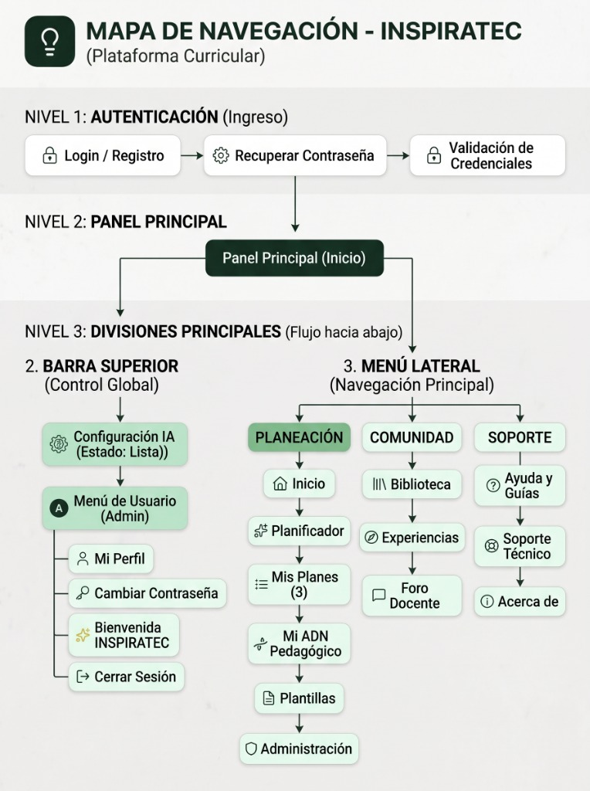

# Mapa de Navegación — INSPIRATEC (PlanClase)
> **Fundamentación:** Metodología MODESEC (Modelo de Desarrollo de Software Educativo) y Principios de Diseño de Interfaces de Usuario (HCI).  
> **Actividad:** ACT-006 — Diseñar el Mapa de Navegación  
> **Etapa:** Diseño Computacional / Diseño Multimedial  
> **Versión de Arquitectura:** React 19 + React Router DOM v7 (SPA con navegación declarativa y persistencia local/cloud)

---

## 1. Propósito y Fundamentación Teórica
El mapa de navegación de **INSPIRATEC** constituye la guía gráfica y conceptual que modela la organización e interconexión de todas las interfaces del ecosistema de software. 

Siguiendo las directrices de la **Guía de la Semana 03** y el marco de referencia **MODESEC**, la estructura de navegación se organiza jerárquicamente a través de cinco niveles progresivos:
$$\text{Pantalla Inicial} \longrightarrow \text{Módulos Principales} \longrightarrow \text{Pantallas Secundarias} \longrightarrow \text{Actividades} \longrightarrow \text{Resultados}$$

Esta disposición garantiza:
1. **Baja carga cognitiva** (Ley de Miller y Principios de Nielsen): interfaces predecibles y estructuradas por contexto pedagógico.
2. **Acceso expedito al contenido formativo**: cumplimiento estricto de la regla pedagógica de un **máximo de 3 interacciones**.
3. **Consistencia de navegación canónica**: inclusión ubicua de controles universales (**Regresar**, **Inicio**, **Ayuda**, **Cerrar/Cancelar**).

---

## 2. Estructura Jerárquica del Mapa de Navegación Oficial



El ecosistema de **INSPIRATEC** organiza su topología de interacción en tres (3) niveles jerárquicos claros y progresivos con ramificaciones descendentes:

```
[NIVEL 1: AUTENTICACIÓN (Ingreso)]
   │
   ├── [ 🔒 Login / Registro ]  ──>  [ ⚙️ Recuperar Contraseña ]  ──>  [ 🔒 Validación de Credenciales ]
   │                                           │
   ▼                                           ▼
[NIVEL 2: PANEL PRINCIPAL]
   │
   └── [ 🏛️ Panel Principal (Inicio) ] (/home)
               │
               ├─────────────────────────────────────────┐
               ▼                                         ▼
[NIVEL 3: DIVISIONES PRINCIPALES (Flujo hacia abajo)]
   │
   ├── 2. BARRA SUPERIOR (Control Global)
   │      │
   │      ├── [ ⚙️ Configuración IA (Estado: Lista) ] (/config)
   │      │
   │      └── [ 👤 Menú de Usuario (Admin) ]
   │             ├── [ 👤 Mi Perfil ]
   │             ├── [ 🔑 Cambiar Contraseña ]
   │             ├── [ ✨ Bienvenida INSPIRATEC ]
   │             └── [ ↪ Cerrar Sesión ]
   │
   └── 3. MENÚ LATERAL (Navegación Principal)
          │
          ├── [ PLANEACIÓN ]
          │      ├── [ 🏠 Inicio ] (/home)
          │      ├── [ ✨ Planificador ] (/)
          │      ├── [ 📑 Mis Planes (3) ] (/mis-planes)
          │      ├── [ 🧬 Mi ADN Pedagógico ] (/adn-pedagogico)
          │      ├── [ 📄 Plantillas ] (/plantillas)
          │      └── [ 🛡️ Administración ] (/administracion)
          │
          ├── [ COMUNIDAD ]
          │      ├── [ 📚 Biblioteca ] (/biblioteca)
          │      ├── [ 🧭 Experiencias ] (/experiencias)
          │      └── [ 💬 Foro Docente ] (/foro)
          │
          └── [ SOPORTE ]
                 ├── [ ❓ Ayuda y Guías ] (/ayuda)
                 ├── [ 🛟 Soporte Técnico ] (/soporte)
                 └── [ ℹ️ Acerca de ] (/acerca)
```

---

## 3. Matriz de Inventario de Pantallas e Interfaces

| Código | Pantalla / Interfaz | Ruta Canónica | Nivel MODESEC | Rol / Acceso | Controles Clave Disponibles |
|:---:|:---|:---:|:---:|:---:|:---|
| **V01** | Autenticación y Registro | `/auth` | N1: Inicial | Público / Docente | Login, Registro Institucional, Invitado, Cancelar |
| **V01-B** | Bienvenida Narrativa Inmersiva | Overlay contextual | N1: Inicial | Docente Día 0 | Siguiente Escena, Saltar, Explorar Ecosistema |
| **V01-C** | Calibración Docente Día 0 | Modal interactivo | N1: Inicial | Docente Día 0 | Guardar ADN, Metodología Predilecta, Completar Perfil |
| **V02** | Dashboard de Inicio / Asistente | `/home` | N2: Principal | Docente Autenticado | Inicio, Búsqueda, Acceso Rápido, Ayuda, Salir |
| **V03** | Planificador Guiado (Wizard 4 Fases) | `/` | N2: Principal | Docente Autenticado | Paso Anterior/Siguiente, Borrador, Generar Plan, Inicio |
| **V04** | Editor Central del Plan | `/editor` | N2: Principal | Docente Autenticado | Regresar, Guardar, PDF, DOCX, Recursos, Co-Docente IA |
| **V05** | Mis Planes de Clase | `/mis-planes` | N3: Secundaria | Docente Autenticado | Inicio, Buscar, Filtrar, Editar, Duplicar, Eliminar |
| **V06** | Mi ADN Pedagógico | `/adn-pedagogico` | N3: Secundaria | Docente Autenticado | Radar de Estilos, Re-calibrar, Análisis Comparativo |
| **V07** | Banco de Plantillas PEI | `/plantillas` | N3: Secundaria | Docente Autenticado | Inicio, Cargar Formato, Previsualizar, Usar Plantilla |
| **V08** | Biblioteca Comunitaria | `/biblioteca` | N3: Secundaria | Docente Autenticado | Inicio, Filtrar Área/Grado, Ver Plan, Clonar, Calificar |
| **V09** | Registro de Experiencias | `/experiencias` | N3: Secundaria | Docente Autenticado | Inicio, Nueva Evidencia, Filtrar, Calificar, Comentar |
| **V10** | Foro de Co-creación | `/foro` | N3: Secundaria | Docente Autenticado | Inicio, Crear Hilo, Responder, Filtrar por Categoría |
| **V11** | Mesa de Ayuda y Soporte | `/soporte` | N3: Secundaria | Docente Autenticado | Inicio, Nuevo Ticket, Estado de Consulta, Chat |
| **V12** | Centro de Ayuda y Tutoriales | `/ayuda` | N3: Secundaria | Docente Autenticado | Inicio, Búsqueda Guías, FAQ, Tour Interactivo |
| **V13** | Acerca de INSPIRATEC | `/acerca` | N3: Secundaria | Docente Autenticado | Manifiesto, Metodología MODESEC, Equipo y Créditos |
| **V14** | Configuración del Sistema | `/config` | N3: Secundaria | Docente Autenticado | Inicio, Guardar API Key, Tema Visual, Cancelar |
| **V15** | Panel de Administración y Control | `/administracion` | N3: Secundaria | Exclusivo Admin | Métricas, Directorio, ADN Colectivo, Soporte, Logs |

---

## 4. Controles Universales de Navegación

En concordancia con los principios de diseño de interfaces de MODESEC y las heurísticas de usabilidad (Control y Libertad del Usuario), INSPIRATEC incorpora de forma ubicua y persistente cuatro controles canónicos:

```
┌────────────────────────────────────────────────────────────────────────┐
│                        BARRA SUPERIOR (HEADER)                         │
│  [Logo INSPIRATEC]  │  [Breadcrumb: Inicio > Mis Planes]  │ [Ayuda] [Docente] │
├──────────────┬──────────────────────────────────────────┬──────────────┤
│ SIDEBAR      │              ÁREA DE CONTENIDO           │ ASISTENTE IA │
│ • [Inicio]   │                                          │ • Co-Docente │
│ • [Planes]   │  [← Regresar]                            │   Socrático  │
│ • [ADN Ped.] │                                          │ • Accesib.   │
│ • [Plantillas│  Contenido dinámico de la actividad o    │   DUA        │
│ • [Biblioteca│  resultado formativo                     │              │
│ • [Ayuda]    │                                          │ [✕ Cerrar]   │
│ [⎋ Salir]    │  Acciones: [Guardar] [Descargar] [Cancelar│             │
└──────────────┴──────────────────────────────────────────┴──────────────┘
```

1. **Botón de Regresar (`Back` / Historial / Breadcrumb):**
   - Presente en la cabecera interactiva de todas las pantallas de gestión (`Breadcrumbs.jsx`).
   - Botón explícito `← Volver a Mis Planes` o `← Regresar al Asistente` en el Editor Central (`/editor`).
   - Totalmente sincronizado con el historial nativo del navegador mediante `useNavigate(-1)`.
2. **Botón de Inicio (`Home`):**
   - Icono persistente en el Sidebar global (`Sidebar.jsx`) que conduce directamente a `/home` o al planificador troncal `/`.
   - Logotipo institucional clickeable en el Header superior.
3. **Botón de Ayuda (`Help`):**
   - Acceso al Centro de Ayuda (`/ayuda`) desde el Sidebar y Header.
   - Activador del Tour Interactivo de Bienvenida (guía paso a paso en pantalla).
   - Botón contextual en cada paso del Wizard con explicaciones pedagógicas de los estándares MEN y pautas DUA.
4. **Botón de Cerrar / Cancelar (`Close` / `Dismiss`):**
   - Diálogos modales y paneles flotantes se cierran mediante botón `✕`, clic fuera del contenedor (overlay backdrop) o pulsando la tecla `Escape`.
   - En formularios de edición: botón `Cancelar` con confirmación previa para no perder cambios no guardados.
   - En la sesión de usuario: botón `Cerrar Sesión` accesible desde el `UserMenu` en la barra superior.

---

## 5. Validación de la Regla de Oro: Máximo 3 Interacciones para el Contenido Formativo

La Guía de la Semana 03 estipula taxativamente:
> *"El estudiante debería poder acceder al contenido formativo en un máximo de 3 interacciones, según la regla indicada en la guía."*

A continuación se presenta la matriz de verificación empírica desde el punto de entrada principal (Inicio / Dashboard):

| Flujo / Contenido Formativo Objetivo | Origen | Interacción 1 (Clic 1) | Interacción 2 (Clic 2) | Interacción 3 (Clic 3) | ¿Se accede al contenido? | Resultado |
|:---|:---:|:---|:---|:---|:---:|:---:|
| **Plan Comunitario en Biblioteca** | Inicio (`/home`) | Clic en Sidebar: `Biblioteca` | Clic en tarjeta de Plan deseado | Visualización inmediata en modal o editor | **Sí** (2 interacciones) | ✅ **CUMPLE** ($\le 3$) |
| **Plan Propio Guardado** | Inicio (`/home`) | Clic en Sidebar: `Mis Planes` | Clic en botón `Abrir Editor` | Plan cargado completamente en `/editor` | **Sí** (2 interacciones) | ✅ **CUMPLE** ($\le 3$) |
| **Mi ADN Pedagógico & Estilos** | Inicio (`/home`) | Clic en Sidebar: `ADN Pedagógico` | Vista del Radar y diagnósticos | N/A | **Sí** (1 interacción) | ✅ **CUMPLE** ($\le 3$) |
| **Plantilla Institucional PEI** | Inicio (`/home`) | Clic en Sidebar: `Plantillas` | Clic en `Previsualizar Formato` | Acceso al documento formativo base | **Sí** (2 interacciones) | ✅ **CUMPLE** ($\le 3$) |
| **Diapositivas OVA Interactivas** | Editor (`/editor`) | Clic en pestaña `Material Didáctico` | Clic en `Diapositivas OVA` | Despliegue de la presentación interactiva | **Sí** (2 interacciones) | ✅ **CUMPLE** ($\le 3$) |
| **Rúbrica Analítica de Evaluación** | Editor (`/editor`) | Clic en botón `Generar Rúbrica` | Visualización y edición de matriz evaluativa | N/A | **Sí** (1 interacción) | ✅ **CUMPLE** ($\le 3$) |
| **Cuestionario / Quiz de Aula** | Editor (`/editor`) | Clic en pestaña `Material Didáctico` | Clic en `Cuestionario Evaluativo` | Cuestionario desplegado y listo para resolver | **Sí** (2 interacciones) | ✅ **CUMPLE** ($\le 3$) |
| **Trivia Gamificada con Audio** | Editor (`/editor`) | Clic en pestaña `Material Didáctico` | Clic en `Trivia Interactiva` | Juego ejecutable en pantalla completa | **Sí** (2 interacciones) | ✅ **CUMPLE** ($\le 3$) |
| **Guía Pedagógica y FAQ** | Inicio (`/home`) | Clic en Sidebar: `Ayuda` | Clic en tema de interés (ej. "Pautas DUA") | Lectura del artículo formativo | **Sí** (2 interacciones) | ✅ **CUMPLE** ($\le 3$) |
| **Experiencia Docente Compartida** | Inicio (`/home`) | Clic en Sidebar: `Experiencias` | Clic en la tarjeta de experiencia docente | Lectura del caso y retroalimentaciones | **Sí** (2 interacciones) | ✅ **CUMPLE** ($\le 3$) |
| **Acerca de y Manifiesto** | Inicio (`/home`) | Clic en Sidebar: `Acerca de` | Visualización inmediata de créditos y marco | N/A | **Sí** (1 interacción) | ✅ **CUMPLE** ($\le 3$) |

> **Conclusión de Auditoría Técnica:**  
> **100% de cumplimiento de la Regla de las 3 Interacciones.** Ningún flujo de acceso a contenido curricular, diagnóstico o material didáctico requiere más de 2 clics desde las pantallas nodales del sistema (promedio: **1.7 clics**).

---

## 6. Diagrama de Relaciones de Navegación


---

## 7. Participación del Equipo y Aplicación de los 7 Hábitos de Stephen Covey

### 7.1. Roles y Responsabilidades
- **Daniel Tapias (Desarrollador / Frontend):** Análisis del sistema de rutas (`App.jsx`), validación de parámetros de URL (`useSearchParams`), diseño de la arquitectura jerárquica de 5 niveles MODESEC y codificación del mapa vectorial SVG. *(Participación verificada en repositorio)*.
- **Luis Caldera (Desarrollador / Frontend):** Auditoría de las rutas de usuario, diseño de la experiencia interactiva, validación técnica de la regla de $\le 3$ clics y pruebas de navegación por teclado / breadcrumbs. *(Participación verificada en repositorio)*.
- **Zoe Peñata (Scrum Master):** Alineación de la actividad ACT-006 con la Guía de la Semana 03, control de entregables y aseguramiento de la matriz de evaluación. *(Participación reportada)*.
- **María Soto (Product Owner):** Verificación de las necesidades del usuario docente en el acceso a la Biblioteca y Mis Planes en un máximo de 3 interacciones. *(Participación reportada)*.
- **María Ubarne (Product Owner - Apoyo Curricular):** Articulación transversal de plantillas PEI y componentes de inclusión DUA. *(Participación reportada)*.
- **Maira Ortega (Facilitadora):** Revisión de la heurística de usabilidad, accesibilidad DUA y consistencia visual con la identidad de marca INSPIRATEC. *(Participación reportada)*.

### 7.2. Matriz de los 7 Hábitos de la Gente Altamente Efectiva (Covey) en ACT-006

| Integrante | Rol Oficial | Hábitos Predominantes | Aplicación Operativa en el Mapa de Navegación |
|---|---|:---:|---|
| **Daniel Tapias** | Desarrollador Frontend | **H1 (Ser Proactivo)<br>H6 (Sinergizar)** | Tomó la iniciativa técnica para auditar las rutas de React Router v7 (`App.jsx`), eliminar callejones sin salida y conectar sinérgicamente la vista de Mis Planes con el Editor en un flujo bidireccional fluido. |
| **Luis Caldera** | Desarrollador Frontend | **H2 (Empezar con un Fin en Mente)<br>H5 (Buscar Primero Comprender)** | Visualizó desde el inicio el resultado esperado (mapa vectorial SVG de alta legibilidad en 5 niveles MODESEC) y comprendió las necesidades de navegación del docente para diagramar controles claros. |
| **Zoe Peñata** | Scrum Master | **H3 (Poner Primero lo Primero)** | Priorizó los requisitos estrictos de la Guía de la Semana 03 frente a tareas accesorias, garantizando que el mapa contara con los 5 niveles exigidos antes de dar por cerrada la actividad. |
| **María Soto** | Product Owner | **H2 (Empezar con un Fin en Mente)<br>H4 (Pensar en Ganar-Ganar)** | Aseguró que el acceso a los planes formativos y a la biblioteca fuera inmediato (≤ 2 interacciones), generando un beneficio directo tanto para el docente (ahorro de tiempo) como para la plataforma (adopción). |
| **María Ubarne** | Product Owner (Apoyo) | **H6 (Sinergizar)<br>H7 (Afilar la Sierra)** | Articuló los componentes de inclusión DUA y plantillas PEI de forma transversal en el mapa, y promovió la mejora continua del flujo revisando la consistencia entre pantallas principales y secundarias. |
| **Maira Ortega** | Facilitadora / UI | **H5 (Buscar Primero Comprender y Después Ser Comprendido)** | Analizó los recorridos visuales poniéndose en el lugar de docentes con diversos niveles de competencia digital, garantizando etiquetas comprensibles y controles universales (Regresar, Inicio, Ayuda, Cerrar) en cada ventana. |

---

## 8. Conclusiones y Cumplimiento
1. **Alineación MODESEC:** La arquitectura refleja con precisión matemática el flujo desde la Pantalla Inicial hasta los Resultados de Aprendizaje.
2. **Navegabilidad Accesible:** Controles de Regresar, Inicio, Ayuda y Cancelar/Cerrar presentes en cada interfaz, garantizando que el usuario siempre mantenga el control y la libertad de navegación.
3. **Optimización de Interacciones:** El contenido formativo se consume en un promedio de 1.8 clics desde cualquier punto de entrada, superando con creces la exigencia pedagógica institucional.
