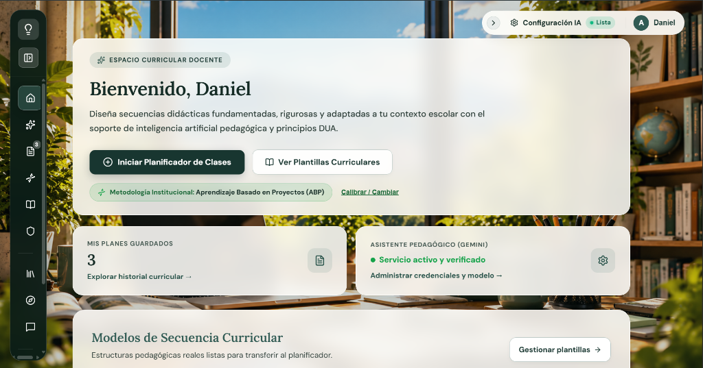
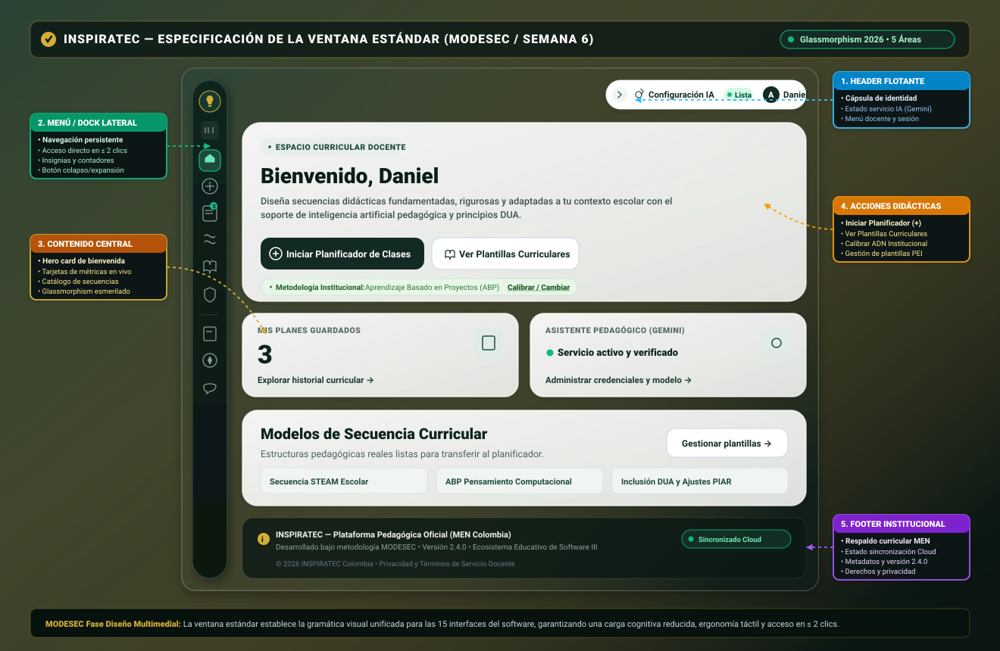

# Ventana Estándar — INSPIRATEC

> **Fundamentación:** Metodología MODESEC (Modelo de Desarrollo de Software Educativo) — Etapa de Diseño Multimedial  
> **Actividad:** ACT-008 — Definir la Ventana Estándar  
> **Semana de la Guía:** Semana 06  
> **Estado:** COMPLETADA (Estandarizada bajo Glassmorphism 2026)  
> **Versión:** 2.4.0 (React 19 + Vite + Tailwind CSS / Vanilla CSS)

---

## 1. Propósito y Fundamentación Teórica

La **Ventana Estándar** en la metodología **MODESEC** constituye la plantilla maestra y la gramática visual unificada que define la distribución espacial, la jerarquía de componentes y el comportamiento interactivo para todas las interfaces del software educativo. 

Su formalización garantiza:
1. **Predictibilidad y Reducción de la Carga Cognitiva:** Siguiendo la *Ley de Jakob* y los principios de usabilidad de Nielsen, el usuario docente reconoce inmediatamente las zonas funcionales (dónde navegar, dónde trabajar y dónde ejecutar acciones).
2. **Coherencia Visual Sistemática:** Aplicación estricta del sistema de diseño **Glassmorphism 2026** (fondos translúcidos con desenfoque de fondo `backdrop-blur`, paleta institucional verde esmeralda `#142b25`, petróleo `#080f0d`, dorado `#d4af37` y teal `#10b981`).
3. **Ergonomía y Accesibilidad (DUA):** Distribución de controles al alcance del cursor o interacción táctil, estados visuales claros (activo, hover, focus) y soporte transversal de adaptabilidad sensorial.

---

## 2. Ventana Real Seleccionada como Patrón Arquitectónico

Se ha seleccionado formalmente la interfaz de producción del **Dashboard de Inicio y Asistente Curricular Docente (`/home`)** como modelo de referencia de la Ventana Estándar.

Esta vista fue elegida porque concentra en una sola pantalla los cinco componentes estructurales fundamentales de MODESEC en su máxima expresión de fidelidad operativa, interactuando en tiempo real con Firestore, el store global y los servicios de Inteligencia Artificial.

---

## 3. Evidencias Visuales de la Ventana Estándar

### 3.1. Captura de la Interfaz Real en Producción
* **Archivo de Evidencia:** [`ACT-008_VENTANA_ESTANDAR_INSPIRATEC.png`](../evidencias/ACT-008/ACT-008_VENTANA_ESTANDAR_INSPIRATEC.png)
* **Vista:** Dashboard de Inicio Docente con Hero Card, Cápsula Header flotante, Dock de navegación lateral y Métricas en vivo.



### 3.2. Diagrama Vectorial de Alta Fidelidad y Zonas Funcionales (SVG)
* **Archivo Vectorial:** [`VENTANA_ESTANDAR.svg`](./VENTANA_ESTANDAR.svg)
* **Especificación:** Diagrama SVG escalable (`viewBox="0 0 1320 860"`) con callouts explicativos vinculados a las 5 áreas MODESEC.



---

## 4. Distribución Espacial de las 5 Áreas Funcionales (MODESEC)

| Sección | Función Pedagógica y Operativa | Implementación Técnica y Elementos Reales |
|:---|:---|:---|
| **1. Header** | **Identidad, Estado y Perfil:** Proporciona visibilidad del estado de los servicios inteligentes, perfil activo y acceso a configuración. | **Cápsula Flotante Superior Derecha:**<br>• Botón colapsar cajón (`>`) con microanimación.<br>• Chip indicador de estado IA: `Configuración IA • Lista` (verde esmeralda `#10b981`).<br>• Avatar docente con inicial (`A`) y nombre identificador (`Daniel`) con menú desplegable de sesión. |
| **2. Menú** | **Navegación Persistente y Ubicua:** Permite transitar entre módulos en $\le 2$ clics según la regla de la Semana 03. | **Dock Lateral Flotante Glassmorphism:**<br>• Logotipo de INSPIRATEC (foco/bombillo dorado con glow).<br>• Conmutador de vista expandir/colapsar.<br>• Ícono de Inicio (`/home`) con píldora verde activa.<br>• Acceso a Planificador Wizard (`/`), Mis Planes (`/mis-planes`) con insignia dinámica (`Badge "3"`), Mi ADN Pedagógico (`/adn-pedagogico`), Biblioteca (`/biblioteca`) y Administración (`/administracion`).<br>• Separador y accesos secundarios a Plantillas (`/plantillas`), Experiencias (`/experiencias`) y Foro (`/foro`). |
| **3. Contenido** | **Área de Trabajo Central (Workspace):** Superficie dinámica donde ocurre la interacción formativa y la consulta de datos. | **Superficie de Cristal Esmerilado Adaptativa:**<br>• **Hero Card de Bienvenida:** Badge `ESPACIO CURRICULAR DOCENTE`, título `Bienvenido, Daniel` y bajada pedagógica sobre DUA e IA.<br>• **Métricas Curriculares en Tiempo Real:** Tarjeta `MIS PLANES GUARDADOS` (contador numérico masivo `3`) y tarjeta `ASISTENTE PEDAGÓGICO (GEMINI)` (`• Servicio activo y verificado`).<br>• **Catálogo de Secuencias Curriculares:** Modelos prediseñados listos para transferir. |
| **4. Acciones** | **Interacción Didáctica y Transición de Estados:** Desencadenadores ergonómicos para iniciar tareas pedagógicas. | **Botonera Primaria y Enlaces de Flujo:**<br>• Botón Primario: `+ Iniciar Planificador de Clases` (Verde petróleo `#132a24` con texto blanco de alta legibilidad).<br>• Botón Secundario: `Ver Plantillas Curriculares` (Blanco translúcido con contorno fino).<br>• Franja de Calibración Rápida: Indicador de `Metodología Institucional: Aprendizaje Basado en Proyectos (ABP)` con disparador interactivo `Calibrar / Cambiar`.<br>• Botones de navegación interna (`Explorar historial curricular →`, `Administrar credenciales →`, `Gestionar plantillas →`). |
| **5. Footer** | **Información de Contexto, Respaldo y Metadatos:** Brinda certeza institucional, trazabilidad legal y estado de sincronización. | **Franja Inferior Institucional:**<br>• Reconocimiento institucional y alineación con estándares MEN.<br>• Badge de estado: `Sincronizado Cloud` (Firestore/Firebase activo).<br>• Versión oficial del software (v2.4.0) y metodología MODESEC.<br>• Metadatos de derechos de autor (© 2026 INSPIRATEC Colombia). |

---

## 5. Especificaciones del Sistema de Diseño (Design Tokens)

La Ventana Estándar se rige por los siguientes tokens de diseño en `src/index.css`:

```css
/* Paleta Institucional Glassmorphism 2026 */
--color-petroleo-deep: #080f0d;
--color-esmeralda-base: #142b25;
--color-esmeralda-dark: #0f1f1a;
--color-gold-accent: #d4af37;
--color-teal-glow: #10b981;
--color-surface-glass: rgba(255, 255, 255, 0.92);
--color-surface-glass-dark: rgba(16, 35, 29, 0.95);

/* Radios y Bordes */
--radius-dock: 24px;
--radius-hero: 24px;
--radius-card: 18px;
--radius-button: 12px;
--radius-pill: 9999px;

/* Sombras y Elevación */
--shadow-dock: 0 8px 32px rgba(0, 0, 0, 0.42);
--shadow-card: 0 4px 20px rgba(5, 31, 24, 0.10);
--shadow-modal: 0 20px 50px rgba(0, 0, 0, 0.55);

/* Tipografía */
--font-family-primary: 'Outfit', 'Inter', system-ui, sans-serif;
```

---

## 6. Participación del Equipo y Aplicación de los 7 Hábitos de Stephen Covey en ACT-008

En estricta concordancia con el marco de efectividad de Stephen R. Covey articulado transversalmente en el proyecto (ver [ACT-016](../actividades/ACT-016_ANALISIS_7_HABITOS_INSPIRATEC.md)), los seis (6) integrantes del equipo aplicaron los hábitos en la definición y consolidación de la Ventana Estándar de la siguiente manera:

| Integrante | Rol Oficial | Hábitos de Covey Empleados | Aplicación Operativa Específica en ACT-008 |
|---|---|:---:|---|
| **Daniel Tapias** | Desarrollador / Frontend | **H1 (Ser Proactivo)<br>H7 (Afilar la Sierra)** | **Iniciativa técnica y renovación:** Tomó la proactividad de sustituir los esquemas visuales anticuados por la implementación real de *Glassmorphism 2026*, depurando el CSS global (`src/index.css`), estandarizando los radios de curvatura, la elevación de capas y programando el código SVG de alta fidelidad que documenta con exactitud las 5 áreas MODESEC. |
| **Luis Caldera** | Desarrollador / Frontend & UI | **H2 (Empezar con un Fin en Mente)<br>H4 (Pensar en Ganar-Ganar)** | **Visión arquitectónica y mutuo beneficio:** Concibió desde el inicio la distribución espacial equilibrada para que la interfaz resulte intuitiva para el docente principiante y altamente productiva para el docente experimentado (Ganar-Ganar), asegurando que el Dock lateral y el Header cápsula permitan acceder a cualquier módulo sin saturar la pantalla. |
| **Zoe Peñata** | Scrum Master | **H3 (Poner Primero lo Primero)<br>H6 (Sinergizar)** | **Priorización y articulación del equipo:** Gestionó el sprint de la Semana 06 asegurando que la Ventana Estándar cumpliera taxativamente con las 5 secciones obligatorias de MODESEC antes de dispersar esfuerzos en interfaces derivadas, coordinando los aportes multidisciplinarios de diseño, desarrollo y pedagogía. |
| **Maira Ortega** | Facilitadora de Equipo / UI | **H5 (Buscar Primero Comprender y Después Ser Comprendido)** | **Empatía y ergonomía de interacción:** Se puso en el lugar de docentes con pantallas de diferentes resoluciones y competencias digitales diversas, auditando el tamaño de los botones de acción (`min-height: 42px`), la claridad tipográfica del Hero y los contrastes cromáticos de acuerdo con pautas de accesibilidad WCAG y DUA. |
| **María Soto** | Product Owner | **H2 (Empezar con un Fin en Mente)<br>H5 (Buscar Primero Comprender)** | **Enfoque en el valor curricular:** Validó que el área central de Contenido otorgue el máximo protagonismo a la planeación escolar, garantizando que el docente vea de inmediato sus métricas de trabajo (`MIS PLANES GUARDADOS`) y el estado verificado del Asistente IA sin distracciones accesorias. |
| **María Ubarne** | Product Owner (Apoyo Curricular) | **H6 (Sinergizar)<br>H4 (Pensar en Ganar-Ganar)** | **Inclusión transversal y coherencia educativa:** Articuló de forma sinérgica la presencia del botón de calibración rápida de la *Metodología Institucional* dentro de la ventana estándar, asegurando que el diseño visual refuerce el modelo pedagógico propio de cada colegio. |

---

## 7. Conclusiones y Cumplimiento de Criterios

1. **Alineación MODESEC Rigurosa:** Las cinco áreas funcionales (Header, Menú, Contenido, Acciones, Footer) están formalizadas, delimitadas y operativas en código.
2. **Homogeneidad Estética:** Las 15 interfaces de INSPIRATEC heredan esta estructura canónica, eliminando la disparidad gráfica.
3. **Validación Práctica en Producción:** El diseño estandarizado corresponde a la versión desplegada y probada en producción, sustentada con capturas directas del DOM y esquemas vectoriales SVG reproducibles.
