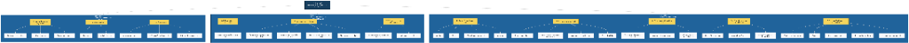

# Documento de Visualización — Borrador del Diagrama de Contenidos

Este documento presenta la digitalización, transcripción y estructuración del **borrador inicial reportado por el equipo** para la actividad **ACT-001 (Diseño del Diagrama de Contenidos)**, facilitando su lectura, análisis y visualización en GitHub.

---

## 1. Visualización Panorámica Original

Para ver la captura original en tamaño completo:

> 🔍 *Haga clic en la imagen superior para ver el archivo original en resolución nativa.*

---

## 2. Diagrama Digitalizado e Interactivo (Mermaid)

El siguiente diagrama reproduce la arquitectura jerárquica del borrador de trabajo en formato renderizable por GitHub:

```mermaid
graph TD
    classDef root fill:#0f172a,stroke:#38bdf8,stroke-width:2px,color:#fff,font-weight:bold
    classDef mainMod fill:#1e40af,stroke:#60a5fa,stroke-width:1.5px,color:#fff,font-weight:bold
    classDef subMod fill:#fbbf24,stroke:#d97706,stroke-width:1.5px,color:#78350f,font-weight:bold
    classDef leaf fill:#f8fafc,stroke:#94a3b8,stroke-width:1px,color:#0f172a

    ROOT["PLANCLASE<br/>(Borrador Inicial)"]:::root

    %% SECCIÓN 1: IDENTIDAD Y ACCESO
    ROOT --> SEC1["Módulo 1: Identidad y Perfil"]:::mainMod
    SEC1 --> S1_1["Autenticación"]:::subMod
    SEC1 --> S1_2["Perfil Docente"]:::subMod
    SEC1 --> S1_3["Roles"]:::subMod

    S1_1 --> I1_1["Inicio de Sesión"]:::leaf
    S1_1 --> I1_2["Registro"]:::leaf
    S1_1 --> I1_3["Recuperación"]:::leaf

    S1_2 --> I1_4["Datos"]:::leaf
    S1_2 --> I1_5["Institución"]:::leaf
    S1_2 --> I1_6["Asignatura"]:::leaf

    S1_3 --> I1_7["Docente"]:::leaf
    S1_3 --> I1_8["Administrador"]:::leaf
    S1_3 --> I1_9["Coordinador"]:::leaf

    %% SECCIÓN 2: ESTRUCTURA CURRICULAR
    ROOT --> SEC2["Módulo 2: Marco Curricular"]:::mainMod
    SEC2 --> S2_1["Estándares"]:::subMod
    SEC2 --> S2_2["Ejes Temáticos"]:::subMod
    SEC2 --> S2_3["Desempeños"]:::subMod

    S2_1 --> I2_1["Lineamientos MEN"]:::leaf
    S2_1 --> I2_2["Guía 30 Informática"]:::leaf
    S2_1 --> I2_3["Competencias"]:::leaf

    S2_2 --> I2_4["Naturaleza y Evolución"]:::leaf
    S2_2 --> I2_5["Apropiación TIC"]:::leaf
    S2_2 --> I2_6["Solución Problemas"]:::leaf
    S2_2 --> I2_7["Tecnología / Sociedad"]:::leaf

    S2_3 --> I2_8["Criterios Grados"]:::leaf
    S2_3 --> I2_9["Indicadores"]:::leaf
    S2_3 --> I2_10["Matrices Logro"]:::leaf

    %% SECCIÓN 3: PLANEACIÓN DIDÁCTICA
    ROOT --> SEC3["Módulo 3: Planeación Didáctica Inclusiva"]:::mainMod
    SEC3 --> S3_1["Datos de Clase"]:::subMod
    SEC3 --> S3_2["Pautas DUA"]:::subMod
    SEC3 --> S3_3["Secuencia"]:::subMod
    SEC3 --> S3_4["Recursos"]:::subMod
    SEC3 --> S3_5["Evaluación"]:::subMod

    S3_1 --> I3_1["Grado y Grupo"]:::leaf
    S3_1 --> I3_2["Periodo / Tiempo"]:::leaf
    S3_1 --> I3_3["Metodología ABP"]:::leaf

    S3_2 --> I3_4["Principio I: Representación"]:::leaf
    S3_2 --> I3_5["Principio II: Acción / Expresión"]:::leaf
    S3_2 --> I3_6["Principio III: Implicación"]:::leaf

    S3_3 --> I3_7["Fase Inicio"]:::leaf
    S3_3 --> I3_8["Fase Desarrollo"]:::leaf
    S3_3 --> I3_9["Fase Cierre"]:::leaf

    S3_4 --> I3_10["Material Digital"]:::leaf
    S3_4 --> I3_11["Herramientas TIC"]:::leaf
    S3_4 --> I3_12["Adaptaciones DUA"]:::leaf

    S3_5 --> I3_13["Rúbricas"]:::leaf
    S3_5 --> I3_14["Instrumentos"]:::leaf
    S3_5 --> I3_15["Evidencias"]:::leaf
```

---

## 3. Desglose Estructurado del Borrador

| Módulo Principal | Submódulos (Nivel 2) | Elementos y Contenidos (Nivel 3) |
|---|---|---|
| **1. Gestión de Identidad y Perfil** | **1.1 Autenticación** **1.2 Perfil Docente** **1.3 Roles de Acceso** | • Inicio de Sesión, Registro, Recuperación de clave. • Datos personales, Institución educativa, Asignatura. • Rol Docente, Administrador, Coordinador. |
| **2. Estructura y Marco Curricular** | **2.1 Estándares y Normativa** **2.2 Ejes Temáticos de Tecnología** **2.3 Desempeños e Indicadores** | • Lineamientos MEN, Orientaciones Guía 30, Competencias. • Naturaleza y evolución, Apropiación TIC, Solución de problemas, Tecnología y sociedad. • Indicadores por grado, Criterios de evaluación, Matrices de valoración. |
| **3. Planeación Didáctica Inclusiva** | **3.1 Datos Generales y Enfoque** **3.2 Pautas DUA e Inclusión** **3.3 Secuencia Didáctica** **3.4 Recursos y Herramientas** **3.5 Evaluación y Evidencias** | • Grado, periodo, tiempo de clase, metodología ABP. • Principios DUA (Representación, Acción/Expresión, Implicación). • Fases de la clase: Inicio, Desarrollo y Cierre. • Recursos didácticos, plataformas TIC, materiales adaptados. • Rúbricas formativas, instrumentos de evaluación, evidencias entregables. |

---

## 4. Documentos y Enlaces Relacionados

- [Diagrama Vectorial SVG Final (diagrama-contenidos.svg)](diagrama-contenidos.svg)
- [Registro de la Actividad ACT-001](../../actividades/ACT-001_DIAGRAMA_CONTENIDOS.md)
- [Monitoreo Semanal — Semana 1](../../seguimiento/MONITOREO_SEMANAL.md#semana-1)
- [Registro del Uso de IA](../../ia/REGISTRO_USO_IA.md#act-001--uso-de-inteligencia-artificial)
