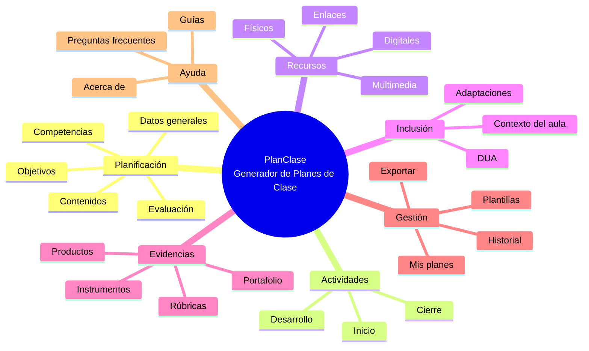

# Diagrama de Contenidos del Proyecto

## Proyecto
**PlanClase (INSPIRATEC — Generador de Planes de Clase)**

## Versión analizada
**Versión Actual (Plataforma Modular Integrada)**

## Propósito
Representar la organización jerárquica y conceptual de los contenidos, módulos formativos, flujos didácticos e instrumentos de evaluación del sistema, estructurados a partir del análisis real del software y orientados al andamiaje docente bajo los lineamientos de la **Guía 30 del MEN** y los principios de inclusión del **Diseño Universal para el Aprendizaje (DUA)**.

---

## Estructura Jerárquica

```
PlanClase — Generador de Planes de Clase
│
├── 1. PLANIFICACIÓN
│   ├── Datos generales (Tema, Nivel, Grado, Duración, Asignatura)
│   ├── Competencias (Componentes curriculares MEN Guía 30)
│   ├── Objetivos (Metas de aprendizaje y taxonomías)
│   ├── Contenidos (Conceptuales, procedimentales y actitudinales)
│   └── Evaluación (Criterios y momentos formativos)
│
├── 2. ACTIVIDADES
│   ├── Inicio (Motivación, saberes previos y contextualización)
│   ├── Desarrollo (Metodologías activas: ABP, Design Thinking, Pensamiento Computacional)
│   └── Cierre (Socialización, síntesis y retroalimentación)
│
├── 3. RECURSOS
│   ├── Digitales (Plataformas, software educativo y simuladores)
│   ├── Físicos (Guías impresas, material concreto y fungible)
│   ├── Multimedia (Diapositivas interactivas D3, videos y audios)
│   └── Enlaces (Repositorios web, referencias y fuentes consultadas)
│
├── 4. INCLUSIÓN
│   ├── Adaptaciones (Ajustes razonables para necesidades específicas PIAR)
│   ├── DUA (Pautas del Diseño Universal para el Aprendizaje y accesibilidad)
│   └── Contexto del aula (Infraestructura técnica: 1 a 1, proyector o unplugged)
│
├── 5. EVIDENCIAS
│   ├── Instrumentos (Cuestionarios interactivos, listas de cotejo)
│   ├── Rúbricas (Rúbricas analíticas con niveles de desempeño del MEN)
│   ├── Productos (Artefactos construidos por los estudiantes)
│   └── Portafolio (Sistematización de experiencias significativas IAP/DSRM)
│
├── 6. GESTIÓN
│   ├── Mis planes (Almacenamiento y edición en Cloud Firestore)
│   ├── Plantillas (Mapeo institucional de formatos PEI)
│   ├── Historial (Trazabilidad y versiones de secuencias didácticas)
│   └── Exportar (Descarga en PDF corporativo y Word nativo .docx)
│
└── 7. AYUDA
    ├── Guías (Tutorial paso a paso y asistente Profe Guía)
    ├── Preguntas frecuentes (Solución de dudas comunes y soporte)
    └── Acerca de (Equipo del Proyecto Grupo 2 y fundamentación académica)
```

---

## Representación Visual en Mermaid



### Diagrama de Flujo Jerárquico (Flowchart TD)

```mermaid
flowchart TD
    ROOT(["🎓 PlanClase: Generador de Planes de Clase"])

    %% Ramas Principales
    ROOT --> B1["📋 1. Planificación"]
    ROOT --> B2["🧩 2. Actividades"]
    ROOT --> B3["📁 3. Recursos"]
    ROOT --> B4["👥 4. Inclusión"]
    ROOT --> B5["📋 5. Evidencias"]
    ROOT --> B6["🗂️ 6. Gestión"]
    ROOT --> B7["❓ 7. Ayuda"]

    %% Nodos 1. Planificación
    B1 --> B1_1["Datos generales"]
    B1 --> B1_2["Competencias (MEN)"]
    B1 --> B1_3["Objetivos"]
    B1 --> B1_4["Contenidos"]
    B1 --> B1_5["Evaluación"]

    %% Nodos 2. Actividades
    B2 --> B2_1["Inicio (Saberes previos)"]
    B2 --> B2_2["Desarrollo (Metodologías activas)"]
    B2 --> B2_3["Cierre (Síntesis)"]

    %% Nodos 3. Recursos
    B3 --> B3_1["Digitales"]
    B3 --> B3_2["Físicos"]
    B3 --> B3_3["Multimedia (D3 / Diapositivas)"]
    B3 --> B3_4["Enlaces"]

    %% Nodos 4. Inclusión
    B4 --> B4_1["Adaptaciones PIAR"]
    B4 --> B4_2["Pautas DUA"]
    B4 --> B4_3["Contexto del aula"]

    %% Nodos 5. Evidencias
    B5 --> B5_1["Instrumentos (Trivias / Sopas)"]
    B5 --> B5_2["Rúbricas analíticas"]
    B5 --> B5_3["Productos de aula"]
    B5 --> B5_4["Portafolio de Experiencias"]

    %% Nodos 6. Gestión
    B6 --> B6_1["Mis planes (Firestore)"]
    B6 --> B6_2["Plantillas PEI"]
    B6 --> B6_3["Historial"]
    B6 --> B6_4["Exportar (PDF / Word)"]

    %% Nodos 7. Ayuda
    B7 --> B7_1["Guías y Tutorial"]
    B7 --> B7_2["Preguntas frecuentes"]
    B7 --> B7_3["Acerca de (Equipo Grupo 2)"]
```



---

## Validación y Articulación con MODESEC

Conforme al marco de software educativo **MODESEC**, la estructura del Diagrama de Contenidos se clasifica en tres niveles de madurez técnica y pedagógica:

### 1. Elementos Implementados (Verificados en Código y Funcionamiento Real)
* **Planificación Básica y Curricular:** Formulario interactivo Wizard de 4 pasos con selección de grados (1° a 11°), duración de clase (60/90/120 min), condiciones técnicas de aula y los 4 componentes curriculares de la Guía 30 del MEN.
* **Inclusión DUA:** Panel de accesibilidad funcional (modo contraste alto, sepia, fuente para dislexia, interlineado y tamaño) y selectores de ajustes para discapacidad sensorial, física y neurodiversidad (TEA, TDAH).
* **Instrumentos de Evaluación y Evidencias:** Generación automatizada de rúbricas analíticas estructuradas, cuestionarios interactivos, sopas de letras en Canvas y sistematización de experiencias significativas.
* **Gestión de Planes:** Persistencia documental en Cloud Firestore, guardado de planes de usuario, biblioteca compartida y descarga en PDF corporativo y Word nativo (`docx`).
* **Sección Ayuda e Identidad:** Asistente Profe Guía con modal de novedades, tour guiado y tarjeta institucional del Equipo del Proyecto (Grupo 2).

### 2. Elementos en Diseño (Documentados en el Proceso Académico)
* **Secuenciación Didáctica Completa:** Refinamiento pedagógico de los tiempos exactos de los 3 momentos de clase (Inicio, Desarrollo, Cierre) según la duración seleccionada.
* **Banco de Recursos Físicos y Digitales Específicos:** Recomendaciones algorítmicas de simuladores y software educativo offline para aulas sin conectividad.
* **Modelado Vectorial Integral:** Artefacto visual SVG definitivo vinculado a la trazabilidad académica de la asignatura.

### 3. Elementos Pendientes (Líneas Futuras de Desarrollo)
* **Evaluación de Impacto en Campo:** Pruebas de usabilidad y pertinencia didáctica con docentes en ejercicio en instituciones educativas del departamento de Córdoba.
* **Portafolio Docente Institucional Unificado:** Exportación consolidada anual de secuencias didácticas y evidencias para auditorías de calidad educativa.

---

## Archivos y Artefactos Relacionados

* **Imagen del Diagrama:** [`docs/evidencias/diagramas/diagrama-contenidos-actual.png`](diagrama-contenidos-actual.png)
* **Vectorial SVG:** [`docs/evidencias/diagramas/diagrama-contenidos-actual.svg`](diagrama-contenidos-actual.svg)
* **Código Fuente Mermaid:** [`docs/evidencias/diagramas/diagrama-contenidos.mmd`](diagrama-contenidos.mmd)
