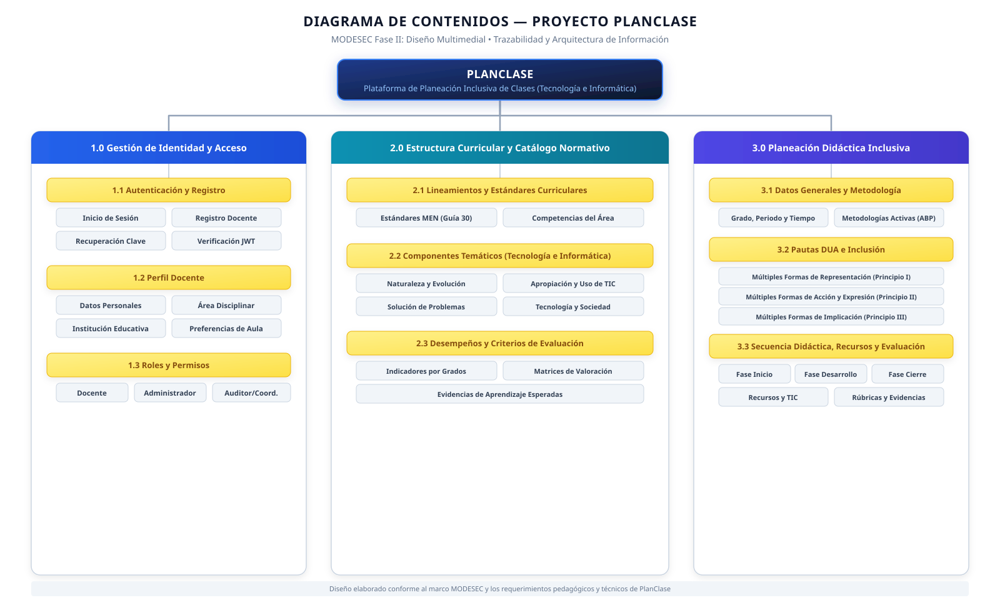

# Diagramas del Diseño Multimedial — PlanClase

Este directorio almacena los diagramas arquitecturales, mapas de contenido, esquemas visuales y sus respectivos archivos fuente (código Mermaid, exportaciones SVG/PNG o fuentes editables) de la **Fase II: Diseño Multimedial (MODESEC)**.

## Diagramas Disponibles

### 1. Diagrama de Contenidos (ACT-001)

- **Vectorial SVG:** [diagrama-contenidos.svg](diagrama-contenidos.svg)
- **Documento del Borrador Inicial:** [BORRADOR_DIAGRAMA.md](BORRADOR_DIAGRAMA.md)
- **Captura del Borrador:** [borrador-diagrama-reportado.png](borrador-diagrama-reportado.png)
- **Exportación PNG:** *diagrama-contenidos.png (Espacio reservado para exportación)*

Visualización del diagrama vectorial:

