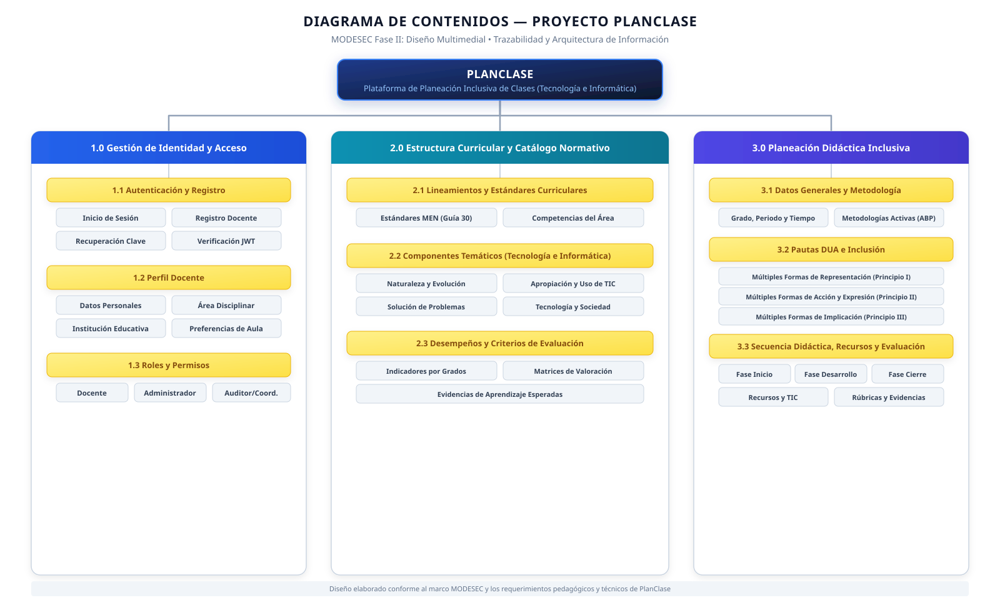

# Evidencias — ACT-001

## Evidencia documental

Disponible:

- [Registro de la actividad ACT-001](../../actividades/ACT-001_DIAGRAMA_CONTENIDOS.md)
- [Documento de Visualización del Borrador](BORRADOR_DIAGRAMA.md)
- [Registro de seguimiento correspondiente a la Semana 1](../../seguimiento/MONITOREO_SEMANAL.md#semana-1)
- [Diario de Campo consolidado (Semana 1)](../../diario-campo/SEMANA_01.md)
- [Registro del uso de Inteligencia Artificial](../../ia/REGISTRO_USO_IA.md#act-001--uso-de-inteligencia-artificial)

---

## Evidencia técnica

- **Archivo vectorial SVG:** [diagrama-contenidos.svg](diagrama-contenidos.svg)
- **Documento del Borrador:** [BORRADOR_DIAGRAMA.md](BORRADOR_DIAGRAMA.md)
- **Especificación técnica en código Mermaid:**

```mermaid
graph TD
    classDef root fill:#1e3a8a,stroke:#3b82f6,stroke-width:2px,color:#fff,font-weight:bold
    classDef mod fill:#2563eb,stroke:#1d4ed8,stroke-width:1.5px,color:#fff,font-weight:bold
    classDef sub fill:#fef08a,stroke:#eab308,stroke-width:1px,color:#854d0e,font-weight:bold
    classDef leaf fill:#f1f5f9,stroke:#cbd5e1,stroke-width:1px,color:#334155

    PLANCLASE["PLANCLASE<br/>(Plataforma de Planeación Inclusiva de Clases)"]:::root

    %% Módulo 1
    M1["1.0 Gestión de Identidad y Acceso"]:::mod
    PLANCLASE --> M1
    M1_1["1.1 Autenticación y Registro"]:::sub
    M1_2["1.2 Perfil Docente"]:::sub
    M1_3["1.3 Roles y Permisos"]:::sub
    M1 --> M1_1
    M1 --> M1_2
    M1 --> M1_3
    M1_1 --> C1_1["Inicio de Sesión"]:::leaf
    M1_1 --> C1_2["Registro Docente"]:::leaf
    M1_1 --> C1_3["Recuperación de Clave"]:::leaf
    M1_2 --> C1_4["Datos Personales e Institución"]:::leaf
    M1_2 --> C1_5["Área Disciplinar y Preferencias"]:::leaf
    M1_3 --> C1_6["Docente / Admin / Auditor"]:::leaf

    %% Módulo 2
    M2["2.0 Estructura Curricular y Catálogo Normativo"]:::mod
    PLANCLASE --> M2
    M2_1["2.1 Lineamientos y Estándares"]:::sub
    M2_2["2.2 Componentes Temáticos"]:::sub
    M2_3["2.3 Desempeños y Criterios"]:::sub
    M2 --> M2_1
    M2 --> M2_2
    M2 --> M2_3
    M2_1 --> C2_1["Estándares MEN (Guía 30)"]:::leaf
    M2_1 --> C2_2["Competencias del Área"]:::leaf
    M2_2 --> C2_3["Naturaleza y Evolución de la Tecnología"]:::leaf
    M2_2 --> C2_4["Apropiación y Uso de TIC"]:::leaf
    M2_2 --> C2_5["Solución de Problemas"]:::leaf
    M2_2 --> C2_6["Tecnología y Sociedad"]:::leaf
    M2_3 --> C2_7["Indicadores de Logro por Grados"]:::leaf
    M2_3 --> C2_8["Matrices de Valoración"]:::leaf

    %% Módulo 3
    M3["3.0 Planeación Didáctica Inclusiva"]:::mod
    PLANCLASE --> M3
    M3_1["3.1 Datos Generales y Metodología"]:::sub
    M3_2["3.2 Pautas DUA e Inclusión"]:::sub
    M3_3["3.3 Secuencia Didáctica y Recursos"]:::sub
    M3 --> M3_1
    M3 --> M3_2
    M3 --> M3_3
    M3_1 --> C3_1["Grado, Periodo y Duración"]:::leaf
    M3_1 --> C3_2["Metodologías Activas (ABP)"]:::leaf
    M3_2 --> C3_3["Múltiples Formas de Representación"]:::leaf
    M3_2 --> C3_4["Múltiples Formas de Acción y Expresión"]:::leaf
    M3_2 --> C3_5["Múltiples Formas de Implicación"]:::leaf
    M3_3 --> C3_6["Secuencia: Inicio, Desarrollo y Cierre"]:::leaf
    M3_3 --> C3_7["Recursos Digitales y Adaptaciones TIC"]:::leaf
    M3_3 --> C3_8["Rúbricas e Instrumentos de Evaluación"]:::leaf
```

---

## Evidencia visual

### 1. Borrador inicial reportado por el equipo
- 📄 **[Abrir Documento Completo del Borrador (con tablas y diagrama interactivo)](BORRADOR_DIAGRAMA.md)**

### 2. Diagrama de Contenidos estructurado (SVG Vectorial)
Representación visual estructurada con base en los lineamientos de MODESEC y la arquitectura de información del proyecto:

### 3. Espacio reservado para producto PNG
- **Archivo esperado:** `diagrama-contenidos.png`
- **Estado:** *Pendiente de exportar/incorporar versión rasterizada en PNG de alta resolución.*

---

## Evidencia de proceso

Información reportada:

- Reunión de socialización y análisis de la actividad.
- Revisión de documentos base (`DDS3-01.pdf`, `Guia_Estudiante_Clase_02.docx`).
- Elaboración de borrador inicial.
- Revisión colaborativa del equipo.
- Ajustes aplicados mediante criterio y validación humana.
- Consolidación del diseño preliminar y archivo vectorial SVG.

> **IMPORTANTE:** Estas evidencias corresponden a información reportada por el equipo y archivos verificables en el repositorio.
